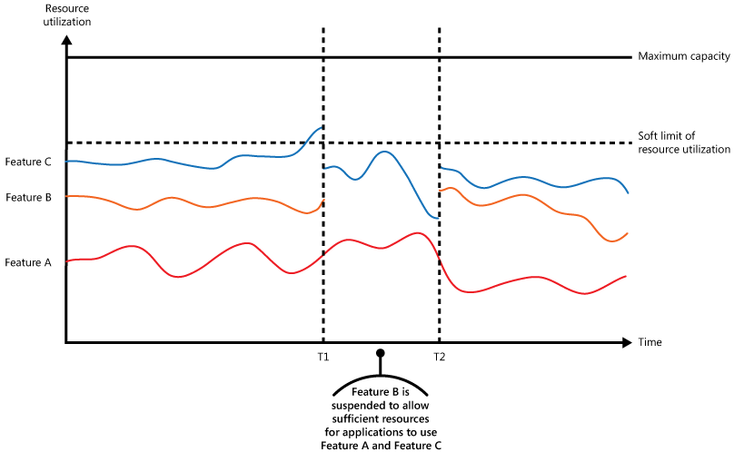

# Throttling pattern

## Summary

Control the consumption of resources used by an instance of an application, an individual tenant, or an entire service. This can allow the system to continue to function and meet service level agreements, even when an increase in demand places an extreme load on resources.

## Prerequisites

TODO: link the notes a reader should know first.

## Core concepts

### Definition

Control the consumption of resources used by an instance of an application, an individual tenant, or an entire service. This can allow the system to continue to function and meet service level agreements, even when an increase in demand places an extreme load on resources.

Control the consumption of resources used by an instance of an application, an individual tenant, or an entire service. This can allow the system to continue to function and meet service level agreements, even when an increase in demand places an extreme load on resources.

### Context and problem

Cloud application load fluctuates with user activity, peaking during business hours or for end-of-month analytics. Exceeding resource capacity leads to poor performance or failure, risking service level agreements. Strategies like autoscaling align resources with current demand and optimize costs but are not instantaneous, risking temporary resource deficits during rapid demand spikes.

### Solution

An alternative strategy to autoscaling is to allow applications to use resources only up to a limit, and then throttle them when this limit is reached. The system should monitor how it's using resources so that, when usage exceeds the threshold, it can throttle requests from one or more users. This enables the system to continue functioning and meet any service level agreements (SLAs) that are in place.

The system could implement several throttling strategies, including:

- Rejecting requests from an individual user who's already accessed system APIs more than n times per second over a given period of time. This requires the system to meter the use of resources for each tenant or user running an application.
- Disabling or degrading the functionality of selected nonessential services so that essential services can run unimpeded with sufficient resources. For example, if the application is streaming video output, it could switch to a lower resolution.
- Implement load leveling to even out activity volume in a multitenant setup, potentially reducing performance across tenants. Prioritize high-value tenant tasks for immediate execution, while delaying others until backlog decreases. Use the Priority Queue pattern and different endpoints for varying service levels to manage this process.
- Deferring operations being performed on behalf of lower priority applications or tenants. These operations can be suspended or limited, with an exception generated to inform the tenant that the system is busy and that the operation should be retried later.
- Be cautious with unreliable 3rd-party services; limit concurrent requests to prevent log overflow and avoid costs from repeated failed attempts. Resume normal processing after successful requests.

The figure shows an area graph for resource use (a combination of memory, CPU, bandwidth, and other factors) against time for applications that are making use of three features. A feature is an area of functionality, such as a component that performs a specific set of tasks, a piece of code that performs a complex calculation, or an element that provides a service such as an in-memory cache. These features are labeled A, B, and C.

## Worked example

TODO: add a concrete, reproducible example with real values.

## Trade offs and when to use it

### Issues and considerations

You should consider the following points when deciding how to implement this pattern:

- Throttling an application, and the strategy to use, is an architectural decision that impacts the entire design of a system. Throttling should be considered early in the application design process because it isn't easy to add once a system has been implemented.
- Throttling must be performed quickly. The system must be capable of detecting an increase in activity and react accordingly. The system must also be able to revert to its original state quickly after the load has eased. This requires that the appropriate performance data is continually captured and monitored.
- If a service needs to deny a user request temporarily, it should return a specific error code like 429 ("Too many requests") and 503 ("Server Too Busy") so the client application can understand that the reason for the refusal to serve a request is due to throttling.
    - HTTP 429 indicates the calling application sent too many requests in a time window and exceeded a predetermined limit.
    - HTTP 503 indicates the service isn't ready to handle the request. The common cause is that the service is experiencing more temporary load spikes than expected.

The client application can wait for a period before retrying the request. A `Retry-After` HTTP header should be included, to support the client in choosing the retry strategy.

- Throttling can be used as a temporary measure while a system autoscales. In some cases, it's better to simply throttle, rather than to scale, if a burst in activity is sudden and isn't expected to be long lived because scaling can add considerably to running costs.
- If throttling is being used as a temporary measure while a system autoscales, and if resource demands grow very quickly, the system might not be able to continue functioning, even when operating in a throttled mode. If this isn't acceptable, consider maintaining larger capacity reserves and configuring more aggressive autoscaling.
- Normalize resource costs for different operations as they generally don't carry equal execution costs. For example, throttling limits might be lower for read operations and higher for write operations. Not considering the cost of an operation can result in exhausted capacity and exposing a potential attack vector.
- Dynamic configuration change of throttling behavior at runtime is desirable. If a system faces an abnormal load that the applied configuration cannot handle, throttling limits might need to increase or decrease to stabilize the system and keep up with the current traffic. Expensive, risky, and slow deployments are not desirable at this point.

### Use cases

Use this pattern:

- To ensure that a system continues to meet service level agreements.
- To prevent a single tenant from monopolizing the resources provided by an application.
- To handle bursts in activity.
- To help cost-optimize a system by limiting the maximum resource levels needed to keep it functioning.

## Common mistakes

TODO: list frequent misunderstandings and failure modes, with the fix for each.

## Practice

TODO: add three to five questions, with answers at the bottom.

## Further reading

- Microsoft. [*Throttling pattern*](https://learn.microsoft.com/en-us/azure/architecture/patterns/throttling). Azure Architecture Center. The full description of the pattern: context and problem, solution, issues and considerations, and when to use it.

TODO: check the content of this note against the sources above and record what was verified and when.
