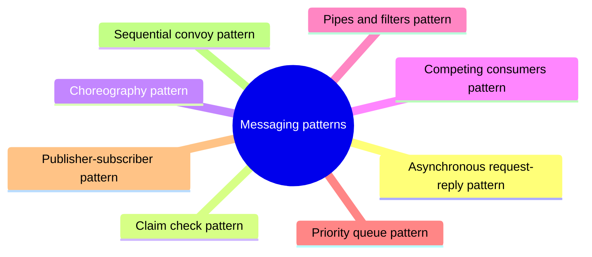

# Messaging patterns

Patterns for communication between components through messages and events, so that senders and receivers stay decoupled.

This is a catalog section: it groups a large body of related notes inside the knowledge area. It is not a separate SWEBOK topic.

## Overview

Messaging is a pattern that allows for the communication and coordination between different components or systems, using messaging technologies such as message queues, message brokers, and event buses. This pattern allows for decoupling of the sender and receiver, and can be used to build scalable and flexible systems.

### Patterns

### Asynchronous request-reply

Decouple backend processing from a frontend host, where backend processing needs to be asynchronous, but the frontend still needs a clear response.

### Claim check

Split a large message into a claim check and a payload to avoid overwhelming a message bus.

### Choreography

Have each component of the system participate in the decision-making process about the workflow of a business transaction, instead of relying on a central point of control.

### Competing consumers

Enable multiple concurrent consumers to process messages received on the same messaging channel.

### Pipes and filters

Break down a task that performs complex processing into a series of separate elements that can be reused.

### Priority queue

Prioritize requests sent to services so that requests with a higher priority are received and processed more quickly than those with a lower priority.

### Publisher-Subscriber

Enable an application to announce events to multiple interested consumers asynchronously, without coupling the senders to the receivers.

### Queue-Based load leveling

Use a queue that acts as a buffer between a task and a service that it invokes in order to smooth intermittent heavy loads.

### Saga

Manage data consistency across microservices in distributed transaction scenarios. A saga is a sequence of transactions that updates each service and publishes a message or event to trigger the next transaction step.

### Scheduler agent supervisor

Coordinate a set of actions across a distributed set of services and other remote resources.

### Sequential convoy

Process a set of related messages in a defined order, without blocking processing of other groups of messages.

## Map

The map shows the notes and sections of this part of the library.

## Reading order

1. [Asynchronous request-reply pattern](asynchronous-request-reply.md): Decouple backend processing from a frontend host, where backend processing needs to be asynchronous, but the frontend still needs a clear response.
2. [Claim check pattern](claim-check.md): The Claim-Check pattern allows workloads to transfer payloads without storing the payload in a messaging system.
3. [Choreography pattern](choreography.md): Decentralize workflow logic and distribute the responsibilities to other components within a system.
4. [Competing consumers pattern](competing-consumers.md): Enable multiple concurrent consumers to process messages received on the same messaging channel.
5. [Pipes and filters pattern](pipes-and-filters.md): Decompose a task that performs complex processing into a series of separate elements that can be reused.
6. [Priority queue pattern](priority-queue.md): The priority queue pattern enables a workload to process high-priority tasks more quickly than lower-priority tasks.
7. [Publisher-subscriber pattern](publisher-subscriber.md): Enable an application to announce events to multiple interested consumers asynchronously, without coupling the senders to the receivers.
8. [Sequential convoy pattern](sequential-convoy.md): Process a set of related messages in a defined order, without blocking processing of other groups of messages.
