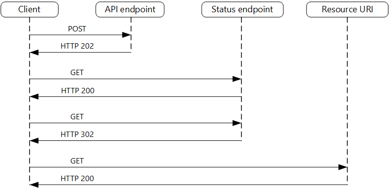

# Asynchronous request-reply pattern

## Summary

Decouple backend processing from a frontend host, where backend processing needs to be asynchronous, but the frontend still needs a clear response. In modern application development, it's normal for client applications, often code running in a web-client (browser), to depend on remote APIs to provide business logic and compose functionality. These APIs may be directly related to the application or may be shared services provided by a third party. Commonly these API calls take place over the HTTP(S) protocol and follow REST semantics.

## Prerequisites

TODO: link the notes a reader should know first.

## Core concepts

### Definition

Decouple backend processing from a frontend host, where backend processing needs to be asynchronous, but the frontend still needs a clear response.

### Context and problem

In modern application development, it's normal for client applications, often code running in a web-client (browser), to depend on remote APIs to provide business logic and compose functionality. These APIs may be directly related to the application or may be shared services provided by a third party. Commonly these API calls take place over the HTTP(S) protocol and follow REST semantics.

In most cases, APIs for a client application are designed to respond quickly, on the order of 100 ms or less. Many factors can affect the response latency, including:

- An application's hosting stack.
- Security components.
- The relative geographic location of the caller and the backend.
- Network infrastructure.
- Current load.
- The size of the request payload.
- Processing queue length.
- The time for the backend to process the request.

Factors like network infrastructure can introduce latency and are usually beyond developers' control. Backend scaling can mitigate some delay. APIs typically reply fast enough to keep the connection open, and non-blocking synchronous API calls can mimic asynchronous operations for I/O tasks.

However, longer backend processes require an alternative to synchronous requests. Message brokers and patterns like Queue-Based Load Leveling can decouple request and response to allow independent scaling but complicate success notifications. These considerations also apply to server-to-server REST API calls in systems like microservices architectures.

### Solution

One solution to this problem is to use HTTP polling. Polling is useful to client-side code, as it can be hard to provide call-back endpoints or use long running connections. Even when callbacks are possible, the extra libraries and services that are required can sometimes add too much extra complexity.

- The client application makes a synchronous call to the API, triggering a long-running operation on the backend.
- The API responds synchronously as quickly as possible. It returns an HTTP 202 (Accepted) status code, acknowledging that the request has been received for processing.
- The response holds a location reference pointing to an endpoint that the client can poll to check for the result of the long running operation.
- The API offloads processing to another component, such as a message queue.
- For every successful call to the status endpoint, it returns HTTP 200. While the work is still pending, the status endpoint returns a resource that indicates the work is still in progress. Once the work is complete, the status endpoint can either return a resource that indicates completion, or redirect to another resource URL. For example, if the asynchronous operation creates a new resource, the status endpoint would redirect to the URL for that resource.

1. The client sends a request and receives an HTTP 202 (Accepted) response.
2. The client sends an HTTP GET request to the status endpoint. The work is still pending, so this call returns HTTP 200.
3. At some point, the work is complete and the status endpoint returns 302 (Found) redirecting to the resource.
4. The client fetches the resource at the specified URL.

## Worked example

TODO: add a concrete, reproducible example with real values.

## Trade offs and when to use it

### Issues and considerations

- There are a number of possible ways to implement this pattern over HTTP and not all upstream services have the same semantics. For example, most services won't return an HTTP 202 response back from a GET method when a remote process hasn't finished. Following pure REST semantics, they should return HTTP 404 (Not Found). This response makes sense when you consider the result of the call isn't present yet.
- An HTTP 202 response should indicate the location and frequency that the client should poll for the response. It should have the following additional headers:

| Header | Description | Notes |
| --- | --- | --- |
| Location | A URL the client should poll for a response status. | This URL could be a SAS token with the [Valet Key Pattern](https://learn.microsoft.com/en-us/azure/architecture/patterns/valet-key) being appropriate if this location needs access control. The valet key pattern is also valid when response polling needs offloading to another backend. |
| Retry-After | An estimate of when processing will complete | This header is designed to prevent polling clients from overwhelming the back-end with retries. |

- Expected client behavior must be considered when designing this response. While a client under your control can be coded to respect these response values explicitly, clients that are not authored by you or use a no or low-code approach (such as Azure Logic Apps) are free to have their own HTTP 202 logic handling.
- You may need to use a processing proxy or façade to manipulate the response headers or payload depending on the underlying services used.
- If the status endpoint redirects on completion, either HTTP 302 or HTTP 303 are appropriate return codes, depending on the exact semantics you support.
- Upon successful processing, the resource specified by the Location header should return an appropriate HTTP response code such as 200 (OK), 201 (Created), or 204 (No Content).
- If an error occurs during processing, persist the error at the resource URL described in the Location header and ideally return an appropriate response code to the client from that resource (4xx code).
- Not all solutions will implement this pattern in the same way and some services will include additional or alternate headers.
- Legacy clients might not support this pattern. In that case, you might need to place a façade over the asynchronous API to hide the asynchronous processing from the original client.
- In some scenarios, you might want to provide a way for clients to cancel a long-running request. In that case, the backend service must support some form of cancellation instruction.

### Use cases

Use this pattern for:

- Client-side code, such as browser applications, where it's difficult to provide call-back endpoints, or the use of long-running connections adds too much additional complexity.
- Service calls where only the HTTP protocol is available and the return service can't fire callbacks because of firewall restrictions on the client-side.
- Service calls that need to be integrated with legacy architectures that don't support modern callback technologies such as WebSockets or webhooks.

This pattern might not be suitable when:

- You can use a service built for asynchronous notifications instead, such as Azure Event Grid.
- Responses must stream in real time to the client.
- The client needs to collect many results, and received latency of those results is important. Consider a service bus pattern instead.
- You can use server-side persistent network connections such as WebSockets or SignalR. These services can be used to notify the caller of the result.
- The network design allows you to open up ports to receive asynchronous callbacks or webhooks.

## Common mistakes

TODO: list frequent misunderstandings and failure modes, with the fix for each.

## Practice

TODO: add three to five questions, with answers at the bottom.

## Further reading

- Microsoft. [*Asynchronous request-reply pattern*](https://learn.microsoft.com/en-us/azure/architecture/patterns/asynchronous-request-reply). Azure Architecture Center. The full description of the pattern: context and problem, solution, issues and considerations, and when to use it.
- Hohpe, G., Woolf, B. (2003). [*Enterprise Integration Patterns*](https://www.enterpriseintegrationpatterns.com/). Addison-Wesley. The catalog of messaging patterns: channels, routers, translators and endpoints.

TODO: check the content of this note against the sources above and record what was verified and when.
