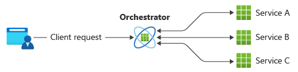
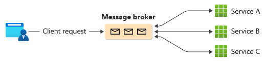
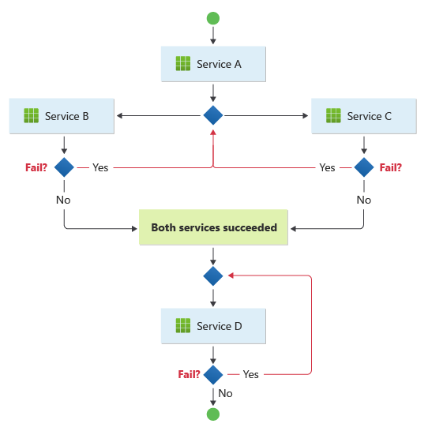
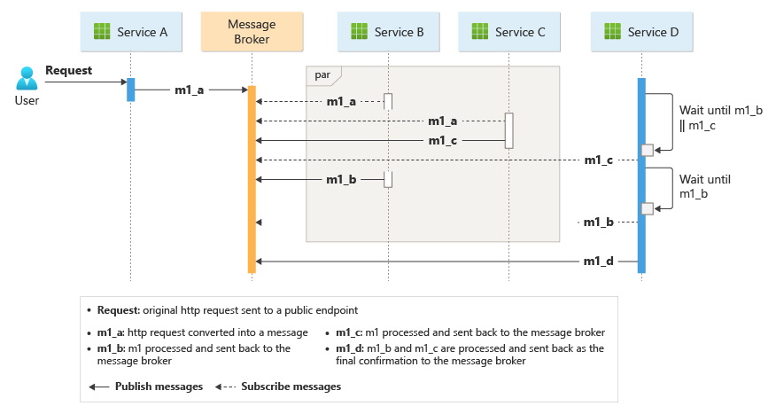

# Choreography pattern

## Summary

Decentralize workflow logic and distribute the responsibilities to other components within a system. Cloud-based applications typically consist of multiple services collaborating on transactions, with operations triggering numerous calls between services. Designing a distributed, efficient, and scalable workflow is difficult due to complex interservice communication.

## Prerequisites

TODO: link the notes a reader should know first.

## Core concepts

### Definition

Decentralize workflow logic and distribute the responsibilities to other components within a system.

### Context and problem

Cloud-based applications typically consist of multiple services collaborating on transactions, with operations triggering numerous calls between services. Designing a distributed, efficient, and scalable workflow is difficult due to complex interservice communication.

A common pattern for communication is to use a centralized service or an *orchestrator*. Incoming requests flow through the orchestrator as it delegates operations to the respective services. Each service just completes their responsibility and isn't aware of the overall workflow.

The orchestrator pattern is typically implemented as custom software and has domain knowledge about the responsibilities of those services. A benefit is that the orchestrator can consolidate the status of a transaction based on the results of individual operations conducted by the downstream services.

However, there are some drawbacks. Adding or removing services might break existing logic because you need to rewire portions of the communication path. This dependency makes orchestrator implementation complex and hard to maintain. The orchestrator might have a negative impact on the reliability of the workload. Under load, it can introduce performance bottleneck and be the single point of failure. It can also cause cascading failures in the downstream services.

### Solution

Delegate the transaction handling logic among the services. Let each service decide and participate in the communication workflow for a business operation.

The pattern is a way to minimize dependency on custom software that centralizes the communication workflow. The components implement common logic as they choreograph the workflow among themselves without having direct communication with each other.

A common way to implement choreography is to use a message broker that buffers requests until downstream components claim and process them. The image shows request handling through a publisher-subscriber model.

1. A client requests are queued as messages in a message broker.
2. The services or the subscriber poll the broker to determine if they can process that message based on their implemented business logic. The broker can also push messages to subscribers who are interested in that message.
3. Each subscribed service does their operation as indicated by the message and responds to the broker with success or failure of the operation.
4. If successful, the service can push a message back to the same queue or a different message queue so that another service can continue the workflow if needed. If the operation fails, the message broker works with other services to compensate that operation or the entire transaction.

## Worked example

TODO: add a concrete, reproducible example with real values.

## Trade offs and when to use it

### Issues and considerations

Decentralizing the orchestrator can cause issues while managing the workflow.

- Handing failures can be challenging. Components in an application might conduct atomic tasks but they might still have a level of dependency. Failure in one component can impact others, which might cause delays in completing the overall request.
- To handle failures gracefully, implementing compensating transactions might introduce complexity. Failure handling logic, such as compensating transactions, is also prone to failures.

- The pattern is suitable for a workflow where independent business operations are processed in parallel. The workflow can become complicated when choreography needs to occur in a sequence. For instance, Service D can start its operation only after Service B and Service C have completed their operations with success.

- The pattern becomes a challenge if the number of services grow rapidly. Given the high number of independent moving parts, the workflow between services tends to get complex. Also, distributed tracing becomes difficult.
- In an orchestrator-led design, the central component can partially participate and delegate resiliency logic to another component that retries transient, nontransient, and time-out failures, consistently. With the dissolution of the orchestrator in the choreography pattern, the downstream components shouldn't pick up those resiliency tasks. Those must still be handled by the resiliency handler. But now, the downstream components must directly communicate with the resiliency handler, increasing point-to-point communication.

### Use cases

Use this pattern when:

- The downstream components handle atomic operations independently. Think of it as a 'fire and forget' mechanism. A component is responsible for a task that doesn't need to be managed actively. When the task is complete, it sends notification to the other components.
- The components are expected to get updated and replaced frequently. The pattern enables the application to be modified with less effort and minimal disruption to existing services.
- The pattern is a natural fit for serverless architectures that are appropriate for simple workflows. The components can be short-lived and event-driven. When an event occurs, components are spun up, perform their tasks, and removed once the task is completed.
- This pattern can be a good choice for communications between bounded contexts. For communications inside an individual bounded context, an orchestrator pattern might be considered.
- There's performance bottleneck introduced by the central orchestrator.

This pattern might not be useful when:

- The application is complex and requires a central component to handle shared logic to keep the downstream components lightweight.
- There are situations where point-to-point communication between the components is inevitable.
- You need to consolidate all operations handled by downstream components, by using business logic.

## Common mistakes

TODO: list frequent misunderstandings and failure modes, with the fix for each.

## Practice

TODO: add three to five questions, with answers at the bottom.

## Further reading

- Microsoft. [*Choreography pattern*](https://learn.microsoft.com/en-us/azure/architecture/patterns/choreography). Azure Architecture Center. The full description of the pattern: context and problem, solution, issues and considerations, and when to use it.
- Hohpe, G., Woolf, B. (2003). [*Enterprise Integration Patterns*](https://www.enterpriseintegrationpatterns.com/). Addison-Wesley. The catalog of messaging patterns: channels, routers, translators and endpoints.

TODO: check the content of this note against the sources above and record what was verified and when.
