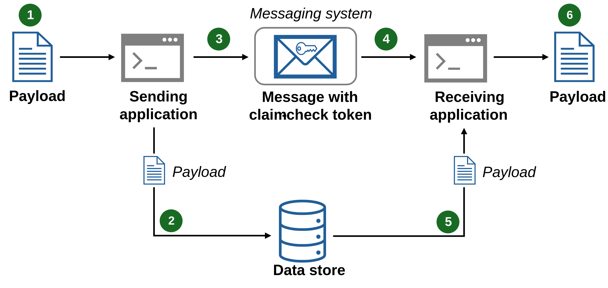

# Claim check pattern

## Summary

The Claim-Check pattern allows workloads to transfer payloads without storing the payload in a messaging system. The pattern stores the payload in an external data store and uses a "claim check" to retrieve the payload. The claim check is a unique, obscure token or key. To retrieve the payload, applications need to present the claim-check token to the external data store.

## Prerequisites

TODO: link the notes a reader should know first.

## Core concepts

### Definition

The Claim-Check pattern allows workloads to transfer payloads without storing the payload in a messaging system. The pattern stores the payload in an external data store and uses a "claim check" to retrieve the payload. The claim check is a unique, obscure token or key. To retrieve the payload, applications need to present the claim-check token to the external data store.

### Context and problem

Traditional messaging systems are optimized to manage a high volume of small messages and often have restrictions on the message size they can handle. Large messages not only risk exceeding these limits but can also degrade the performance of the entire system when the messaging system stores them.

### Solution

Use the Claim-Check pattern, and don't send large messages to the messaging system. Instead, send the payload to an external data store and generate a claim-check token for that payload. The messaging system sends a message with the claim-check token to receiving applications so these applications can retrieve the payload from the data store. The messaging system never sees or stores the payload.

1. Payload
2. Save payload in data store.
3. Generate claim-check token and send message with claim-check token.
4. Receive message and read claim-check token.
5. Retrieve the payload.
6. Process the payload.

## Worked example

TODO: add a concrete, reproducible example with real values.

## Trade offs and when to use it

### Issues and considerations

Consider the following recommendations when implementing the Claim-Check pattern:

- *Delete consumed messages.* If you don't need to archive the message, delete the message and payload after the receiving applications consume it. Use either a synchronous or asynchronous deletion strategy:
    - *Synchronous deletion*: The consuming application deletes the message and payload immediately after consumption. It ties deletion to the message handling workflow and uses messaging-workflow compute capacity.
    - *Asynchronous deletion*: A process outside the message processing workflow deletes the message and payload. It decouples the deletion process from the message handling workflow and minimizes use of messaging-workflow compute.
- *Implement the pattern conditionally.* Incorporate logic in the sending application that applies the Claim-Check pattern if the message size surpasses the messaging system's limit. For smaller messages, bypass the pattern and send the smaller message to the messaging system. This conditional approach reduces latency, optimizes resources utilization, and improves throughput.

### Use cases

The following scenarios are the primary use cases for the Claim-Check pattern:

- *Messaging system limitations*: Use the Claim-Check pattern when message sizes surpass the limits of your messaging system. Offload the payload to external storage. Send only the message with its claim-check token to the messaging system.
- *Messaging system performance*: Use the Claim-Check pattern when large messages are straining the messaging system and degrading system performance.

The following scenarios are secondary use cases for the Claim-Check pattern:

- *Sensitive data protection*: Use the Claim-Check pattern when payloads contain sensitive data that don't want visible to the messaging system. Apply the pattern to all or portions of sensitive information in the payload. Secure the sensitive data without transmitting it directly through the messaging system.
- *Complex routing scenarios*: Messages traversing multiple components can cause performance bottlenecks due to serialization, deserialization, encryption, and decryption tasks. Use the Claim-Check pattern to prevent direct message processing by intermediary components.

## Common mistakes

TODO: list frequent misunderstandings and failure modes, with the fix for each.

## Practice

TODO: add three to five questions, with answers at the bottom.

## Further reading

- Microsoft. [*Claim check pattern*](https://learn.microsoft.com/en-us/azure/architecture/patterns/claim-check). Azure Architecture Center. The full description of the pattern: context and problem, solution, issues and considerations, and when to use it.
- Hohpe, G., Woolf, B. (2003). [*Enterprise Integration Patterns*](https://www.enterpriseintegrationpatterns.com/). Addison-Wesley. The catalog of messaging patterns: channels, routers, translators and endpoints.

TODO: check the content of this note against the sources above and record what was verified and when.
