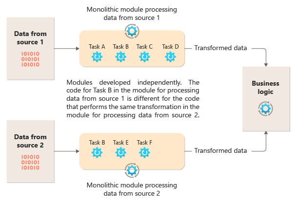
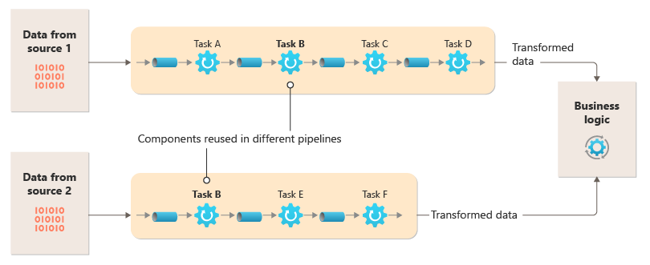
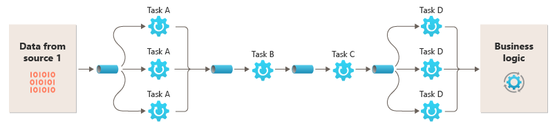

# Pipes and filters pattern

## Summary

Decompose a task that performs complex processing into a series of separate elements that can be reused. Doing so can improve performance, scalability, and reusability of initial steps by allowing task elements that perform the processing to be deployed and scaled independently. Pipes and Filters pattern supports a high level of modularity.

## Prerequisites

TODO: link the notes a reader should know first.

## Core concepts

### Definition

Decompose a task that performs complex processing into a series of separate elements that can be reused. Doing so can improve performance, scalability, and reusability of initial steps by allowing task elements that perform the processing to be deployed and scaled independently. Pipes and Filters pattern supports a high level of modularity.

### Context and problem

A monolithic module for sequential task processing is simple but rigid, hindering code refactoring, optimization, and reuse. The diagram shows the problem of non-reusable code in monolithic systems, where separate modules process data from two sources through various tasks before integration with the application's business logic.

Monolithic modules performing similar functions often involve repeated, tightly coupled code that can't be reused. This creates risks when updating multiple instances of the code due to changing requirements. Monoliths also lack flexibility in running tasks across varied environments or scaling them independently. Some tasks may need more compute power or parallel processing, while others do not. Additionally, reordering or adding new tasks to a monolithic pipeline is difficult and necessitates retesting the entire system.

### Solution

Break down each stream's processing into separate, single-task filters. Use multiple filters for composite tasks and connect them into pipelines with pipes. Filters are independent, stateless units that take messages from an inbound pipe and send them to an outbound pipe, transforming or conditionally testing the messages. Pipes only pass messages between filters without routing or logic. Filters operate autonomously, aware only of their input and output schemas, and can be reordered if schemas match. Standardized schemas promote filter reusability in a pipes and filters architecture.

The loose coupling of filters makes it easy to:

- Create new pipelines composed of existing filters
- Update or replace logic in individual filters
- Reorder filters, when necessary
- Run filters on differing hardware, where required
- Run filters in parallel

This diagram shows a solution implemented with pipes and filters:

Processing time for requests is tied to the slowest filters. Bottlenecks may occur with high traffic from specific sources. Parallel processing of slow filters can distribute workload and increase throughput. Filters on separate compute instances scale independently, leveraging cloud flexibility. Intensive filters use high-performance hardware; simpler ones use cheaper hardware. Filters can operate in different locations, optimizing resource proximity. Design tactics like messaging and multi-threading enhance elasticity.

This diagram shows an example applied to the pipeline for the data from Source 1:

If the input and output of a filter are structured as a stream, you can perform the processing for each filter in parallel. The first filter in the pipeline can start its work and output its results, which are passed directly to the next filter in the sequence before the first filter completes its work.

Using the Pipes and Filters pattern together with the Compensating Transaction pattern is an alternative approach to implementing distributed transactions. You can break a distributed transaction into separate, compensable tasks, each of which can be implemented via a filter that also implements the Compensating Transaction pattern. You can implement the filters in a pipeline as separate hosted tasks that run close to the data that they maintain.

## Worked example

TODO: add a concrete, reproducible example with real values.

## Trade offs and when to use it

### Issues and considerations

Consider the following points when you decide how to implement this pattern:

- **Monolithic nature**. This pattern is usually implemented as a monolithic pipeline, so for any change, the entire filter chain should be tested end to end. Also, fault-tolerance for the whole process needs to be considered; if a filter or pipe fails, the whole pipeline is likely to fail.
- **Complexity**. The increased flexibility that this pattern provides can also introduce complexity, especially if the filters in a pipeline are distributed across different servers.
- **Reliability**. Use an infrastructure that ensures that data flowing between filters in a pipe aren't lost.
- **Idempotency**. If a filter in a pipeline fails after receiving a message and the work is rescheduled to another instance of the filter, part of the work might already be complete. If the work updates some aspect of the global state (like information stored in a database), a single update could be repeated. A similar issue might occur if a filter fails after it posts its results to the next filter, but before it indicates that it completed its work successfully. In these cases, another instance of the filter could repeat this work, causing the same results to be posted twice. This scenario could result in subsequent filters in the pipeline processing the same data twice. Therefore, filters in a pipeline should be designed to be idempotent.
- **Repeated messages**. If a filter in a pipeline fails after it posts a message to the next stage of the pipeline, another instance of the filter might be run, and it would post a copy of the same message to the pipeline. This scenario could cause two instances of the same message to be passed to the next filter. To avoid this problem, the pipeline should detect and eliminate duplicate messages.
- **Context and state**. In a pipeline, each filter essentially runs in isolation and shouldn't make any assumptions about how it was invoked. Therefore, each filter should be provided with sufficient context to perform its work. This context could include a significant amount of state information. If filters use external state, such as data in a database or external storage, then you must consider the impact on performance. Every filter has to load, operate, and persist that state, which adds overhead over solutions that load the external state a single time.
- **Message tolerance**. Filters must be tolerant of data in the incoming message that they don't operate against. They operate on the data pertinent to them and ignore other data and pass it along unchanged in the output message.
- **Error handling** - Every filter must determine what to do in the case of a breaking error. The filter must determine if it fails the pipeline or propagates the exception.

### Use cases

Use this pattern when:

- The processing required by an application can easily be broken down into a set of independent steps.
- The processing steps performed by an application have different scalability requirements.
- You require the flexibility to allow reordering of the processing steps the application performs, or to allow the capability to add and remove steps.
- The system can benefit from distributing the processing for steps across different servers.
- You need a reliable solution that minimizes the effects of failure in a step while data is being processed.

This pattern might not be useful when:

- The application follows a request-response pattern.
- The task processing must be completed as part an initial request, such as a request/response scenario.
- The processing steps performed by an application aren't independent, or they have to be performed together as part of a single transaction.
- The amount of context or state information a step requires makes this approach inefficient. You might be able to persist state information to a database, but don't use this strategy if the extra load on the database causes excessive contention.

## Common mistakes

TODO: list frequent misunderstandings and failure modes, with the fix for each.

## Practice

TODO: add three to five questions, with answers at the bottom.

## Further reading

- Microsoft. [*Pipes and filters pattern*](https://learn.microsoft.com/en-us/azure/architecture/patterns/pipes-and-filters). Azure Architecture Center. The full description of the pattern: context and problem, solution, issues and considerations, and when to use it.
- Hohpe, G., Woolf, B. (2003). [*Enterprise Integration Patterns*](https://www.enterpriseintegrationpatterns.com/). Addison-Wesley. The catalog of messaging patterns: channels, routers, translators and endpoints.

TODO: check the content of this note against the sources above and record what was verified and when.
