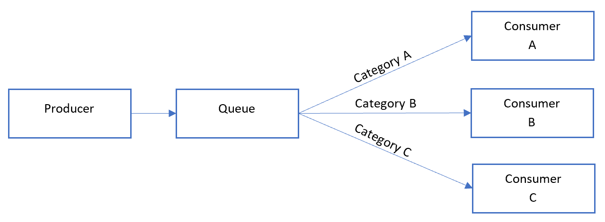
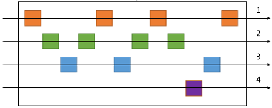

# Sequential convoy pattern

## Summary

Process a set of related messages in a defined order, without blocking processing of other groups of messages. Applications often need to process a sequence of messages in the order they arrive, while still being able to scale out to handle increased load. In a distributed architecture, processing these messages in order is not straightforward, because the workers can scale independently and often pull messages independently, using a Competing Consumers pattern.

## Prerequisites

TODO: link the notes a reader should know first.

## Core concepts

### Definition

Process a set of related messages in a defined order, without blocking processing of other groups of messages.

### Context and problem

Applications often need to process a sequence of messages in the order they arrive, while still being able to scale out to handle increased load. In a distributed architecture, processing these messages in order is not straightforward, because the workers can scale independently and often pull messages independently, using a Competing Consumers pattern.

For example, an order tracking system receives a ledger containing orders and the relevant operations on those orders. These operations could be to create an order, add a transaction to the order, modify a past transaction, or delete an order. In this system, operations must be performed in a first-in-first-out (FIFO) manner, but only at the order level. However, the initial queue receives a ledger containing transactions for many orders, which may be interleaved.

### Solution

Push related messages into categories within the queuing system, and have the queue listeners lock and pull only from one category, one message at a time.

Here's what the general Sequential Convoy pattern looks like:

In the queue, messages for different categories may be interleaved, as shown in the following diagram:

## Worked example

TODO: add a concrete, reproducible example with real values.

## Trade offs and when to use it

### Issues and considerations

Consider the following points when deciding how to implement this pattern:

- Category/scale unit. What property of your incoming messages can you scale out on? In the order tracking scenario, this property is the order ID.
- Throughput. What is your target message throughput? If it is very high, you may need to reconsider your FIFO requirements. For example, can you enforce a start/end message, sort by time, then send a batch for processing?
- Service capabilities. Does your choice of message bus allow for one-at-a-time processing of messages within a queue or category of a queue?
- Evolvability. How will you add a new category of message to the system? For example, suppose the ledger system described above is specific one customer. If you needed to onboard a new customer, could you have a set of ledger processors that distribute work per customer ID?
- It's possible that consumers might receive a message out of order, due to variable network latency when sending messages. Consider using sequence numbers to verify ordering. You might also include a special "end of sequence" flag in the last message of a transaction. Stream processing technologies such as Spark or Azure Stream Analytics can process messages in order within a time window.

### Use cases

Use this pattern when:

- You have messages that arrive in order and must be processed in the same order.
- Arriving messages are or can be "categorized" in such a way that the category becomes a unit of scale for the system.

This pattern might not be suitable for:

- Extremely high throughput scenarios (millions of messages/minute or second), as the FIFO requirement limits the scaling that can be done by the system.

## Common mistakes

TODO: list frequent misunderstandings and failure modes, with the fix for each.

## Practice

TODO: add three to five questions, with answers at the bottom.

## Further reading

- Microsoft. [*Sequential convoy pattern*](https://learn.microsoft.com/en-us/azure/architecture/patterns/sequential-convoy). Azure Architecture Center. The full description of the pattern: context and problem, solution, issues and considerations, and when to use it.
- Hohpe, G., Woolf, B. (2003). [*Enterprise Integration Patterns*](https://www.enterpriseintegrationpatterns.com/). Addison-Wesley. The catalog of messaging patterns: channels, routers, translators and endpoints.

TODO: check the content of this note against the sources above and record what was verified and when.
