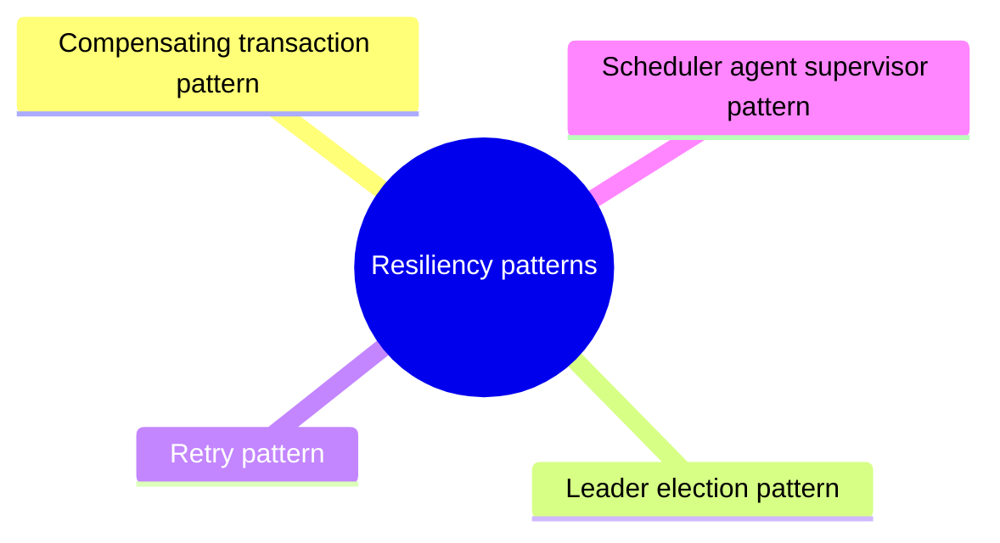

# Resiliency patterns

Patterns that let a system recover gracefully from transient and permanent failures.

This is a catalog section: it groups a large body of related notes inside the knowledge area. It is not a separate SWEBOK topic.

## Overview

Resiliency is the ability of a system to gracefully handle and recover from failures, both inadvertent and malicious.

The nature of cloud hosting, where applications are often multi-tenant, use shared platform services, compete for resources and bandwidth, communicate over the Internet, and run on commodity hardware means there is an increased likelihood that both transient and more permanent faults will arise. The connected nature of the internet and the rise in sophistication and volume of attacks increase the likelihood of a security disruption.

Detecting failures and recovering quickly and efficiently, is necessary to maintain resiliency.

## Map

The map shows the notes and sections of this part of the library.

## Reading order

1. [Compensating transaction pattern](compensating-transaction.md): When you use an eventually consistent operation that consists of a series of steps, the Compensating Transaction pattern can be useful.
2. [Leader election pattern](leader-election.md): Coordinate the actions performed by a collection of collaborating instances in a distributed application by electing one instance as the leader that assumes responsibility for managing the others.
3. [Retry pattern](retry.md): Enable an application to handle transient failures when it tries to connect to a service or network resource, by transparently retrying a failed operation.
4. [Scheduler agent supervisor pattern](scheduler-agent-supervisor.md): Coordinate a set of distributed actions as a single operation.
