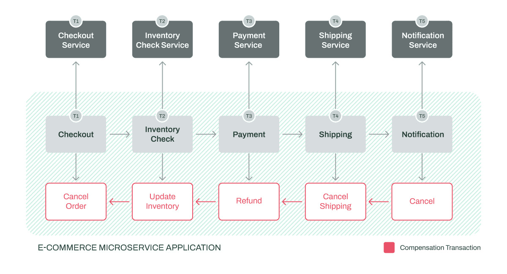
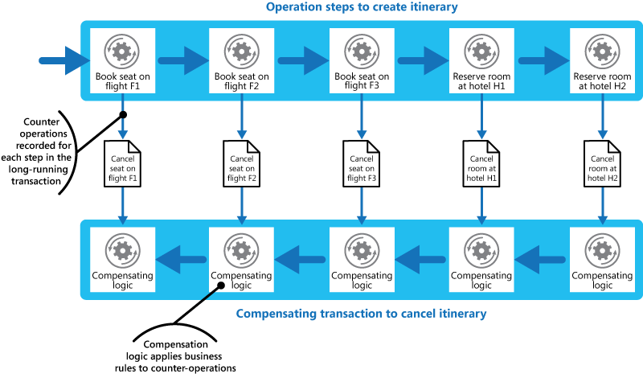

# Compensating transaction pattern

## Summary

When you use an eventually consistent operation that consists of a series of steps, the Compensating Transaction pattern can be useful. Specifically, if one or more of the steps fail, you can use the Compensating Transaction pattern to undo the work that the steps performed. Typically, you find operations that follow the eventual consistency model in cloud-hosted applications that implement complex business processes and workflows.

## Prerequisites

- [Eventual consistency](../../distributed-systems/eventual-consistency.md)

## Core concepts

### Definition

When you use an eventually consistent operation that consists of a series of steps, the Compensating Transaction pattern can be useful. Specifically, if one or more of the steps fail, you can use the Compensating Transaction pattern to undo the work that the steps performed. Typically, you find operations that follow the eventual consistency model in cloud-hosted applications that implement complex business processes and workflows.

### Context and problem

Cloud-based applications frequently modify data across different sources and locations. For better performance in such distributed systems, they should use eventual consistency instead of strong transactional consistency. Eventual consistency involves completing a sequence of steps that may temporarily result in system inconsistency; however, the system should stabilize once all steps are complete.

Handling failures in this model is challenging, as it may require complex rollbacks or application of business rules if previous steps cannot be simply reversed due to concurrent application changes or complexity. Operations spanning multiple data stores must ensure each store's changes are reliably undone to maintain consistency. In service-oriented architectures, reverting operations may entail invoking compensatory actions in the affected services.

### Solution

Implement a compensating transaction to reverse an original operation's effects. Rather than restoring the initial state, which may interfere with concurrent changes, design a smart process that considers other application activities. This is typically tailored to the application, based on the original operation's nature. To achieve eventual consistency, track each step's undo information within a workflow. If failure occurs, the workflow backtracks, reversing each completed step's work.

Two important points are:

- A compensating transaction might not have to undo the work in the exact reverse order of the original operation.
- It might be possible to perform some of the undo steps in parallel.

A compensating transaction is an eventually consistent operation itself, so it can also fail. The system should be able to resume the compensating transaction at the point of failure and continue. It might be necessary to repeat a step that fails, so you should define the steps in a compensating transaction as idempotent commands.

In some cases, manual intervention might be the only way to recover from a step that has failed. In these situations, the system should raise an alert and provide as much information as possible about the reason for the failure.

## Worked example

TODO: add a concrete, reproducible example with real values.

## Trade offs and when to use it

### Issues and considerations

Consider the following points when you decide how to implement this pattern:

- It might not be easy to determine when a step in an operation that implements eventual consistency fails. A step might not fail immediately. Instead, it might get blocked. You might need to implement a time-out mechanism.
- It's not easy to generalize compensation logic. A compensating transaction is application-specific. It relies on the application having sufficient information to be able to undo the effects of each step in a failed operation.
- Compensating transactions don't always work. You should define the steps in a compensating transaction as idempotent commands. If you do, the steps can be repeated if the compensating transaction itself fails.
- The infrastructure that handles the steps must meet the following criteria:
    - It's resilient in the original operation and in the compensating transaction.
    - It doesn't lose the information that's required to compensate for a failing step.
    - It reliably monitors the progress of the compensation logic.
- A compensating transaction doesn't necessarily return the system data to its state at the start of the original operation. Instead, the transaction compensates for the work that the operation completed successfully before it failed.
- The order of the steps in the compensating transaction isn't necessarily the exact opposite of the steps in the original operation. For example, one data store might be more sensitive to inconsistencies than another. The steps in the compensating transaction that undo the changes to this store should occur first.
- Certain measures can help increase the likelihood that the overall activity succeeds. Specifically, you can place a short-term, time-out, based lock on each resource that's required to complete an operation. You can also obtain these resources in advance. Then, perform the work only after you've acquired all the resources. Finalize all actions before the locks expire.
- Retry logic that's more forgiving than usual can help minimize failures that trigger a compensating transaction. If a step in an operation that implements eventual consistency fails, try handling the failure as a transient exception and repeating the step. Stop the operation and initiate a compensating transaction only if a step fails repeatedly or can't be recovered.
- When you implement a compensating transaction, you face many of the same challenges that you face when you implement eventual consistency.

#### Use cases

Use this pattern only for operations that must be undone if they fail. If possible, design solutions to avoid the complexity of requiring compensating transactions.

## Common mistakes

TODO: list frequent misunderstandings and failure modes, with the fix for each.

## Practice

TODO: add three to five questions, with answers at the bottom.

## Further reading

- Microsoft. [*Compensating transaction pattern*](https://learn.microsoft.com/en-us/azure/architecture/patterns/compensating-transaction). Azure Architecture Center. The full description of the pattern: context and problem, solution, issues and considerations, and when to use it.

TODO: check the content of this note against the sources above and record what was verified and when.
