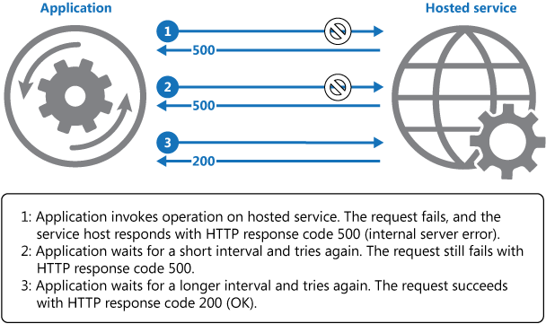
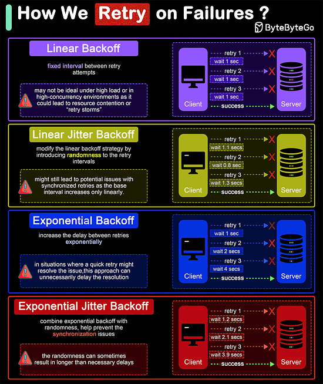

# Retry pattern

## Summary

Enable an application to handle transient failures when it tries to connect to a service or network resource, by transparently retrying a failed operation. This can improve the stability of the application.

## Prerequisites

- [Idempotent operations](../../system-design/asynchronous-processing/idempotent-operations.md)

## Core concepts

### Definition

Enable an application to handle transient failures when it tries to connect to a service or network resource, by transparently retrying a failed operation. This can improve the stability of the application.

### Context and problem

Applications in the cloud must handle transient faults such as brief network disconnections, service downtimes, or timeouts during high load. These faults usually resolve themselves, and retrying after a delay often leads to success, like when a throttled database service recovers from heavy traffic.

### Solution

In the cloud, transient faults should be expected and an application should be designed to handle them elegantly and transparently. Doing so minimizes the effects faults can have on the business tasks the application is performing. The most common design pattern to address is to introduce a retry mechanism.

The diagram above illustrates invoking an operation in a hosted service using a retry mechanism. If the request is unsuccessful after a predefined number of attempts, the application should treat the fault as an exception and handle it accordingly.

### Retry strategies

If an application detects a failure when it tries to send a request to a remote service, it can handle the failure using the following strategies:

- **Cancel**. If the fault indicates that the failure isn't transient or is unlikely to be successful if repeated, the application should cancel the operation and report an exception.
- **Retry immediately**. If the specific fault reported is unusual or rare, like a network packet becoming corrupted while it was being transmitted, the best course of action may be to immediately retry the request.
- **Retry after delay**. If the fault is caused by one of the more commonplace connectivity or busy failures, the network or service might need a short period while the connectivity issues are corrected or the backlog of work is cleared, so programatically delaying the retry is a good strategy. In many cases, the period between retries should be chosen to spread requests from multiple instances of the application as evenly as possible to reduces the chance of a busy service continuing to be overloaded.

If the request fails, the application should wait before retrying, potentially with increasing delays, up to a maximum number of tries. Delays can grow incrementally or exponentially based on the failure type and its likelihood of being fixed. Retry logic should be encapsulated in code for accessing remote services, tailored to specific service policies. Log all faults and failures for operator use, but mark initial failed attempts as informational and only log the final attempt as an error to prevent alert flooding.

#### Backoff

##### Linear backoff

Linear backoff involves waiting for a progressively increasing fixed interval between retry attempts.

**Advantages:** Simple to implement and understand.

**Disadvantages:** May not be ideal under high load or in high-concurrency environments as it could lead to resource contention or "retry storms".

###### Linear jitter backoff

Linear jitter backoff modifies the linear backoff strategy by introducing randomness to the retry intervals. This strategy still increases the delay linearly but adds a random "jitter" to each interval.

**Advantages:** The randomness helps spread out the retry attempts over time, reducing the chance of synchronized retries across instances.

**Disadvantages:** Although better than simple linear backoff, this strategy might still lead to potential issues with synchronized retries as the base interval increases only linearly.

###### Exponential backoff

Exponential backoff involves increasing the delay between retries exponentially. The interval might start at 1 second, then increase to 2 seconds, 4 seconds, 8 seconds, and so on, typically up to a maximum delay. This approach is more aggressive in spacing out retries than linear backoff.

**Advantages:** Significantly reduces the load on the system and the likelihood of collision or overlap in retry attempts, making it suitable for high-load environments.

**Disadvantages:** In situations where a quick retry might resolve the issue, this approach can unnecessarily delay the resolution.

###### Exponential jitter backoff

Exponential jitter backoff combines exponential backoff with randomness. After each retry, the backoff interval is exponentially increased, and then a random jitter is applied. The jitter can be either additive (adding a random amount to the exponential delay) or multiplicative (multiplying the exponential delay by a random factor).

**Advantages:** Offers all the benefits of exponential backoff, with the added advantage of reducing retry collisions even further due to the introduction of jitter.

**Disadvantages:** The randomness can sometimes result in longer than necessary delays, especially if the jitter is significant.

### General guidance

- Ensure that all retry code is fully tested against a variety of failure conditions. Check that it doesn't severely impact the performance or reliability of the application, cause excessive load on services and resources, or generate race conditions or bottlenecks.
- Implement retry logic only where the full context of a failing operation is understood. For example, if a task that contains a retry policy invokes another task that also contains a retry policy, this extra layer of retries can add long delays to the processing. It might be better to configure the lower-level task to fail fast and report the reason for the failure back to the task that invoked it. This higher-level task can then handle the failure based on its own policy.
- Log all connectivity failures that cause a retry so that underlying problems with the application, services, or resources can be identified.
- Investigate the faults that are most likely to occur for a service or a resource to discover if they're likely to be long lasting or terminal. If they are, it's better to handle the fault as an exception. The application can report or log the exception, and then try to continue either by invoking an alternative service (if one is available), or by offering degraded functionality. For more information on how to detect and handle long-lasting faults, see the Circuit Breaker pattern.

## Worked example

TODO: add a concrete, reproducible example with real values.

## Trade offs and when to use it

### Issues and considerations

#### Impact on performance

Adjust the retry policy to meet application needs and failure types. For noncritical tasks, failing quickly may be preferable to avoid reducing throughput. In an interactive web application, fewer retries with short delays are advised, alerting users to try later. Batch applications can benefit from more retries with increasing delays.

An excessive number of retries with minimal delays can strain services at capacity and hinder application responsiveness. After many failed attempts, halt further requests to the resource and report failure, using a Circuit Breaker pattern approach to test if subsequent requests succeed.

##### Idempotency

Consider whether the operation is idempotent. If so, it's inherently safe to retry. Otherwise, retries could cause the operation to be executed more than once, with unintended side effects. For example, a service might receive the request, process the request successfully, but fail to send a response. At that point, the retry logic might re-send the request, assuming that the first request wasn't received.

##### Exception type

A request to a service can fail for a variety of reasons raising different exceptions depending on the nature of the failure. Some exceptions indicate a failure that can be resolved quickly, while others indicate that the failure is longer lasting. It's useful for the retry policy to adjust the time between retry attempts based on the type of the exception.

##### Transaction consistency

Consider how retrying an operation that's part of a transaction will affect the overall transaction consistency. Fine tune the retry policy for transactional operations to maximize the chance of success and reduce the need to undo all the transaction steps.

### When to use this pattern

Use this pattern when an application could experience transient faults as it interacts with a remote service or accesses a remote resource. These faults are expected to be short lived, and repeating a request that has previously failed could succeed on a subsequent attempt.

This pattern might not be useful:

- When a fault is likely to be long lasting, because this can affect the responsiveness of an application. The application might be wasting time and resources trying to repeat a request that's likely to fail.
- For handling failures that aren't due to transient faults, such as internal exceptions caused by errors in the business logic of an application.
- As an alternative to addressing scalability issues in a system. If an application experiences frequent busy faults, it's often a sign that the service or resource being accessed should be scaled up.

## Common mistakes

TODO: list frequent misunderstandings and failure modes, with the fix for each.

## Practice

TODO: add three to five questions, with answers at the bottom.

## Further reading

- Microsoft. [*Retry pattern*](https://learn.microsoft.com/en-us/azure/architecture/patterns/retry). Azure Architecture Center. The full description of the pattern: context and problem, solution, issues and considerations, and when to use it.

TODO: check the content of this note against the sources above and record what was verified and when.
