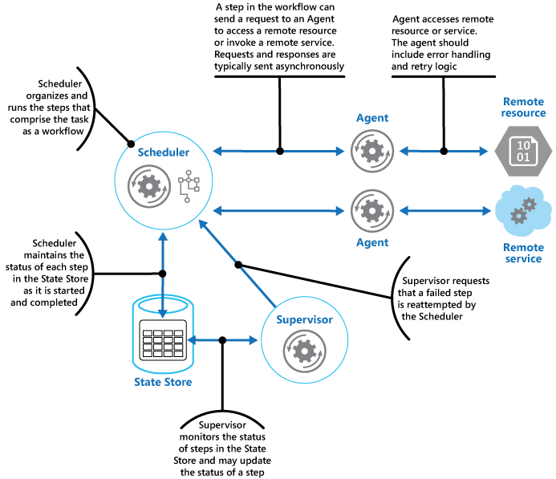

# Scheduler agent supervisor pattern

## Summary

Coordinate a set of distributed actions as a single operation. If any of the actions fail, try to handle the failures transparently, or else undo the work that was performed, so the entire operation succeeds or fails as a whole. This can add resiliency to a distributed system, by enabling it to recover and retry actions that fail due to transient exceptions, long-lasting faults, and process failures.

## Prerequisites

TODO: link the notes a reader should know first.

## Core concepts

### Definition

Coordinate a set of distributed actions as a single operation. If any of the actions fail, try to handle the failures transparently, or else undo the work that was performed, so the entire operation succeeds or fails as a whole. This can add resiliency to a distributed system, by enabling it to recover and retry actions that fail due to transient exceptions, long-lasting faults, and process failures.

### Context and problem

An application orchestrates tasks comprising multiple steps, often involving remote services or resources. It should complete tasks and handle failures from inaccessible services or resources, which may be due to network issues, unstable services, or resource limitations. Transient failures may be managed with the Retry pattern. For persistent faults beyond easy recovery, the application must restore system consistency and operational integrity.

### Solution

The Scheduler Agent Supervisor pattern defines the following actors. These actors orchestrate the steps to be performed as part of the overall task.

- The **Scheduler** coordinates tasks by executing and managing workflow steps in the correct order, tracking their state such as "not started," "running," or "completed," with a complete-by time for each step. For steps needing remote resources, it delegates work to an Agent via asynchronous messaging, which can be queue-based or use other messaging technologies. Similar to a Process Manager, the Scheduler oversees workflows defined by a separate workflow engine, separating business logic from scheduling tasks.
- The **Agent** manages remote service calls or resource access for a task step, usually linking to one service or resource with specific error handling and retry strategies, constrained by a timeout. Retry attempts should carry a consistent identifier for the remote service's deduplication. In workflows run by the Scheduler involving multiple services and resources, different steps may utilize distinct Agents as an implementation detail.
- The **Supervisor** monitors the status of the steps in the task being performed by the Scheduler. It runs periodically (the frequency will be system-specific), and examines the status of steps maintained by the Scheduler. If it detects any that have timed out or failed, it arranges for the appropriate Agent to recover the step or execute the appropriate remedial action (this might involve modifying the status of a step). Note that the recovery or remedial actions are implemented by the Scheduler and Agents. The Supervisor should simply request that these actions be performed.

The Scheduler, Agent, and Supervisor are logical components and their physical implementation depends on the technology being used. For example, several logical agents might be implemented as part of a single web service.

The Scheduler maintains information about the progress of the task and the state of each step in a durable data store, called the state store. The Supervisor can use this information to help determine whether a step has failed. The figure illustrates the relationship between the Scheduler, the Agents, the Supervisor, and the state store.

When an application starts a task, it requests the Scheduler which logs the task's initial state and begins the workflow steps. The Scheduler updates the task status as it progresses through steps, including when referencing remote services via Agents. If an Agent successfully completes its operation, it reports back to the Scheduler, which then proceeds with subsequent steps until the task is finished. Agents have retry logic but must stop work if the complete-by deadline passes without success.

If a step fails or times out, the Supervisor will attempt recovery, possibly by extending the completion time or prompting a retry. Tasks must be idempotent for this process to work effectively, ensuring system consistency. The Supervisor may limit retries or undo tasks through compensating transactions, based on a step's retry count in the state store.

The Supervisor's role is not to monitor the Scheduler or Agents but to manage step failures and recovery. If the Scheduler fails, it should resume in-progress tasks upon restart. The pattern ensures resilience against failures, allowing the system to self-heal by resuming tasks with new instances of failed components. The system's infrastructure, not the Supervisor, handles component failure and restarts, and maintains business operation knowledge. The state store's replication further enhances resilience.

## Worked example

TODO: add a concrete, reproducible example with real values.

## Trade offs and when to use it

### Issues and considerations

You should consider the following points when deciding how to implement this pattern:

- This pattern can be difficult to implement and requires thorough testing of each possible failure mode of the system.
- The recovery/retry logic implemented by the Scheduler is complex and dependent on state information held in the state store. It might also be necessary to record the information required to implement a compensating transaction in a durable data store. A compensating transaction might fail as well.
- How often the Supervisor runs will be important. It should run often enough to prevent any failed steps from blocking an application for an extended period, but it shouldn't run so often that it becomes an overhead.
- The steps performed by an Agent could be run more than once. The logic that implements these steps should be idempotent.

### Use cases

Use this pattern when a process that runs in a distributed environment, such as the cloud, must be resilient to communications failure and/or operational failure.

This pattern might not be suitable for tasks that don't invoke remote services or access remote resources.

## Common mistakes

TODO: list frequent misunderstandings and failure modes, with the fix for each.

## Practice

TODO: add three to five questions, with answers at the bottom.

## Further reading

- Microsoft. [*Scheduler agent supervisor pattern*](https://learn.microsoft.com/en-us/azure/architecture/patterns/scheduler-agent-supervisor). Azure Architecture Center. The full description of the pattern: context and problem, solution, issues and considerations, and when to use it.

TODO: check the content of this note against the sources above and record what was verified and when.
