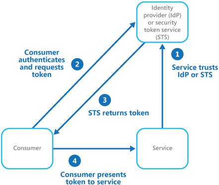

# Federated identity pattern

## Summary

Delegate authentication to an external identity provider. This can simplify development, minimize the requirement for user administration, and improve the user experience of the application.

## Prerequisites

TODO: link the notes a reader should know first.

## Core concepts

### Definition

Delegate authentication to an external identity provider. This can simplify development, minimize the requirement for user administration, and improve the user experience of the application.

### Context and problem

Users typically need to work with multiple applications provided and hosted by different organizations they have a business relationship with. These users might be required to use specific (and different) credentials for each one. This can:

- **Cause a disjointed user experience**. Users often forget sign-in credentials when they have many different ones.
- **Expose security vulnerabilities**. When a user leaves the company the account must immediately be deprovisioned. It's easy to overlook this in large organizations.
- **Complicate user management**. Administrators must manage credentials for all of the users, and perform additional tasks such as providing password reminders.

Users typically prefer to use the same credentials for all these applications.

### Solution

Implement federated identity authentication by offloading user authentication to external identity providers (IdP), streamlining development and broadening IdP options. This reduces administrative tasks and separates authentication from authorization.

Trusted IdPs can be corporate directories, on-premises federation services, partner-provided STS, or social IdPs like Microsoft, Google, Yahoo!, or Facebook. The Federated Identity pattern shows a client accessing a service that requires IdP-verified authentication via an STS, issuing tokens with user claims, including identity and potentially roles and access rights.

Claims-based access control enables applications and services to authorize access based on token claims. The service must trust the Identity Provider (IdP), which authenticates the user and issues a token with claims via the Security Token Service (STS). The STS may modify these claims, which the client then uses to prove identity to the service.

Additional STSs might exist in the trust chain, such as when an on-premises STS relies on another for user authentication, typical in enterprise settings with an on-site STS and directory.

Federated authentication enables trust across different domains and supports single sign-on, increasingly popular in cloud applications as it does not need a direct connection to identity providers.

It enhances security by eliminating the need for multiple credentials and only exposes user credentials to the original identity provider.

Federated identity simplifies management by placing responsibility with the identity provider, not the application or service, reducing administrative work for corporate directories when trusting an external identity provider.

## Worked example

TODO: add a concrete, reproducible example with real values.

## Trade offs and when to use it

### Issues and considerations

Consider the following when designing applications that implement federated authentication:

- Authentication can be a single point of failure. If you deploy your application to multiple datacenters, consider deploying your identity management mechanism to the same datacenters to maintain application reliability and availability.
- Authentication tools make it possible to configure access control based on role claims contained in the authentication token. This is often referred to as role-based access control (RBAC), and it can allow a more granular level of control over access to features and resources.
- Social identity providers typically offer limited user information, such as an email address or name, with Microsoft accounts providing only a unique identifier. Applications must store user details and link them to the claims in the token. This is often done during initial registration, with additional claims added post-authentication.
- When multiple identity providers are available, the STS must direct users to the correct provider through home realm discovery, possibly using the user's provided email, accessed subdomain, IP address, or browser cookies. For instance, a Microsoft email leads to redirection to the Microsoft sign-in page, with subsequent visits potentially streamlined by cookies. If automatic detection fails, users select their provider from a list on a home realm discovery page.

### Use cases

This pattern is useful for scenarios such as:

- **Single sign-on in the enterprise**. In this scenario you need to authenticate employees for corporate applications that are hosted in the cloud outside the corporate security boundary, without requiring them to sign in every time they visit an application. The user experience is the same as when using on-premises applications where they're authenticated when signing in to a corporate network, and from then on have access to all relevant applications without needing to sign in again.
- **Federated identity with multiple partners**. In this scenario you need to authenticate both corporate employees and business partners who don't have accounts in the corporate directory. This is common in business-to-business applications, applications that integrate with third-party services, and where companies with different IT systems have merged or shared resources.
- **Federated identity in SaaS applications**. In this scenario independent software vendors provide a ready-to-use service for multiple clients or tenants. Each tenant authenticates using a suitable identity provider. For example, business users will use their corporate credentials, while consumers and clients of the tenant will use their social identity credentials.

This pattern might not be useful in the following situations:

- All users of the application can be authenticated by one identity provider, and there's no requirement to authenticate using any other identity provider. This is typical in business applications that use a corporate directory (accessible within the application) for authentication, by using a VPN, or (in a cloud-hosted scenario) through a virtual network connection between the on-premises directory and the application.
- The application was originally built using a different authentication mechanism, perhaps with custom user stores, or doesn't have the capability to handle the negotiation standards used by claims-based technologies. Retrofitting claims-based authentication and access control into existing applications can be complex, and probably not cost effective.

## Common mistakes

TODO: list frequent misunderstandings and failure modes, with the fix for each.

## Practice

TODO: add three to five questions, with answers at the bottom.

## Further reading

- Microsoft. [*Federated identity pattern*](https://learn.microsoft.com/en-us/azure/architecture/patterns/federated-identity). Azure Architecture Center. The full description of the pattern: context and problem, solution, issues and considerations, and when to use it.

TODO: check the content of this note against the sources above and record what was verified and when.
