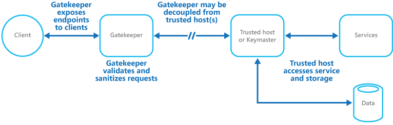

# Gatekeeper pattern

## Summary

Protect applications and services by using a dedicated host instance to broker requests between clients and the application or service. The broker validates and sanitizes the requests, and can provide an additional layer of security and limit the system's attack surface.

## Prerequisites

TODO: link the notes a reader should know first.

## Core concepts

### Definition

Protect applications and services by using a dedicated host instance to broker requests between clients and the application or service. The broker validates and sanitizes the requests, and can provide an additional layer of security and limit the system's attack surface.

### Context and problem

Cloud services offer API endpoints for client applications. These APIs handle tasks such as authentication, authorization, validation, and request processing, often accessing storage and services for the client. If compromised, a malicious user could exploit the hosting environment's security, potentially gaining access to credentials, sensitive data, and services.

### Solution

Decouple public endpoint code from request processing and storage access by using a façade or task for client interaction, handing off requests through a decoupled interface to handling hosts or tasks, as shown in the figure.

The gatekeeper pattern can be used to protect storage, or it can be used as a more comprehensive façade to protect all of the functions of the application. The important factors are:

- **Controlled validation**. The gatekeeper validates all requests, and rejects requests that don't meet validation requirements.
- **Limited risk and exposure**. The gatekeeper doesn't have access to the credentials or keys used by the trusted host to access storage and services. If the gatekeeper is compromised, the attacker doesn't get access to these credentials or keys.
- **Appropriate security**. The gatekeeper runs in a limited privilege mode, while the rest of the application runs in the full trust mode required to access storage and services. If the gatekeeper is compromised, it can't directly access the application services or data.

This pattern acts like a firewall in a typical network topography. It allows the gatekeeper to examine requests and make a decision about whether to pass the request on to the trusted host that performs the required tasks. This decision typically requires the gatekeeper to validate and sanitize the request content before passing it on to the trusted host.

## Worked example

TODO: add a concrete, reproducible example with real values.

## Trade offs and when to use it

### Issues and considerations

Consider the following points when deciding how to implement this pattern:

- Ensure that the trusted hosts expose only internal or protected endpoints, used only by the gatekeeper. The trusted hosts shouldn't expose any external endpoints or interfaces.
- The gatekeeper must run in a limited privilege mode, which typically requires running the gatekeeper and the trusted host in separate hosted services or virtual machines.
- The gatekeeper shouldn't perform any processing related to the application or services or access any data. Its function is purely to validate and sanitize requests. The trusted hosts might need to perform additional request validation, but the gatekeeper should perform the core validation.
- Use a secure communication channel (HTTPS, SSL, or TLS) between the gatekeeper and the trusted hosts or tasks where possible. However, some hosting environments don't support HTTPS on internal endpoints.
- Adding the extra layer to implement the gatekeeper pattern will likely impact performance due to the additional processing and network communication required.
- The gatekeeper instance could be a single point of failure. To minimize the impact of a failure, consider deploying redundant instances and using an autoscaling mechanism to ensure capacity to maintain availability.

### Use cases

This pattern is helpful for applications that:

- handle sensitive information
- expose services that require a high degree of protection from malicious attacks
- perform mission-critical operations that can't be disrupted.
- require request validation be performed separately from the main tasks, or to centralize this validation to simplify maintenance and administration

## Common mistakes

TODO: list frequent misunderstandings and failure modes, with the fix for each.

## Practice

TODO: add three to five questions, with answers at the bottom.

## Further reading

- Microsoft. [*Gatekeeper pattern*](https://learn.microsoft.com/en-us/azure/architecture/patterns/gatekeeper). Azure Architecture Center. The full description of the pattern: context and problem, solution, issues and considerations, and when to use it.

TODO: check the content of this note against the sources above and record what was verified and when.
