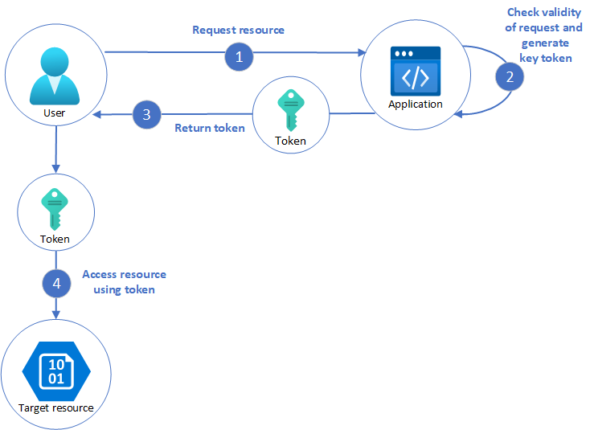

# Valet key pattern

## Summary

Use a token that provides clients with restricted direct access to a specific resource, in order to offload data transfer from the application. This is particularly useful in applications that use cloud-hosted storage systems or queues, and can minimize cost and maximize scalability and performance.

## Prerequisites

TODO: link the notes a reader should know first.

## Core concepts

### Definition

Use a token that provides clients with restricted direct access to a specific resource, in order to offload data transfer from the application. This is particularly useful in applications that use cloud-hosted storage systems or queues, and can minimize cost and maximize scalability and performance.

### Context and problem

Clients and web browsers need to transfer files or data streams to/from an application's storage. The application typically manages the data transfer, consuming resources like compute, memory, and bandwidth. Data stores can directly manage uploads and downloads, saving resources and improving performance, but this requires clients to have store credentials and compromises the application's control over data security. Direct access is unsuitable for systems with untrusted clients; applications must securely control access while offloading data transfers to reduce server load.

### Solution

To control data store access without built-in authentication, limit its public connection and issue clients a valet key, a token that grants time-limited and operation-specific access, like write-only or upload/download permissions. Valet keys are created by applications and given to clients for direct resource access, reducing the application's data handling and improving performance and scalability. The key expires after a set period, restricting resource access.

Keys can be configured with dependencies like data scope, specifying a table or rows in a data store, or a container or item in cloud storage. Applications can invalidate keys post-data transfer to prevent further access. This pattern eliminates the need for user creation, permission granting, and revocation, simplifying resource access management. It's vital to tightly control the validity period and resource location to ensure keys are used only as intended.

## Worked example

TODO: add a concrete, reproducible example with real values.

## Trade offs and when to use it

### Issues and considerations

Consider the following points when deciding how to implement this pattern:

- **Manage the validity status and period of the key**. A compromised key allows misuse during its validity. Keys can be revoked or disabled, and server policies or signing keys updated to invalidate them. Use short validity periods to reduce unauthorized access risks but ensure they're long enough for client operations. Permit key renewals by authorized users for repeated resource access.
- **Control the level of access the key will provide**. The key should grant only the necessary permissions for the task, like read-only for clients not uploading data. For uploads, use a write-only key with specified location and duration. Ensure the key applies to the correct resources.
- **Consider how to control users' behavior**. Implementing this pattern reduces control over user resource access, limited by policy capabilities. For instance, keys can't limit data size or access frequency, potentially leading to high data transfer costs due to coding errors. To prevent multiple uploads, have clients notify the application after each operation. Some data stores provide events for monitoring and controlling user actions. Enforcing individual quotas in multitenant environments with shared keys is difficult. Using *create* permissions restricts data updates by making tokens single-use, as they don't allow overwrites.
- **Validate, and optionally sanitize, all uploaded data**. A malicious user that gains access to the key could upload data designed to compromise the system. Alternatively, authorized users might upload data that's invalid and, when processed, could result in an error or system failure. To protect against this, ensure that all uploaded data is validated and checked for malicious content before use.
- **Audit all operations**. Many key-based mechanisms can log operations such as uploads, downloads, and failures. These logs can usually be incorporated into an audit process, and also used for billing if the user is charged based on file size or data volume. Use the logs to detect authentication failures that might be caused by issues with the key provider, or accidental removal of a stored access policy.
- **Deliver the key securely**. It can be embedded in a URL that the user activates in a web page, or it can be used in a server redirection operation so that the download occurs automatically. Always use HTTPS to deliver the key over a secure channel.
- **Protect sensitive data in transit**. Sensitive data delivered through the application will usually take place using TLS, and this should be enforced for clients accessing the data store directly.

Other issues to be aware of when implementing this pattern are:

- If the client doesn't, or can't, notify the server of completion of the operation, and the only limit is the expiration period of the key, the application won't be able to perform auditing operations such as counting the number of uploads or downloads, or preventing multiple uploads or downloads.
- The flexibility of key policies that can be generated might be limited. For example, some mechanisms only allow the use of a timed expiration period. Others aren't able to specify a sufficient granularity of read/write permissions.
- If the start time for the key or token validity period is specified, ensure that it's a little earlier than the current server time to allow for client clocks that might be slightly out of synchronization. The default, if not specified, is usually the current server time.
- The URL containing the key might be recorded in server log files. While the key will typically have expired before the log files are used for analysis, ensure that you limit access to them. If log data is transmitted to a monitoring system or stored in another location, consider implementing a delay to prevent leakage of keys until after their validity period has expired.
- If the client code runs in a web browser, the browser might need to support cross-origin resource sharing (CORS) to enable code that executes within the web browser to access data in a different domain from the one that served the page. Some older browsers and some data stores don't support CORS, and code that runs in these browsers might not be able to use a valet key to provide access to data in a different domain, such as a cloud storage account.
- While the client doesn't need to have pre-configured authentication for to the end resource, the client does need to preestablish means of authentication to the valet key service.
- Keys should only be handed out to authenticated clients with proper authorization.
- The generation of access tokens is privileged action, so the valet key service must be secured with strict access policies. The service may allow access to sensitive systems by third parties, making the security of this service of particular importance.

### Use cases

This pattern is useful for the following situations:

- Minimize resource loading and enhance performance and scalability by using valet keys, which don't lock resources, omit remote server calls, have no issuance limit, and prevent single points of failure from data transfers via application code. Creating a valet key usually involves signing a string with a key.
- When clients regularly upload or download data, particularly where there's a large volume or when each operation involves large files.
- When the application has limited compute resources available, either due to hosting limitations or cost considerations. In this scenario, the pattern is even more helpful if there are many concurrent data uploads or downloads because it relieves the application from handling the data transfer.
- When the data is stored in a remote data store or a different region. If the application was required to act as a gatekeeper, there might be a charge for the additional bandwidth of transferring the data between regions, or across public or private networks between the client and the application, and then between the application and the data store.

This pattern might not be useful in the following situations:

- If clients can already uniquely authenticate to your backend service, with RBAC for example, do not use this pattern.
- If the application must perform some task on the data before it's stored or before it's sent to the client. For example, if the application needs to perform validation, log access success, or execute a transformation on the data. However, some data stores and clients are able to negotiate and carry out simple transformations such as compression and decompression (for example, a web browser can usually handle gzip formats).
- If the design of an existing application makes it difficult to incorporate the pattern. Using this pattern typically requires a different architectural approach for delivering and receiving data.
- If it's necessary to maintain audit trails or control the number of times a data transfer operation is executed, and the valet key mechanism in use doesn't support notifications that the server can use to manage these operations.
- If it's necessary to limit the size of the data, especially during upload operations. The only solution to this is for the application to check the data size after the operation is complete, or check the size of uploads after a specified period or on a scheduled basis.

## Common mistakes

TODO: list frequent misunderstandings and failure modes, with the fix for each.

## Practice

TODO: add three to five questions, with answers at the bottom.

## Further reading

- Microsoft. [*Valet key pattern*](https://learn.microsoft.com/en-us/azure/architecture/patterns/valet-key). Azure Architecture Center. The full description of the pattern: context and problem, solution, issues and considerations, and when to use it.

TODO: check the content of this note against the sources above and record what was verified and when.
