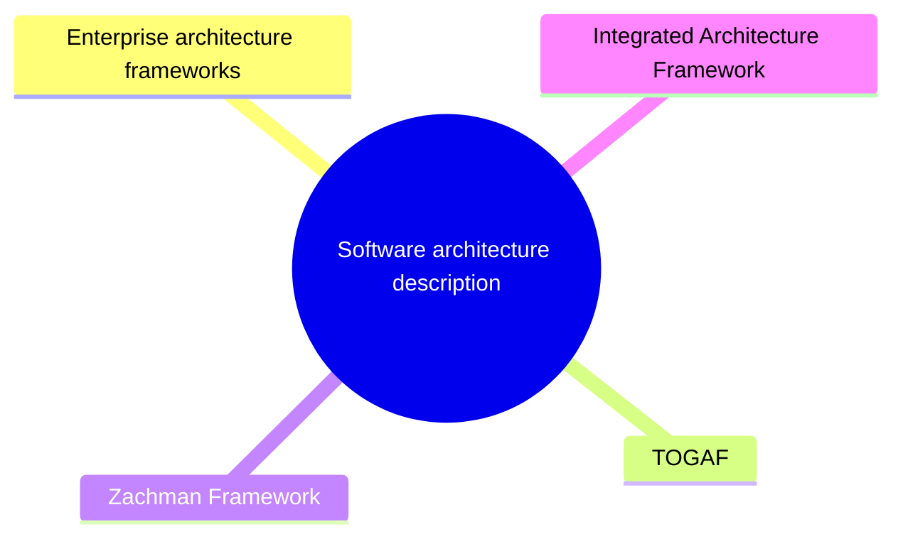

# Software architecture description

How an architecture is documented: views, viewpoints, models and the enterprise architecture frameworks that organize them.

This section corresponds to topic 2.2 of the [SWEBOK Guide V4.0](https://www.computer.org/education/bodies-of-knowledge/software-engineering).

## Map

The map shows the notes and sections of this part of the library.

## Reading order

1. [Enterprise architecture frameworks](enterprise-architecture-frameworks.md): An enterprise architecture framework (or simply EA framework) is the collection of processes, templates and tools that software teams use to plan and build large, enterprise-grade application...
2. [TOGAF](togaf.md): TOGAF (The Open Group Architecture Framework) is a widely adopted enterprise architecture framework that provides a methodology and tools to design, plan, implement, and govern enterprise...
3. [Zachman Framework](zachman-framework.md): The Zachman Framework is a foundational enterprise architecture framework that provides a structured approach for organizing and analyzing the artifacts of an organization’s architecture.
4. [Integrated Architecture Framework (IAF)](integrated-architecture-framework.md): The Integrated Architecture Framework (IAF) is a comprehensive, structured framework used to design and manage enterprise architectures.

## Planned topics

- ISO/IEC/IEEE 42010 concepts: views, viewpoints and model kinds
- The 4+1 view model
- The C4 model
- Architecture decision records (ADR)
- Architecture description languages
