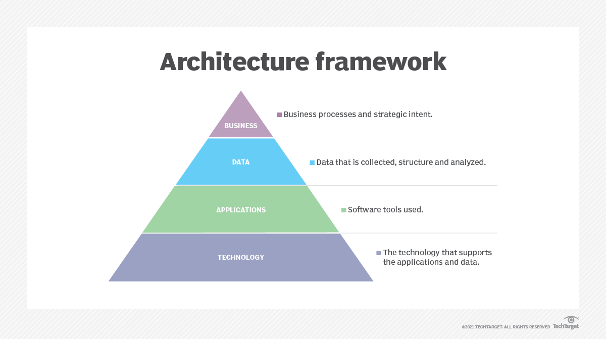

# Enterprise architecture frameworks

## Summary

An enterprise architecture framework (or simply EA framework) is the collection of processes, templates and tools that software teams use to plan and build large, enterprise-grade application architecture systems. Alongside an enterprise architecture's conceptual blueprint, the specific purpose of a framework is to help architects, designers and engineers understand the logical structure and component relationships that define that system.

## Prerequisites

TODO: link the notes a reader should know first.

## Core concepts

### Enterprise architecture framework (EA)

#### Definition

An enterprise architecture framework (or simply EA framework) is the collection of processes, templates and tools that software teams use to plan and build large, enterprise-grade application architecture systems. Alongside an enterprise architecture's conceptual blueprint, the specific purpose of a framework is to help architects, designers and engineers understand the logical structure and component relationships that define that system.

#### Components

There are three basic components that make up the creation of an enterprise architecture framework:

1. A description of the architecture that outlines the procedures surrounding documentation creation and access;
2. A design method that dictates the steps architects should follow when forming an architectural model; and
3. A record of the technical knowledge, niche proficiencies and general experience levels possessed by those involved, including a record of any notable skill gaps to address.

#### How to implement EA

1. **Establish Governance**
    - Create an enterprise architecture team with clear roles and responsibilities.
    - Define governance processes and standards.
2. **Define Scope and Objectives**
    - Align architecture goals with organizational strategy.
    - Identify key stakeholders and their needs.
3. **Choose an Appropriate Framework**
    - Select a framework that matches organizational requirements and maturity.
4. **Develop Current and Target Architectures**
    - Document the current state of architecture (as-is).
    - Define the desired future state (to-be).
5. **Gap Analysis and Roadmap**
    - Identify gaps between current and target states.
    - Develop a roadmap for bridging gaps through projects and initiatives.
6. **Implement Architecture**
    - Execute projects to transition from the current state to the target state.
7. **Continuous Improvement**
    - Monitor architecture performance, gather feedback, and refine processes.

#### Examples EA frameworks

1. **TOGAF (The Open Group Architecture Framework)**
    - Focuses on a four-layered approach: Business, Data, Application, and Technology.
    - Provides the **Architecture Development Method (ADM)** for implementation.
    - Widely used in large organizations.
2. **Zachman Framework**
    - A grid-based approach with six rows (What, How, Where, Who, When, Why) and six columns (Planner, Owner, Designer, Builder, Subcontractor, User).
    - Focuses on organizing and categorizing architecture artifacts.
3. **Federal Enterprise Architecture Framework (FEAF)**
    - Used by the U.S. federal government.
    - Provides a structure for integrating federal IT systems and improving efficiency.
4. **Gartner Enterprise Architecture Framework**
    - Business-outcome-driven, emphasizing continuous alignment with organizational goals.
    - Flexible and adaptable to different industries.
5. **MODAF (Ministry of Defence Architecture Framework)**
    - Designed for defense and military organizations.
    - Focuses on operational, system, and technical viewpoints.
6. **DODAF (Department of Defense Architecture Framework)**
    - U.S. Department of Defense-specific framework.
    - Prioritizes operational requirements and system interoperability.
7. **PEAF (Pragmatic Enterprise Architecture Framework)**
    - A lightweight framework focused on practical application rather than theoretical concepts.

#### Benefits of using an EA framework

- **Strategic Alignment**: Ensures IT aligns with business goals.
- **Efficiency**: Reduces redundancy and optimizes resource use.
- **Risk Management**: Identifies potential risks and mitigates them early.
- **Improved Decision-Making**: Provides a clear overview of processes, data, and technology.
- **Interoperability**: Ensures seamless integration of systems and processes.
- **Agility**: Enables quicker adaptation to change.

#### Key components

1. **Architecture Domains**
    - **Business Architecture**: Describes business processes, goals, and organizational structures.
    - **Information Architecture**: Focuses on data structures, flow, and management.
    - **Application Architecture**: Covers applications and their interactions.
    - **Technology Architecture**: Includes hardware, software, and IT infrastructure.
2. **Architecture Principles**
    - Guidelines to ensure consistency and alignment with organizational goals.
    - Examples: Modularity, interoperability, scalability, reusability.
3. **Framework Processes**
    - **Planning**: Define vision, goals, and scope.
    - **Development**: Build models, design solutions, and document architecture.
    - **Implementation**: Execute projects and integrate architectures.
    - **Governance**: Monitor and enforce compliance with the architecture.
4. **Artifacts**
    - Models, diagrams, and documentation used to represent the architecture.
    - Examples: Process flow diagrams, data models, system blueprints.
5. **Standards**
    - Specifications for technology, data formats, and protocols to ensure consistency and interoperability.
6. **Tools**
    - Software tools used for modeling, analysis, and management of architecture.
    - Examples: ArchiMate, Sparx Systems Enterprise Architect, and OpenText ProVision.

## Worked example

TODO: add a concrete, reproducible example with real values.

## Trade offs and when to use it

TODO: describe benefits, costs, alternatives and when this is the wrong choice.

## Common mistakes

TODO: list frequent misunderstandings and failure modes, with the fix for each.

## Practice

TODO: add three to five questions, with answers at the bottom.

## Further reading

- ISO/IEC/IEEE (2022). [*ISO/IEC/IEEE 42010:2022 Software, systems and enterprise: Architecture description*](https://www.iso.org/standard/74393.html). ISO. The standard that defines architecture descriptions, views, viewpoints and architecture frameworks.

TODO: check the content of this note against the sources above and record what was verified and when.
