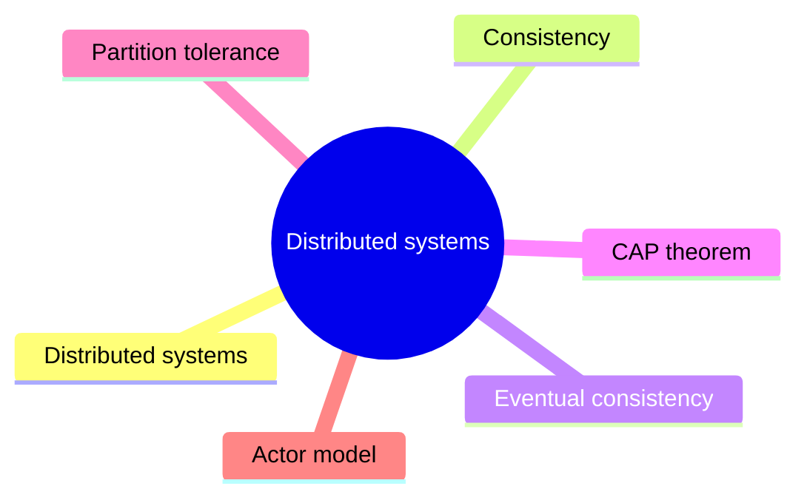

# Distributed systems

Concepts that govern systems whose components run on networked computers: consistency, partitions, the CAP theorem and actor based concurrency.

This is a catalog section: it groups a large body of related notes inside the knowledge area. It is not a separate SWEBOK topic.

## Map

The map shows the notes and sections of this part of the library.

## Reading order

1. [Distributed systems](distributed-systems.md): A distributed system is a set of independent computers that communicate over a network and appear to their users as one system.
2. [Consistency](consistency.md): Consistency in system design refers to the property of ensuring that all nodes in a distributed system have the same view of the data at any given point in time, despite possible concurrent...
3. [Eventual consistency](eventual-consistency.md): Eventual consistency is a consistency model used in distributed computing, where updates to a data system are propagated across nodes asynchronously.
4. [CAP theorem](cap-theorem.md): The CAP theorem states that when a network partition occurs, a distributed data store must choose between consistency (every read sees the latest write) and availability (every request gets a...
5. [Partition tolerance](partition-tolerance.md): A partition is when the network fails to deliver some messages to one or more nodes by losing them (not by delaying them - eventual delivery is not a partition).
6. [Actor model](actor-model.md): The actor model is a conceptual model to deal with concurrent computation.

## Planned topics

- Fallacies of distributed computing
- Consensus algorithms (Paxos, Raft)
- Clocks, ordering and vector clocks
- Consistent hashing
- Load balancing
- Distributed transactions and two-phase commit
- PACELC theorem
