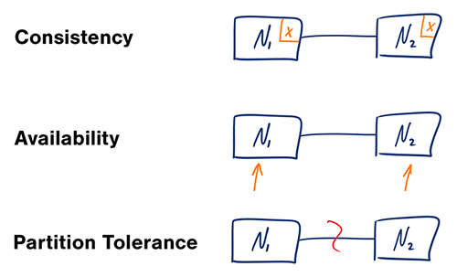
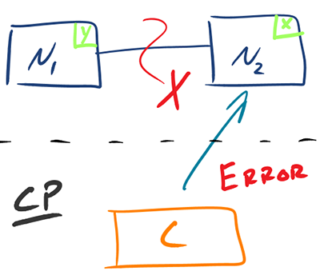
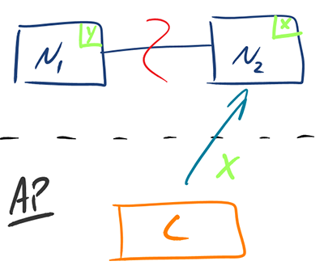

# CAP theorem

## Summary

The CAP theorem states that when a network partition occurs, a distributed data store must choose between consistency (every read sees the latest write) and availability (every request gets a non-error response). Without a partition both can be provided. The note defines the terms precisely and shows how real systems make the trade off.

## Prerequisites

- [Distributed systems](distributed-systems.md)

## Core concepts

### Definition

The CAP Theorem states that, in a distributed system (a collection of interconnected nodes that share data.), you can only have two out of the following three guarantees across a write/read pair: Consistency, Availability, and Partition Tolerance - one of them must be sacrificed. However, as you will see below, you don't have as many options here as you might think.

- **Consistency** - A read is guaranteed to return the most recent write for a given client.
- **Availability** - A non-failing node will return a reasonable response within a reasonable amount of time (no error or timeout).
- **Partition Tolerance** - The system will continue to function when network partitions occur.

Given that networks aren't completely reliable, you must tolerate partitions in a distributed system, period. Fortunately, though, you get to choose what to do when a partition does occur. According to the CAP theorem, this means we are left with two options: Consistency and Availability.

### Key definitions

- **Consistency (C) -** Every read returns the most recent write (atomic/linearizable). The system behaves as if there’s a single, up-to-date copy of the data.
- **Availability (A) -** Every request receives a valid (non-error) response, eventually, even during failures. No request is dropped.
- **Partition Tolerance (P) -** The system continues to operate despite network message loss between nodes.

### Importance

- In the real world, **partitions are inevitable** (hardware failures, network issues).
- When a partition occurs, you must choose between:
    - **C over A** → wait for correct data (may be slow or unavailable)
    - **A over C** → respond immediately, possibly with stale data.

### Clarifications

- **P is not optional** in real distributed systems, all real networks can partition.
- CAP ≠ "Choose any two", it’s:
    - **If partitions can happen → you cannot always have both C and A.**
    - **C and A are binary in CAP** (strong guarantees) but can be **relaxed** in practice (eventual consistency, partial availability).
    - **Slow machines ≠ partitions**, but they make it hard to distinguish between a partition and a delay.

## Worked example

### Examples

- **C-first systems** (sacrifice availability): ZooKeeper, traditional RDBMS clusters.
- **A-first systems** (sacrifice consistency): Amazon Dynamo, Cassandra with eventual consistency.

## Trade offs and when to use it

### Tradeoffs

#### CP

Consistency/Partition Tolerance - Wait for a response from the partitioned node which could result in a timeout error. The system can also choose to return an error, depending on the scenario you desire. Choose Consistency over Availability when your business requirements dictate atomic reads and writes.

#### AP

Availability/Partition Tolerance - Return the most recent version of the data you have, which could be stale. This system state will also accept writes that can be processed later when the partition is resolved. Choose Availability over Consistency when your business requirements allow for some flexibility around when the data in the system synchronizes. Availability is also a compelling option when the system needs to continue to function in spite of external errors (shopping carts, etc.)

The decision between Consistency and Availability is a *software trade off*. You can choose what to do in the face of a network partition - the control is in your hands. Network outages, both temporary and permanent, are a fact of life and occur whether you want them to or not - this exists outside of your software.

## Common mistakes

TODO: list frequent misunderstandings and failure modes, with the fix for each.

## Practice

TODO: add three to five questions, with answers at the bottom.

## Further reading

- Gilbert, S., Lynch, N. (2002). [*Brewer's conjecture and the feasibility of consistent, available, partition-tolerant web services*](https://doi.org/10.1145/564585.564601). ACM SIGACT News. The formal proof of the CAP theorem, with precise definitions of consistency, availability and partition tolerance.
- Brewer, E. (2012). [*CAP Twelve Years Later: How the "Rules" Have Changed*](https://www.infoq.com/articles/cap-twelve-years-later-how-the-rules-have-changed/). InfoQ (originally IEEE Computer). Brewer explains common misreadings of CAP and how systems manage partitions in practice.

TODO: check the content of this note against the sources above and record what was verified and when.
