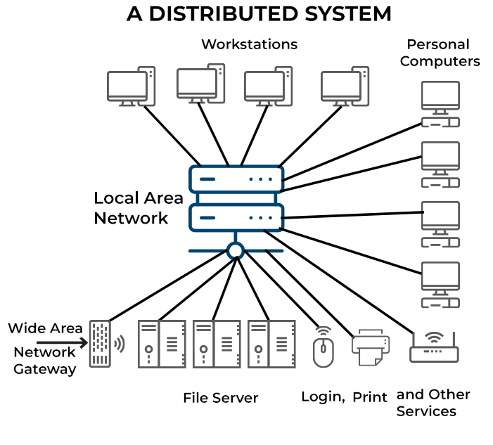
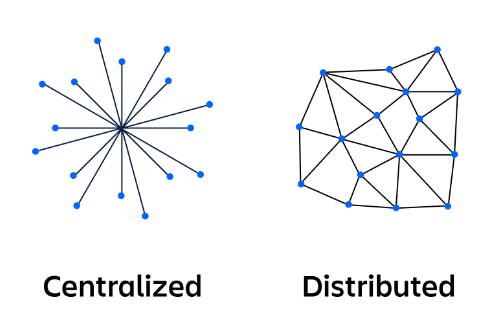
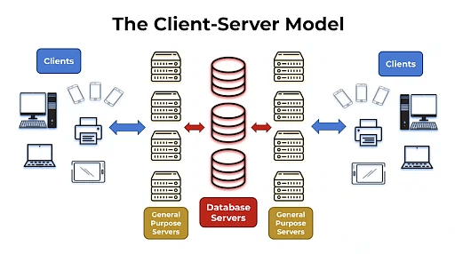
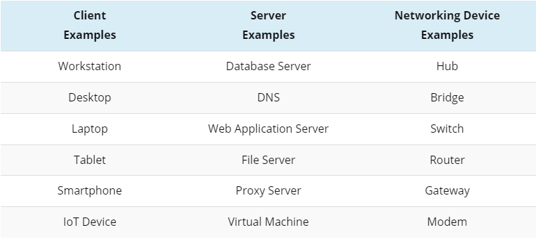
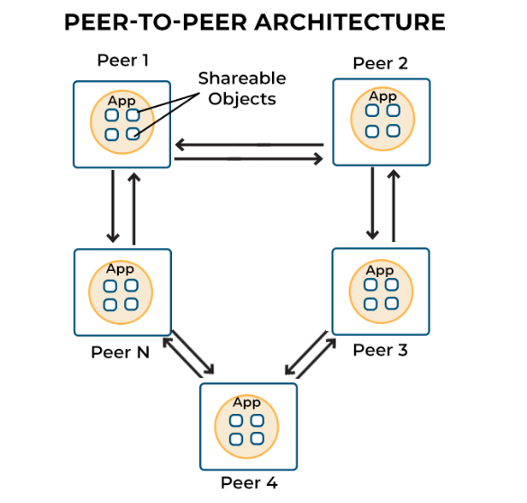
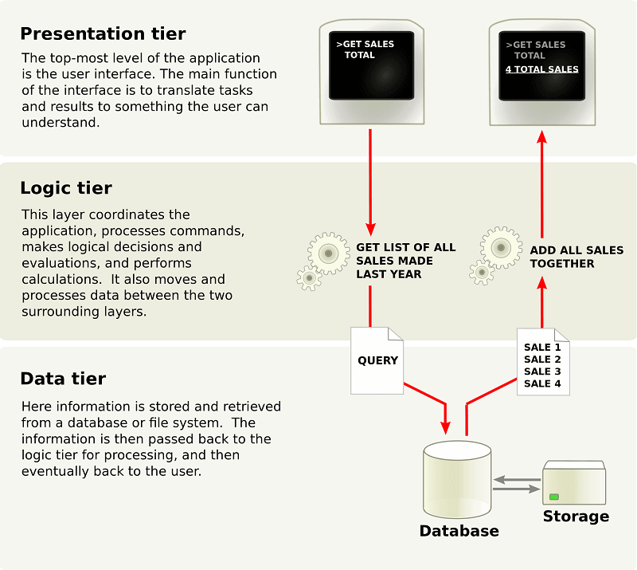
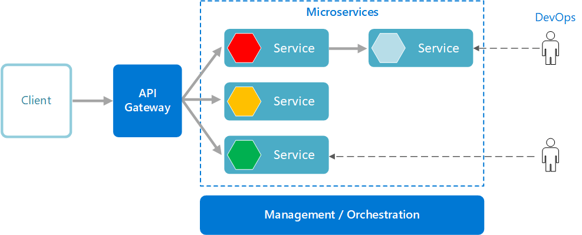

# Distributed systems

## Summary

A distributed system is a set of independent computers that communicate over a network and appear to their users as one system. Distribution gives scalability and fault tolerance, but it brings partial failures, unreliable networks, lack of a global clock and the need to choose between consistency and availability.

## Prerequisites

TODO: link the notes a reader should know first.

## Core concepts

### Introduction

Distributed architectures are crucial in tech infrastructures. With cloud computing, big data, and highly available systems, traditional monolithic designs have shifted to distributed, scalable, and resilient ones. These architectures enable high-performance, reliable services across large areas, handling vast data and many users. Understanding these architectures is essential for designing robust systems and optimizing performance, reliability, and user experience. This article explores distributed architectures, their components, and effective design and implementation, focusing on the 4 major types and their unique features.

### Definition

A distributed system is a **collection of computer programs spread across multiple computational nodes**. Each node is a separate physical device or software process but works towards a shared objective. This setup is also known as distributed computing systems or distributed databases.

The main goal of a distributed database system is to **avoid bottlenecks and eliminate central points of failure** by allowing the nodes to communicate and coordinate through a shared network.

The following are the characteristics of the distributed systems:

- **Error detection:** Failures or errors within a distributed system are readily identified and detected.
- **Simultaneous processing:** Multiple machines in a distributed system can perform the same function or task simultaneously.
- **Scalability**: The computing and processing capacity of a distributed system can be expanded by adding more machines as required.
- **Resource sharing**: In a distributed computing system, resources like hardware, software, or data can be shared among multiple nodes.
- **Transparency:** Each node within the system can access and communicate with other nodes without being aware of the underlying complexities or differences in their implementation.

#### Centralized vs. distributed

In a centralized system, a single computer in one location performs all computations. **Every node accesses a central node** which causes congestion and slower performance. On the other hand, distributed systems consist of multiple nodes that work collaboratively.

In these systems, the **state is spread across different nodes** which prevents a single point of failure. This dispersion of computation and storage resources causes improved performance and resilience.

##### Benefits

- **Scalability:** Distributed database systems offer improved scalability as they can add more nodes to easily accommodate the increase in workload**.**
- **Improved reliability:** It eliminates central points of failure and bottlenecks. The redundancy of nodes ensures that even if one node fails, others can take over its tasks.
- **Enhanced performance:** These systems can easily scale horizontally by adding more nodes or vertically by increasing a node's capacity. This scalability results in enhanced performance and optimum output.

##### Drawbacks & risks

- **Requirement for specialized tools:** Management of multiple repositories in a distributed system requires the use of specialized tools.
- **Development sprawl and complexity**: As the system's complexity grows, organizing, managing, and improving a distributed system can become challenging.
- **Security risks:** A distributed system is more vulnerable to cyber attacks, as data processing is distributed across multiple nodes that communicate with each other.

### Components & types

Distributed architecture refers to a model where **software components that reside on networked computers communicate and coordinate their actions to achieve a common goal.** In this approach, computation tasks are divided among several machines rather than relying on a central server. This spreading out of the workload by distributed architectures enhances a system's performance, scalability, and resilience.

A key advantage of distributed architecture is its fault tolerance. **If one node in the system fails, others can take over its tasks**, ensuring uninterrupted service. Moreover, this architecture can easily be scaled up by adding more machines which makes it an excellent choice for large, complex applications.

#### Key components

Distributed systems are complex and can vary greatly depending on their specific use case and architecture. However, the following core components are present in most distributed systems:

##### Nodes

These are the individual computers or servers that make up the distributed system. Each node **runs its own instances of the applications and services** that make up the system.

###### Network

This is the **communication infrastructure that connects all nodes.** The network enables data and information to be exchanged between nodes.

###### Middleware

This software layer **provides a programming model for developers and masks the heterogeneity** of the underlying network, hardware, and operating systems. It provides useful abstractions and services which simplify the process of creating complex distributed systems.

###### Shared data/database

**This is where the system stores and retrieves data.** Depending on the specific design of the distributed system, the data could be distributed across multiple nodes, replicated, or partitioned.

###### Distributed algorithms

These are the **rules and procedures nodes follow to communicate and coordinate** with each other. They enable nodes to work together, even when some nodes fail or network connections are unreliable.

###### System management tools

These tools **help manage, monitor, and troubleshoot the distributed system.** They provide functionality for load balancing, fault tolerance, system configuration, and more.

#### Types

Distributed architectures vary in the way they organize nodes, share computational tasks, or handle communication between different parts of the system. They **embody the principles of distributed computing** that are tailored to specific requirements and constraints.

##### Client-Server architecture

The [client-server architecture](https://www.simplilearn.com/what-is-client-server-architecture-article) is a fundamental model in distributed systems. It breaks down the system into **2 main components: the client and the server.**

The client-server model **describes how various network devices, known as clients, interact with servers**. These clients, which include workstations, laptops, and IoT devices, create requests that are completed by servers.

While servers were traditionally physical devices, the current trend is towards deploying virtual servers for diverse workloads. The client sends a request to the server which **handles the business logic and state management.**

On the other hand, when the server receives and processes the client's request, it sends back a response. These interactions often involve messaging, data collection, and calculations. **While the servers need not know about clients, clients should be aware of the servers' identities.**

A truly distributed client-server system **includes multiple server nodes to distribute client connections** which prevents the structure from degrading into a centralized one. These systems are prevalent in modern enterprises and data centers, serving various processes such as email, internet connections, application hosting, and more.

###### Components

The client-server architectures are constructed around three fundamental components. Let‘s examine each one by one.

**Workstations**

Workstations, or clients, are **user systems that run various operating systems**. As network clients can be an array of device and OS types, administrators are tasked with ensuring compatibility among them. With the increasing heterogeneity of devices, the challenge of maintaining interoperability has become more significant.

**Servers**

Servers are high-performance devices that can be physical, virtual, or cloud-based. They perform various functions and have fast processing, large storage, and robust memory. They **manage multiple requests from various workstations simultaneously.** Examples include mail servers, database servers, file servers, and domain controllers.

**Networking Devices**

Networking devices provide the medium for workstations and servers to connect. Different types of devices are used for specific purposes:

- **Bridges** are used for network segmentation.
- **Repeaters** transfer data from one device to another.
- **Hubs** are used to connect multiple workstations to a server.

##### Peer-To-Peer (P2P) architecture

The [peer-to-peer (P2P)](https://www.techopedia.com/definition/454/peer-to-peer-architecture-p2p-architecture) architecture is a unique type of distributed system that **operates without centralized control.** In this architecture, any node, also referred to as a peer, can **function as either a client or a server.** When a node requests a service, it acts as a client and when it offers a service, it's considered a server.

P2P networks can be broadly categorized into 3 types:

- **Structured P2P**: Nodes adhere to a predefined distributed data structure.
- **Unstructured P2P**: Networks feature nodes that randomly select their neighbors.
- **Hybrid P2P**: Systems combine elements of both, with certain nodes assigned unique, organized functions.

An important feature of the P2P system is its **inherent redundancy**. Each node carries the full application instance, containing both the presentation and data processing layers. When a new peer is introduced to the system, it **discovers and connects to other peers for synchronizing its local state with the wider system**. This redundancy ensures the system's resilience with the failure of a single node having minimal impact on the overall network.

A key advantage of P2P networks is the **increase in system capacity as more nodes join the network**. This yields shared resources such as bandwidth, storage, and processing power. Compared to typical client-server networks where increased demands cause fewer available resources per client, **P2P networks become more robust and resilient with each additional node.**

###### Components

The following are the main components of a P2P architecture:

**Peers Or Nodes**

The foundation of any Peer-to-Peer (P2P) network is the peers or nodes. These are **individual computers that can both request and provide services.** This dual role of each participant sets P2P apart from traditional client-server models.

**Network Infrastructure**

This element refers to the connection medium that links all nodes in the system. It can range from a local communication network to the expansive internet. The network **allows the nodes to communicate and enables the sharing of resources.**

**Distributed Data**

In a P2P system, data is not stored in a central location but is spread across the network. **Each peer holds a part of the overall data.** This distributed nature of data is one of the key aspects that enhances the resilience and efficiency of P2P systems.

**Directory Services**

While P2P networks fundamentally lack central control, **some incorporate a directory service.** This service helps locate resources in the network which enhances its overall efficiency.

**Communication Protocols**

Protocols form the rules of interaction within the network. They **allow peers to discover other nodes, ask for services, offer services, and synchronize their data.** These protocols are vital for smooth operations and communications in the P2P network.

##### Multi-Tier (n-tier) architecture

Multi-tier architecture, also known as n-tier architecture, was first created by enterprise web services. It **divides an application's functions into physically separated tiers.** This separation allows developers to alter or add a specific layer without modifying the entire application, enhancing its flexibility and reusability.

Multi-tier architecture offers **better performance than a thin-client approach** and is **simpler to manage than a thick-client approach.** It supports reusability and scalability so you can add additional servers as demand increases. It also **reduces network traffic and offers multi-threading support** for better flexibility.

Despite its advantages, multi-tier architecture lacks comprehensive testing tools which poses challenges in terms of testability. Given its distributed nature, it also needs more critical server reliability and availability.

###### Components

The components of a Multi-tier Architecture, often called three-tier architecture, are typically broken down into 3 main components/tiers:

**Presentation Tier**

This is the front-end layer and the interface of the architecture that users interact with directly. Its main responsibility is to **handle user interaction and display data.** Components here include user interfaces, templates, and other components focused on user engagement and interaction.

**Logic Tier**

This tier is also known as the application tier or mid/business tier. It **handles the functionality of the system** and processes commands, makes logical decisions, and performs calculations. Components in this tier include the application server, business workflows, and business rules.

**Data Tier**

This is the **back-end layer of the architecture where data is stored and retrieved**. It includes the data persistence mechanisms like database servers and file shares and also provides APIs to the application tier for managing the stored data. Components in this tier involve databases, database servers, and other data management technologies.

##### Microservices architecture

Microservices Architecture is about **developing applications as a collection of small, independent services**. Each microservice has a specific task or responsibility and they communicate with others via well-defined APIs.

Microservices are designed to operate autonomously with each component developed, deployed, scaled, and operated without affecting others. Interestingly, **they don't share code or implementation.** If a service becomes complex over time, it can be further broken down into smaller services.

Microservices Architecture provides several benefits. It:

- Encourages agility.
- Boosts productivity.
- Shortens development cycles.
- Helps precisely determine infrastructure needs and costs.
- Promotes small, independent teams that take ownership of their services.
- Allows for flexible scaling with each service independently scaled based on its demand.

Microservices architecture allows for **faster deployment and empowers continuous integration and delivery**, enabling easy experimentation with new ideas and minimizing the cost of failure. The architecture also provides technological freedom since teams can choose the best tools to solve their problems. Moreover, code becomes reusable and applications gain increased resilience as failure in one service doesn't crash the entire application.

###### Components

Microservices architecture is composed of several key components that work together to create a cohesive, scalable, and efficient system.

**Individual Microservices**

Individual Microservices form the backbone of this architecture. Each microservice **focuses on a specific function and operates independently from the others.** This independent operation enables each microservice to be developed, updated, or scaled without disrupting the entire system.

**Database Per Service**

In the Microservices architecture, each microservice has its dedicated database. This ensures **loose coupling and data consistency within each service** and also contributes to the overall robustness and resilience of the system.

**API Gateway**

The API Gateway is the **single point of entry for all client requests.** It handles request routing, composition, and protocol translation, directing these requests to the corresponding microservice.

**Service Registry & Configuration Server**

The Service registry is a **database for all active microservice instances** and facilitates inter-service communication. On the other hand, the configuration server **maintains and supplies configuration properties across various environments and services.**

**Circuit Breaker & Message Queue**

The circuit breaker **detects system failures and diverts requests to fallback methods** to prevent widespread outages. The message queue enables asynchronous communication between microservices, promoting loose coupling and enhancing overall system efficiency.

**Load Balancer**

The load balancer plays a vital role in managing network or application traffic. For maintaining optimal system performance, it **evenly distributes the traffic across servers** and ensures that no single server is overburdened.

## Worked example

TODO: add a concrete, reproducible example with real values.

## Trade offs and when to use it

TODO: describe benefits, costs, alternatives and when this is the wrong choice.

## Common mistakes

TODO: list frequent misunderstandings and failure modes, with the fix for each.

## Practice

TODO: add three to five questions, with answers at the bottom.

## Further reading

- Kleppmann, M. (2017). *Designing Data-Intensive Applications*. O'Reilly Media. A rigorous treatment of replication, partitioning, transactions, consistency models and stream processing.
- Lamport, L. (1978). [*Time, Clocks, and the Ordering of Events in a Distributed System*](https://doi.org/10.1145/359545.359563). Communications of the ACM. The paper that defined the happened-before relation and logical clocks.

TODO: check the content of this note against the sources above and record what was verified and when.
