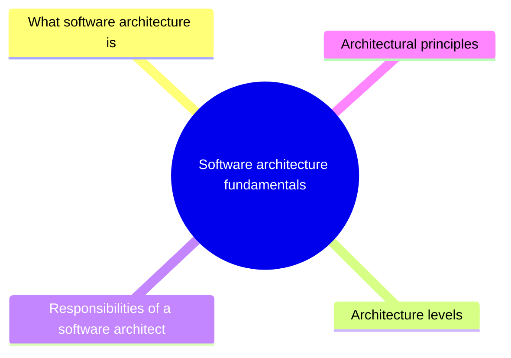

# Software architecture fundamentals

What software architecture is, why it matters, the levels at which architects work and the responsibilities of the role.

This section corresponds to topic 2.1 of the [SWEBOK Guide V4.0](https://www.computer.org/education/bodies-of-knowledge/software-engineering).

## Map

The map shows the notes and sections of this part of the library.

## Reading order

1. [What software architecture is](software-architecture.md): Software architecture is the set of fundamental structures of a software system and the design decisions that created them.
2. [Architecture levels](architecture-levels.md): Application architecture is the foundational level of architecture focused on the structure and behavior of individual applications.
3. [Responsibilities of a software architect](architect-responsibilities.md): A software architect makes and communicates the decisions that shape a system: technology and platform choices, development standards, decomposition into components and the handling of quality...

## Sections

- [Architectural principles](architectural-principles/README.md) (3 notes): Principles that guide how components, boundaries and dependencies are arranged so that an architecture stays easy to change.

## Planned topics

- Stakeholders and concerns
- Architecturally significant requirements
- Conway's law and socio-technical architecture
- Architecture and agility
