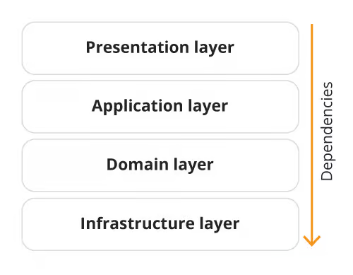
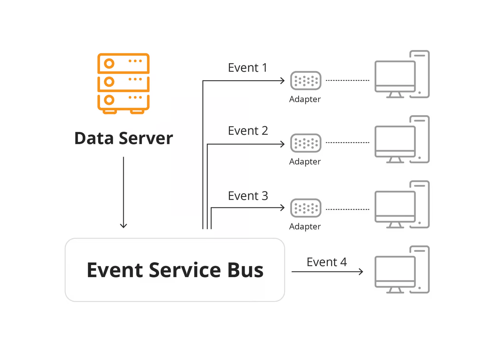
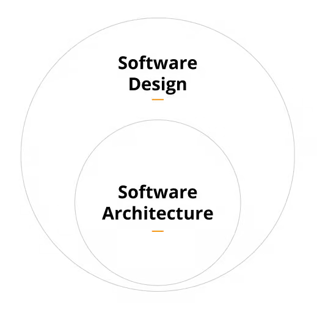

# What software architecture is

## Summary

Software architecture is the set of fundamental structures of a software system and the design decisions that created them. Architecture is decision making under trade offs: knowing why a decision was made matters as much as the decision. The note covers why architecture matters, how it differs from design and the common architectural patterns.

## Prerequisites

TODO: link the notes a reader should know first.

## Core concepts

### Definition

#### Key notes

1. **Architecting as decision-making**:
    - The structure and behavior of software systems are results of decisions, and understanding why decisions were made is as important as the final implementation.
    - Architectural decisions are compromises between alternatives, and knowing what was tried and rejected is often more valuable than knowing what worked.
2. **Active aevelopment is crucial for architects**:
    - Software architects should be developers to understand system forces and test hypotheses on how to meet quality attributes (QARs).
    - Architecting is about continuously exploring and experimenting to meet evolving requirements.
3. **Focus on quality attributes**:
    - Quality attributes like scalability, performance, security, and maintainability shape the system's longevity and should be a central focus for architects.
    - Teams often prioritize functional requirements, but good architecture addresses cross-cutting concerns like system-wide performance and supportability.
4. **Holistic ssystem vview**:
    - Architects must be able to see how decisions affect the entire system, not just individual components, especially in modular designs.
5. **System llifecycle kknowledge**:
    - Architects need to understand the complete lifecycle, including development, testing, deployment, maintenance, and modernization, to make sustainable decisions and limit technical debt.
6. **Balancing trade-offs**:
    - Architecture is about making trade-offs between conflicting QARs and constraints, requiring a deep understanding of the system and its needs.
7. **Continuous experimentation**:
    - Architecting modern applications involves exploration and hypothesis testing, as new challenges arise. Solutions evolve through experimentation, and architecture cannot be set upfront.
    - Teams should document architectural decisions, including alternatives considered, assumptions made, and the cost of reversing decisions.
8. **Documenting architectural decisions**:
    - Important documentation includes:
        - Reversibility costs.
        - Constraints or assumptions behind decisions.
        - How QARs were met, with links to test cases.
        - Rejected alternatives and rationale.
        - Known technical debt incurred from decisions.
9. **Technical debt awareness**:
    - Some decisions inevitably incur technical debt, and future developers should understand the reasons behind these choices to better handle them later.
10. **Leadership in architecting**:
    - Anyone on a team can and should contribute to architectural leadership, raising concerns, fostering discussions, and facilitating consensus on complex problems.
11. **Modern architecture as a continuous activity**:
    - architecture should be viewed not as static decisions made by detached committees but as an evolving, empirical process driven by developers.

### Importance

**The main purpose of software architecture is to represent and embody the design decisions of the system that is being built.**

Every software project will have a brief, and the software architecture is the first step to bringing that brief to life. **Some key functions of software architecture include:**

- It helps stakeholders visualise, understand, and analyse a system’s qualities.
- It focuses on the structure (rather than implementation).
- It can be used to anticipate expensive choices in a project before they’re made.
- It is used as the basis for making core decisions to ensure high-quality work.

Software architecture describes the development of software systems, including how their different components will work together.

1. **Functional requirements**:
    - This answers the question: What is the software supposed to do?
2. **Non-functional requirements**:
    - **Functionality**: This looks at the quality of the software’s features.
    - **Reliability**: It checks if the software works consistently.
    - **Usability**: This asks if the software is user-friendly.
    - **Efficiency**: Here, we see if the software uses resources well.
    - **Maintainability**: This considers how easy updating or fixing the software is.
    - **Scalability**: It determines if the software can handle more users or data as it grows.
3. **Restrictions**:
    - **Legal needs**: Some laws might affect how the software is built.
    - **Standards**: There are general rules or industry-specific ones that the software should follow.
    - **Cost**: There might be a budget limit for building the software.
    - **Time-to-market**: Sometimes, there’s a rush to release the software quickly.
    - **Talent**: The skills of the available team can affect the software’s design.

### Common software architecture patterns

When we create a new building, we have to make choices about which materials to use, what kind of foundation to build it on, which style to use and so on. Software architecture is no different. There are quite a number of ways that architectures can be structured and patterned, with some more popular than others.

#### Layered (N-tier) pattern architecture

This database-driven architecture is probably the most common approach as it is a great way to store information effectively in tables. It has been used for some of the biggest software frameworks like Express, Java EE, and Drupal.

In a layered approach, the data begins at the top layer and works its way down until it reaches the bottom (which is typically a database). **As it descends, each layer has a different task, focusing on the data and solving issues such as reformatting the values**.

##### Event-driven architecture

This agile, high-performance approach is ideal for programs that wait for events (like user input). It processes data only when needed through a central unit, which delegates to relevant modules. Unlike layered architecture, event-driven systems send data directly to the right location, making them efficient. They adapt well to complex environments and are easily scalable and extendable. However, testing requires independent modules; otherwise, a full system test is needed. Error handling is complex if multiple modules handle the same events.

##### Client-server architecture

In the client-server architecture style, end users, referred to as “clients,” request services from “servers,” which handle and process data. **This pattern is most commonly seen in web applications, where the browser acts as the client and communicates with the server to provide the necessary services.**

##### Microservices architecture

The microservices architecture is a technique that simplifies complex programs by dividing them into smaller services that can still communicate with each other. **Each service is designed to solve a specific business problem, such as payments or identification.**

##### Microkernel architecture

A kernel is like the brain of a software system, controlling everything the system does. **The microkernel design keeps this “brain” as small and straightforward as possible, dealing only with the most crucial tasks**. Other tasks, like managing files or connecting to devices, are handled by separate pieces outside this core. This way, if one piece has an issue, the central component remains unaffected.

In the microkernel design, these separate pieces communicate with the core brain using a method called “inter-process communication.” **This design makes adding, changing, or fixing parts easier without disturbing the entire system.** It’s like having a central control room focusing only on primary decisions while specialised departments handle detailed tasks.

##### Cloud-native architecture

Using a cloud-native design approach allows you to reap the benefits of cloud computing. **Applications built with this architecture are made of services that are loosely linked with each other, which makes each service scalable and reliable, making it possible to use them across multiple cloud environments.**

This results in high availability and flexibility. Adopting this method leads to better use of resources, shorter launch times, and better adaptability to changing workloads.

## Worked example

TODO: add a concrete, reproducible example with real values.

## Trade offs and when to use it

### Software architecture vs software design

**Software architecture is the foundational element of software design.** So what’s the difference between the two?

Software architecture and design in software engineering can be likened to conventional architecture and design of buildings. When designing physical structures, the architect creates the concept while the designer (or engineer) works out the specific details required to actually make the project happen.

**The architect is concerned with the ‘big picture’ questions of what the project is, how it will look, what its function is, and so on, whereas the designer/engineer is concerned with how to make the architect’s ideas work.** The software architecture is all done before any of the actual coding begins.

**Software architecture involves understanding and organising a system, all of its components, their interactions, the environment in which they operate, and the core principles which will be used to design the software.**

It is developed with the project’s mission or goal in mind and serves as the basis for the rest of the design project.

**Software design is all about how the software architecture can be implemented into the overall system.** This involves:

- Coding
- Using specific design patterns
- Choosing classes, interfaces, functions and responsibilities
- Working with specific components and modules

## Common mistakes

TODO: list frequent misunderstandings and failure modes, with the fix for each.

## Practice

TODO: add three to five questions, with answers at the bottom.

## Further reading

- Bass, L., Clements, P., Kazman, R. (2021). *Software Architecture in Practice, 4th Edition*. Addison-Wesley. Covers quality attributes, architectural tactics, documentation and evaluation of architectures.
- ISO/IEC/IEEE (2022). [*ISO/IEC/IEEE 42010:2022 Software, systems and enterprise: Architecture description*](https://www.iso.org/standard/74393.html). ISO. The standard that defines architecture descriptions, views, viewpoints and architecture frameworks.

TODO: check the content of this note against the sources above and record what was verified and when.
