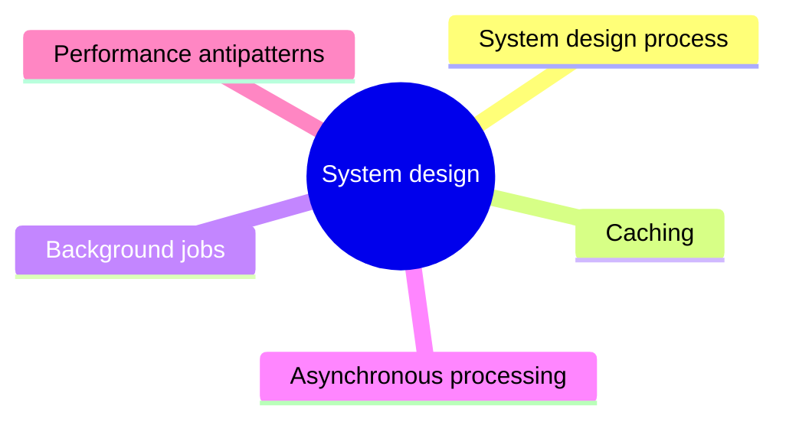

# System design

Building blocks used when designing a concrete system for a set of requirements: caching, background jobs, asynchronous processing and the performance antipatterns to avoid.

This is a catalog section: it groups a large body of related notes inside the knowledge area. It is not a separate SWEBOK topic.

## Map

The map shows the notes and sections of this part of the library.

## Reading order

1. [System design process](system-design.md): System design is the process of defining the elements of a system, as well as their interactions and relationships, in order to satisfy a set of specified requirements.
2. [Caching](caching.md): Caching is the process of storing frequently accessed data in a temporary storage location, called a cache, in order to quickly retrieve it without the need to query the original data source.
3. [Background jobs](background-jobs.md): Background jobs in system design refer to tasks that are executed in the background, independently of the main execution flow of the system.

## Sections

- [Asynchronous processing](asynchronous-processing/README.md) (6 notes): Moving work out of the request path with queues, and the techniques that keep asynchronous systems correct and stable.
- [Performance antipatterns](performance-antipatterns/README.md) (10 notes): Common design and implementation mistakes that make cloud applications slow or unstable under load, with ways to detect each one.

## Planned topics

- Load balancing
- Content delivery networks
- Rate limiting algorithms (token bucket, leaky bucket, sliding window)
- Back-of-the-envelope capacity estimation
- Data partitioning and replication strategies
