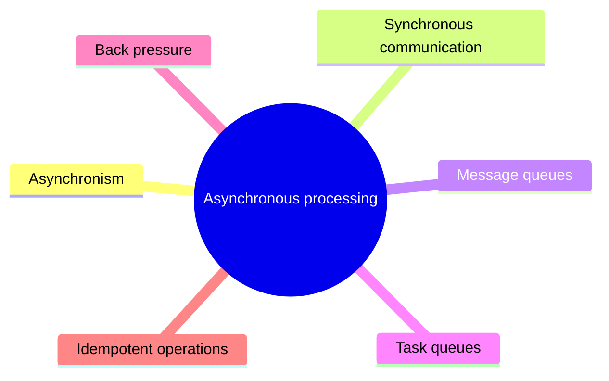

# Asynchronous processing

Moving work out of the request path with queues, and the techniques that keep asynchronous systems correct and stable.

This is a catalog section: it groups a large body of related notes inside the knowledge area. It is not a separate SWEBOK topic.

## Map

The map shows the notes and sections of this part of the library.

## Reading order

1. [Asynchronism](asynchronism.md): Asynchronous workflows help reduce request times for expensive operations that would otherwise be performed in-line.
2. [Synchronous communication](synchronous-communication.md): Synchronous communication in system design refers to a type of interaction where processes or components operate in lockstep with each other.
3. [Message queues](message-queues.md): A Message Queue is a form of communication and data transfer mechanism used in computer science and system design.
4. [Task queues](task-queues.md): Tasks queues receive tasks and their related data, runs them, then delivers their results.
5. [Back pressure](back-pressure.md): Back pressure is a way for an overloaded consumer to signal producers to slow down, instead of letting queues grow without bound.
6. [Idempotent operations](idempotent-operations.md): Idempotent operations are operations that can be applied multiple times without changing the result beyond the initial application.

## Planned topics

- Delivery semantics: at most once, at least once, exactly once
- Dead-letter queues
- Transactional outbox
- Event streaming logs
