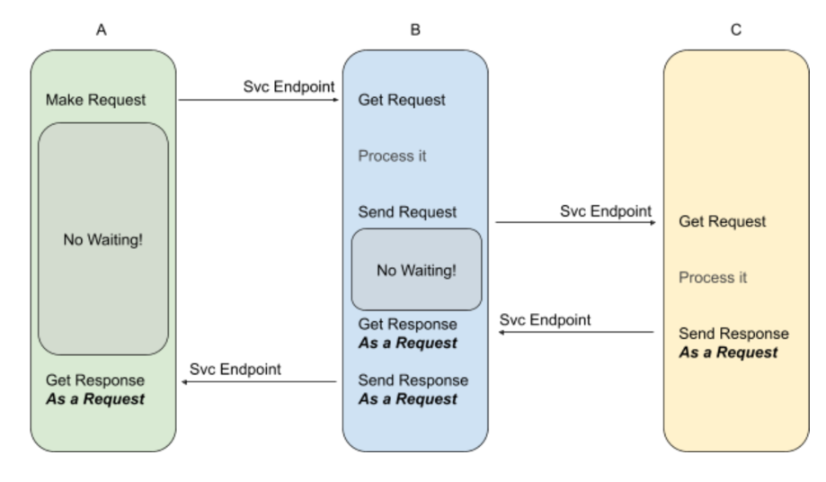

# Asynchronism

## Summary

Asynchronous workflows help reduce request times for expensive operations that would otherwise be performed in-line. They can also help by doing time-consuming work in advance, such as periodic aggregation of data.

## Prerequisites

TODO: link the notes a reader should know first.

## Core concepts

### Definition

Asynchronous workflows help reduce request times for expensive operations that would otherwise be performed in-line. They can also help by doing time-consuming work in advance, such as periodic aggregation of data.

#### Fundamental principle

In asynchronous design, the core principle is that there are only requests and no direct responses. Instead, what are traditionally considered responses are implemented as new requests. This results in a system where no component waits for a response after sending a request, making the architecture "fire and forget".

##### How it works

- **Client-Server Duality**: Every client also acts as a server by exposing endpoints where it can receive responses in the form of requests.
- **Callback URLs**: Requests contain callback URLs, informing where the response should be sent.
- **Statelessness**: Services remain more stateless since they cannot keep the request context in memory. The response must contain all necessary context for processing.

###### Synchronous vs asynchronous

- No waiting for responses; requests are sent and forgotten.
- Responses are treated as new requests sent to designated endpoints.
- Requires embedding context information within each request to ensure responses can be appropriately handled.

###### Handling context and fault tolerance

- **Context Propagation**: Information about the response target must be included in each request to maintain context.
- **Persistence and Order**: Requests must be stored persistently with status flags to handle retries and avoid work loss.
- **Fault Tolerance**: Each service must ensure fault tolerance by managing unfinished requests, avoiding duplication, and ensuring that work can be retried without loss.

###### Challenges

- **Complexity**: Each service needs to handle its own fault tolerance, adding significant complexity.
- **Coordination**: Services must adhere to agreed-upon communication contracts to maintain context.
- **Race Conditions**: Potential for race conditions when managing state and processing responses.

###### Outsourcing fault tolerance

- A fault-tolerant work management system can centralize fault tolerance, reducing the burden on individual microservices.
- Such systems can manage message delivery and ensure work is not lost or duplicated, aiding in system resilience and reliability.

By following these principles, asynchronous systems can achieve higher fault tolerance and better resource utilization, though at the cost of increased complexity and the need for robust coordination mechanisms.

## Worked example

TODO: add a concrete, reproducible example with real values.

## Trade offs and when to use it

TODO: describe benefits, costs, alternatives and when this is the wrong choice.

## Common mistakes

TODO: list frequent misunderstandings and failure modes, with the fix for each.

## Practice

TODO: add three to five questions, with answers at the bottom.

## Further reading

- Martin, D.. [*The System Design Primer*](https://github.com/donnemartin/system-design-primer). GitHub. A widely used open overview of system design building blocks such as asynchronism, queues, back pressure, caching and consistency.

TODO: check the content of this note against the sources above and record what was verified and when.
