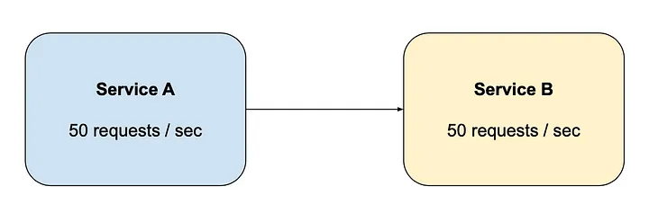
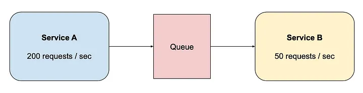
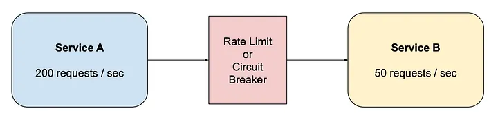
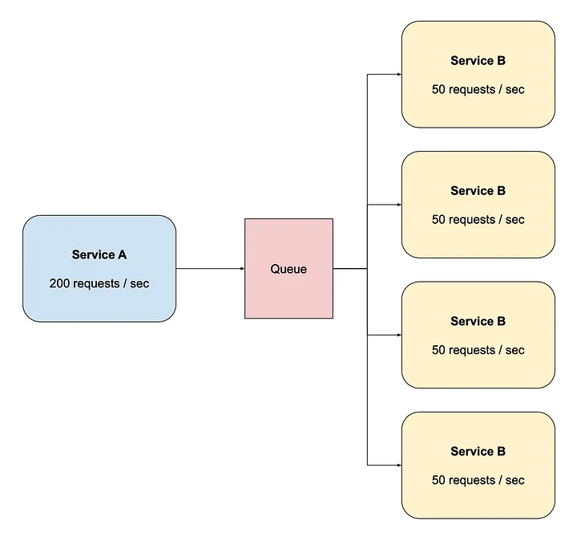

# Back pressure

## Summary

Back pressure is a way for an overloaded consumer to signal producers to slow down, instead of letting queues grow without bound. When a queue is full, the system rejects or delays new work (for example with HTTP 503 and a retry later) so that latency stays bounded for the work it does accept.

## Prerequisites

TODO: link the notes a reader should know first.

## Core concepts

### Definition

If queues start to grow significantly, the queue size can become larger than memory, resulting in cache misses, disk reads, and even slower performance. Back pressure can help by limiting the queue size, thereby maintaining a high throughput rate and good response times for jobs already in the queue. Once the queue fills up, clients get a server busy or HTTP 503 status code to try again later. Clients can retry the request at a later time, perhaps with exponential backoff.

Our system capacity depends on thread pool size and transaction processing time, often using queues to manage traffic spikes. If queues are limitless and arrivals exceed capacity, they'll grow indefinitely, adding latency and eventually crashing the system due to memory overload. To prevent this, we should implement "Back Pressure" to reroute excess requests while maintaining peak service rates.

### Strategies

Aside from scaling up your available compute resources, how you handle backpressure can pretty much be summed up with three possible options:

- **Control** the producer (slow down/speed up is decided by consumer)
- **Buffer** (accumulate incoming data spikes temporarily)
- **Drop** (sample a percentage of the incoming data)

> *Technically there’s a fourth option, ignore the backpressure, which, to be honest, is not a bad idea if the backpressure isn’t causing critical issues. Introducing more complexity comes at a cost too.*

#### Controlling

**Controlling** the producer is by far the best option. When it’s actually possible, it has no real tradeoffs to speak of, other than the overhead of the control mechanism itself. You don’t need to use excess memory buffering things on your end, and you don’t need to be lossy and drop data.

Unfortunately, of course controlling the producer isn’t always possible. The most clear case is when dealing with user input. Try as we might, it’s not easy to control our users!

#### Buffering

**Buffering** is what most people will reach for next. However, always keep in mind that buffering is dangerous if unbounded, meaning you don’t have a size or time limit to the buffer. Unbounded buffers are a common source of memory crashes in servers.

When used, always ask yourself: is it possible that the rate the buffer grows will ever exceed the rate it is drained for any appreciable amount of time?

In fact, some people advocate that buffers should **never** be left unbounded. I’m not that strict, but I would say that it is often better to start dropping than to fall over completely (run out of memory).

#### Dropping

**Dropping** is the last strategy, and as mentioned it’s often combined with buffering too. Sampling based on time is the most common, e.g. 10% of data per second.

#### Scale out

Scaling out works well with queues as you can add more consumers to the queue to process messages at the rate they are enqueued.

Adding 4 instances of Service B allows 200 req/s to be handled.

Service B can be auto-scaled based on queue depth, the number of messages in the queue yet to be processed, or CPU utilization.

## Worked example

TODO: add a concrete, reproducible example with real values.

## Trade offs and when to use it

TODO: describe benefits, costs, alternatives and when this is the wrong choice.

## Common mistakes

TODO: list frequent misunderstandings and failure modes, with the fix for each.

## Practice

TODO: add three to five questions, with answers at the bottom.

## Further reading

- Martin, D.. [*The System Design Primer*](https://github.com/donnemartin/system-design-primer). GitHub. A widely used open overview of system design building blocks such as asynchronism, queues, back pressure, caching and consistency.
- Reactive Streams initiative (2015). [*Reactive Streams*](https://www.reactive-streams.org/). The specification for asynchronous stream processing with non-blocking back pressure.

TODO: check the content of this note against the sources above and record what was verified and when.
