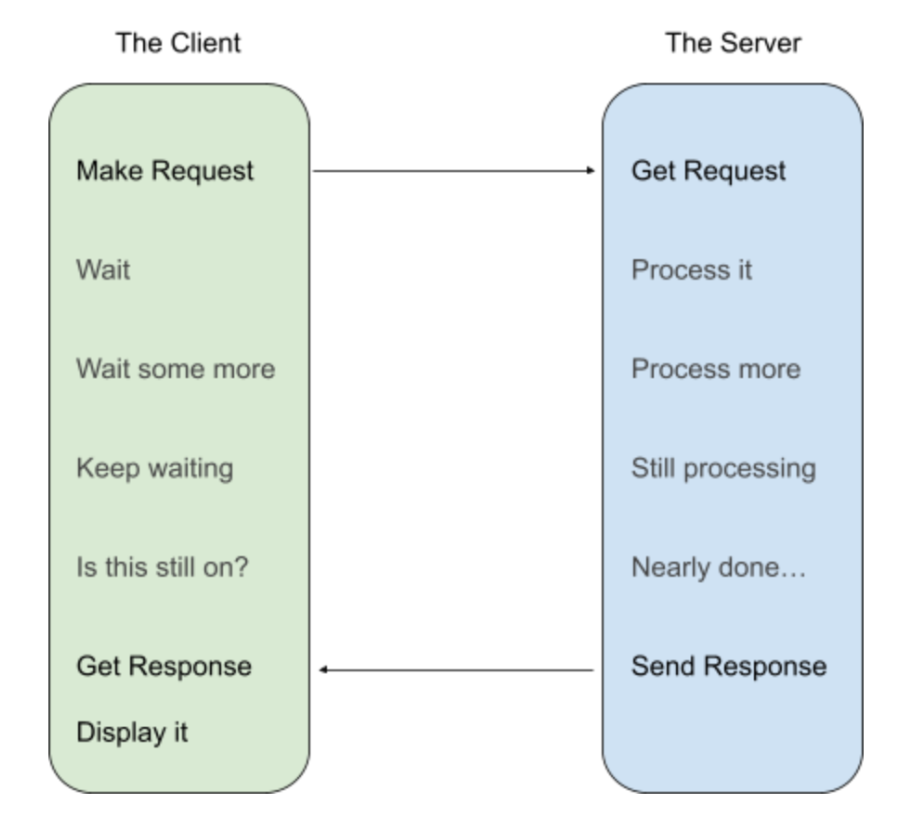

# Synchronous communication

## Summary

Synchronous communication in system design refers to a type of interaction where processes or components operate in lockstep with each other. This means that a process will wait for a response from another process before moving on to the next operation. Here's how it works:

## Prerequisites

TODO: link the notes a reader should know first.

## Core concepts

### Definition

Synchronous communication in system design refers to a type of interaction where processes or components operate in lockstep with each other. This means that a process will wait for a response from another process before moving on to the next operation. Here's how it works:

1. **Request and Wait**: One system sends a request to another and waits for a response.
2. **Real-Time Interaction**: The systems communicate in real-time, with minimal delay.
3. **Sequential Processing**: Tasks are processed in a strict order, one at a time.

In synchronous operations, if the responding system is slow or fails, the requesting system may become idle or get blocked, waiting for the response. This can lead to a bottleneck effect, where the speed of the entire system is limited by its slowest component.

However, synchronous communication ensures consistency and simplicity in the design as operations are easier to understand and predict when they follow a set sequence. It's often used in scenarios where immediate feedback is necessary, such as in transaction processing systems.

#### Basic concept

Synchronous communication is exemplified by web browsing: your browser sends a request and waits for a response before rendering a page. This wait time can result in delays if the response is slow. In microservice architectures, synchronous communication follows a similar pattern using HTTP: Service A sends a request to Service B and waits for a response.

##### Key principles

- **Request-Response Model**: In synchronous systems, the requester waits for the responder to complete the request.
- **Resource Usage**: Both requester and responder hold resources until the response is completed, keeping the connection open throughout the process.
- **Client-Server Roles**: In microservice systems, components can act both as clients and servers, unlike traditional web browsers which primarily act as clients.

###### Challenges

1. **Intermediate Service Failures**: If an intermediate service (Service B) fails while waiting for another service (Service C), the original requester (Service A) gets stuck. Retries can mitigate this but are not ideal.
2. **Client Failures**: If the client dies, it may forget its requests, leading to lost responses.
3. **Load Balancers**: Required for scaling, load balancers add complexity and require cooperation for health checks and announcements.

###### Latency

Unpredictable latency is a significant drawback. Service A becomes dependent on multiple latency paths, leading to compounded wait times. This variability requires increased timeouts, risking missed successful responses due to longer wait times.

## Worked example

TODO: add a concrete, reproducible example with real values.

## Trade offs and when to use it

### Pros and cons

#### Pros

Synchronous designs are nice for both the client (e.g., your browser) and the server (e.g., serving a website), because they are straightforward to reason about and to just make work. Code flows in a fairly linear way on both ends:

- The client: ask, wait, process response.
- The server: receive, process, send response.

Both sides are written in a way that is simple, direct, and understandable. Furthermore, it doesn’t require a lot of cooperation between services: information about the request is in the same scope (and thread of execution) as the received response. We will see later on that this is not the case for asynchronous designs.

#### Cons

1. **Resource Utilization**: Both client and server hold a connection open during the request, even if only one side is actively processing, leading to inefficient resource use.
2. **Failure Handling**: If the server crashes or is evicted, the client waits for a response that will never come, leading to timeouts and retries. Intermediate service failures (e.g., Service B failing while waiting for Service C) can cause the entire request chain to fail, resulting in loss of valuable processing.
3. **Retry Overhead**: Retries are necessary but add overhead, as the entire request process must be repeated from the beginning, increasing the load and potential for repeated failures.
4. **Client-Side Failures**: If the client fails after sending a request, the response is lost, wasting the server's processing effort.
5. **Complexity of Load Balancers**: Scaling requires load balancers, which introduce additional complexity and necessitate cooperation with health checks and startup/shutdown notifications.
6. **Latency Issues**: Unpredictable latency is a significant problem. The client is dependent on the slowest response in a chain of services, leading to compounded wait times. Increased timeouts are necessary to handle variability, but this increases the risk of missing successful responses due to extended waiting periods.
7. **System Complexity**: Multiple microservices interacting synchronously can make the system unwieldy and harder to manage, especially when considering the compounded variability and dependencies between services.

## Common mistakes

TODO: list frequent misunderstandings and failure modes, with the fix for each.

## Practice

TODO: add three to five questions, with answers at the bottom.

## Further reading

- Martin, D.. [*The System Design Primer*](https://github.com/donnemartin/system-design-primer). GitHub. A widely used open overview of system design building blocks such as asynchronism, queues, back pressure, caching and consistency.
- Hohpe, G., Woolf, B. (2003). [*Enterprise Integration Patterns*](https://www.enterpriseintegrationpatterns.com/). Addison-Wesley. The catalog of messaging patterns: channels, routers, translators and endpoints.

TODO: check the content of this note against the sources above and record what was verified and when.
