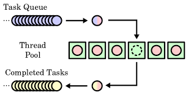
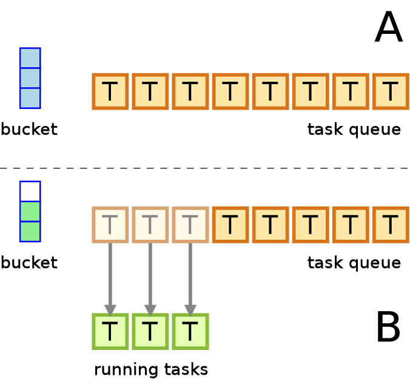

# Task queues

## Summary

Tasks queues receive tasks and their related data, runs them, then delivers their results. They can support scheduling and can be used to run computationally-intensive jobs in the background.

## Prerequisites

- [Message queues](message-queues.md)

## Core concepts

### Definition

Tasks queues receive tasks and their related data, runs them, then delivers their results. They can support scheduling and can be used to run computationally-intensive jobs in the background.

Task queues are critical components in asynchronous systems. They allow tasks to be queued and processed independently, decoupling the producer and consumer of tasks. This leads to improved scalability, fault tolerance, and resource utilization.

#### Key concepts

1. **Decoupling Producer and Consumer**:
    - **Producers**: Components that generate tasks and place them in the queue.
    - **Consumers**: Components that process tasks from the queue.
    - Producers and consumers operate independently, allowing each to scale as needed without impacting the other.
2. **Queue Management**:
    - **Message Brokers**: Middleware that handles the queue, such as RabbitMQ, Kafka, Redis, or NATS.
    - **Persistence**: Tasks can be stored persistently to ensure they are not lost in case of system failures.
3. **Task Handling**:
    - **Task Generation**: Tasks are created by producers and include all necessary context for processing.
    - **Task Retrieval**: Consumers retrieve tasks from the queue and process them asynchronously.
    - **Acknowledgment**: Once a task is processed, the consumer sends an acknowledgment to remove the task from the queue.

### Implementation strategies

#### Simple task queue

- A basic setup where tasks are placed in a queue and processed by available consumers.
- Suitable for straightforward use cases with predictable load.

#### Advanced task queue with workflows

- Tasks may trigger additional tasks, creating complex workflows.
- Requires careful management of task dependencies and context propagation.

#### Distributed task queues

- Tasks are distributed across multiple queues and consumers for high availability and load balancing.
- Involves additional complexity in managing queue synchronization and consistency.

### Handling fault tolerance

1. **Retry Mechanism**:
    - Implement retries with exponential backoff to handle transient failures.
    - Ensure idempotency of tasks to prevent issues from repeated execution.
2. **Dead Letter Queues**:
    - Tasks that fail after multiple retries are moved to a dead letter queue for further analysis.
    - Helps in identifying persistent issues and handling them appropriately.
3. **Checkpointing and State Management**:
    - Persist the state of long-running tasks to allow resumption from checkpoints in case of failures.
    - Use unique task identifiers and status flags to manage task states.

## Worked example

TODO: add a concrete, reproducible example with real values.

## Trade offs and when to use it

### Benefits

1. **Improved Scalability**:
    - Allows independent scaling of producers and consumers.
    - Facilitates load distribution across multiple consumers.
2. **Fault Tolerance**:
    - Persistent queues ensure tasks are not lost during failures.
    - Tasks can be retried if processing fails.
3. **Resource Optimization**:
    - Consumers can process tasks at their own pace, optimizing resource utilization.
    - Reduces idle time as consumers are only active when there are tasks to process.
4. **Increased Throughput**:
    - Asynchronous processing allows multiple tasks to be handled concurrently, increasing overall system throughput.

## Common mistakes

TODO: list frequent misunderstandings and failure modes, with the fix for each.

## Practice

TODO: add three to five questions, with answers at the bottom.

## Further reading

- Martin, D.. [*The System Design Primer*](https://github.com/donnemartin/system-design-primer). GitHub. A widely used open overview of system design building blocks such as asynchronism, queues, back pressure, caching and consistency.

TODO: check the content of this note against the sources above and record what was verified and when.
