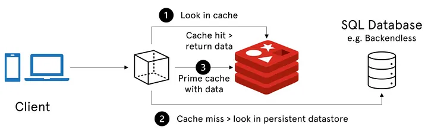
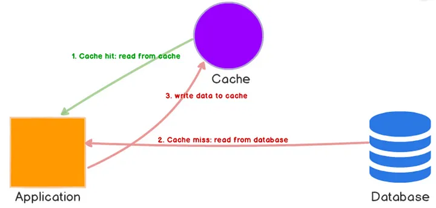
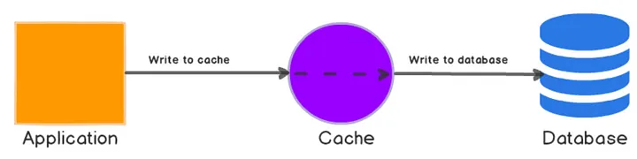
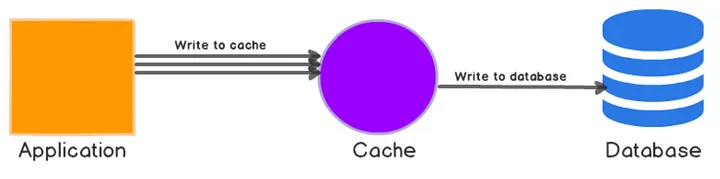
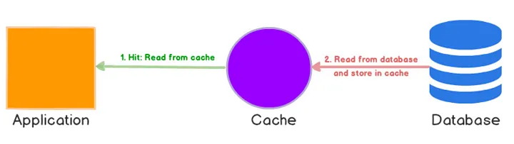

# Caching

## Summary

Caching is the process of storing frequently accessed data in a temporary storage location, called a cache, in order to quickly retrieve it without the need to query the original data source. This can improve the performance of an application by reducing the number of times a data source must be accessed.

## Prerequisites

TODO: link the notes a reader should know first.

## Core concepts

### Definition

Caching is the process of storing frequently accessed data in a temporary storage location, called a cache, in order to quickly retrieve it without the need to query the original data source. This can improve the performance of an application by reducing the number of times a data source must be accessed.

There are several caching strategies:

- Refresh Ahead
- Write-Behind
- Write-through
- Cache Aside

Also, you can have the cache in several places, examples include:

- Client Caching
- CDN Caching
- Web Server Caching
- Database Caching
- Application Caching

#### Benefits

One of the primary benefits of caching is improved application performance. By reducing the time it takes to access frequently requested content, web applications can respond to user requests more quickly, improving user experience and overall application performance. Additionally, caching can help reduce the load on web servers and other resources, which can help reduce costs and improve scalability.

Caching is suitable for frequently accessed data without negatively affecting data integrity or application functionality. Common use cases include serving static assets like images, stylesheets, and scripts, caching database queries or API responses, and caching pages or content for dynamic web apps. However, consider the caching strategy for each app and regularly refresh or invalidate cached content to avoid serving stale content.

### Layers

#### Client caching

Client-side caching stores frequently accessed data on the client’s device to improve application performance by reducing server requests. Web browsers cache web pages and resources, speeding up page loads for repeat visits. Mobile apps also use caching to enhance performance and minimize network data transfers. Advantages include reduced server load and faster access, but drawbacks involve possible stale data and resource consumption on the client’s device.

#### CDN caching

A Content Delivery Network (CDN) is a distributed network of servers that are strategically placed in various locations around the world. The main purpose of a CDN is to serve content to end-users with high availability and high performance by caching frequently accessed content on servers that are closer to the end-users.

When a user requests CDN-hosted content, the CDN checks its local cache. Cached content is delivered from the nearest server; uncached content is fetched from the origin, then stored locally for future use. This enhances website performance and availability by minimizing data travel, decreasing origin server load, and speeding up delivery.

#### Web server caching

Reverse proxies and caching systems like Varnish are crucial for efficiently delivering both static and dynamic web content. They enable direct user access to this content by storing it and serving it from the cache, reducing the need for constant backend server processing. Web servers complement this by caching requests internally, which allows them to provide quick responses without repeatedly querying application servers. This setup not only speeds up content delivery but also reduces server load, enhancing overall performance and user experience.

#### Database caching

Your database usually includes some level of caching in a default configuration, optimized for a generic use case. Tweaking these settings for specific usage patterns can further boost performance. it’s like having a quick-access memory for frequently used data in applications.

Reasons:

1. **Quick Access**: Imagine you’re looking up information in a big library (the database). Instead of going to the library every time you need the same book (data), you keep a copy of it on your desk (cache).
2. **Faster Retrieval**: When you need that book again, you first check your desk (cache). If it’s there, great! You get it right away without going to the library (database) again.
3. **Saving Time**: If the book isn’t on your desk (cache miss), you go to the library (database) to get it. But you make sure to put a copy on your desk for next time, so you won’t have to go to the library again if you need it soon.
4. **Different Types**: There are different ways to do this caching. You can cache the results of searches (like bookmarking), whole pieces of information (like keeping a paper copy), or even entire web pages (like saving a snapshot).
5. **Benefits**: By keeping frequently used data close by, you save time and reduce the strain on the library (database). It’s like having your most-used books right at your fingertips, making your work faster and more efficient.

#### Application caching

In-memory caches such as Memcached and Redis are key-value stores between your application and your data storage. Since the data is held in RAM, it is much faster than typical databases where data is stored on disk. RAM is more limited than disk, so cache invalidation algorithms such as least recently used (LRU) can help invalidate ‘cold’ entries and keep ‘hot’ data in RAM.

Redis has the following additional features:

- Persistence option
- Built-in data structures such as sorted sets and lists

Generally, you should try to avoid file-based caching, as it makes cloning and auto-scaling more difficult.

### Types

#### In-memory caching

In-memory caching stores data in RAM instead of on disk, boosting application performance by reducing database queries and disk reads. However, it's volatile and data can be lost upon system restarts.

**Example**

Imagine you have a web application that frequently needs to retrieve a list of products from a database. You could use in-memory caching to store the list of products in memory after the first retrieval, so that subsequent requests for the same data can be served directly from memory instead of hitting the database each time.

#### Distributed caching

Distributed caching stores data across multiple servers, enhancing availability and scalability. It distributes the workload, improving performance and reducing data loss risk, but managing consistency can be complex.

**Example:**

Let’s say you have a large-scale e-commerce website that serves customers all over the world. To ensure that product information is readily available to customers no matter where they are located, you could use a distributed caching solution such as Redis or Memcached to store product data in memory across multiple servers in different regions. This would help reduce latency and improve overall site performance.

#### Client-side caching

Client-side caching stores data on the client, like in browsers, to boost performance by reducing server requests. It's great for static resources but may cause stale data if not managed properly with appropriate policies and expiration times.

**Example**

Imagine you have a web application that frequently displays images or other static content that doesn’t change very often. You could use client-side caching to store the images in the user’s browser cache after the first retrieval, so that subsequent requests for the same content can be served directly from the cache instead of having to download the content again from the server. This can help improve page load times and reduce network traffic.

### Strategies

Since you can only store a limited amount of data in cache, you’ll need to determine which cache update strategy works best for your use case. Here is the list of cache update strategies:

- Cache-aside
- Write-through
- Write-behind
- Refresh-ahead

#### Cache-Aside

In this strategy, the application is responsible for managing the cache. When data is requested, the application checks the cache first. If the data is not in the cache, it is retrieved from the database and stored in the cache for future use. This strategy is simple and flexible, but it requires careful management of the cache to ensure that it remains up-to-date.

#### Write-Through

In this strategy, data is written to both the cache and the database at the same time. When data is updated, it is written to the cache and the database simultaneously. This ensures that the cache always contains up-to-date data, but it can slow down write operations.

**Disadvantages**

- When a new node is created due to failure or scaling, the new node will not cache entries until the entry is updated in the database. Cache-aside in conjunction with write through can mitigate this issue.
- Most data written might never be read, which can be minimized with a TTL.

#### Write-Behind

In this strategy, data is written to the cache first and then to the database at a later time. This allows write operations to be faster, but it can lead to data inconsistencies if the cache is not properly managed.

#### Read-Through

In this strategy, the cache is used as the primary data source. When data is requested, the cache is checked first. If the data is not in the cache, it is retrieved from the database and stored in the cache for future use. This strategy can be useful when the database is slow or when data is frequently read but rarely updated.

#### Refresh ahead

The refresh-ahead strategy is a method used in caching to keep the data fresh and up-to-date. In this approach, the system predicts when the cached data is likely to be needed again and automatically updates it before the user requests it. This helps in reducing the wait time for users because they get the latest data without any delay.

Here's how it works:

1. **Data Access Patterns**: The system keeps track of how often and when certain pieces of data are accessed.
2. **Predictive Refreshing**: Based on these patterns, the system can predict when the data will be needed next.
3. **Automatic Update**: Before that predicted time arrives, the system refreshes the data in the cache with the most current version from the original source.

**Example**

Imagine you have an online store with daily deals that change every morning at 9 AM. Most shoppers visit the site around this time to check the new deals.

- Without refresh-ahead: Shoppers who visit right at 9 AM might experience a delay as the server fetches the new deals from the database to update the cache.
- With refresh-ahead: The system notices the pattern that high traffic comes in at 9 AM. So, it automatically updates the cache with the new deals just before 9 AM. When shoppers visit, they instantly see the new deals without any wait.

**Disadvantage**

- Not accurately predicting which items are likely to be needed in the future can result in reduced performance than without refresh-ahead.

### Metrics

Here are some steps to measure the effectiveness of your caching strategy and choose the right cache expiration time:

#### Hit rate

The cache hit rate is the percentage of requests that are served from the cache instead of the backend data store. A high hit rate indicates that your caching strategy is effective in reducing the load on the backend data store. You can measure the hit rate by dividing the number of requests served from the cache by the total number of requests.

#### Eviction rate

The cache eviction rate is the percentage of cached items that are removed from the cache due to expiration or replacement. A high eviction rate can indicate that the cache expiration time is too short or the cache size is too small.

#### Data consistency

Data consistency is critical in caching. If the cached data becomes stale or outdated, it can lead to incorrect results and compromise the integrity of your application. You can monitor data consistency by comparing the cached data with the data in the backend data store.

#### Expiration time

The cache expiration time determines how long the cached data remains valid before it is evicted from the cache. A longer cache expiration time can improve the cache hit rate but increase the risk of stale data. A shorter cache expiration time can reduce the risk of stale data but decrease the cache hit rate. You can choose the right cache expiration time based on the data volatility and the acceptable level of data staleness.

### Replacement policies

#### Least recently used (LRU)

**Definition**: Replaces the cache entry that has not been used for the longest period of time.

**Explanation**: LRU assumes that the least recently used items are the least likely to be used in the near future. It keeps track of the order in which items are accessed.

**Example**: If the cache can hold three items and they are accessed in the order A, B, C, and then D needs to be added, LRU will evict A, assuming it is the least likely to be needed soon.

#### First-In, first-out (FIFO)

**Definition**: Replaces the oldest entry in the cache that was first brought in.

**Explanation**: FIFO maintains a queue of cache entries, evicting the entry that has been in the cache the longest.

**Example**: For a cache holding three items, if items A, B, and C are added in that order and then D needs to be added, FIFO will evict A since it was the first one in.

#### Least frequently used (LFU)

**Definition**: Replaces the entry that is used the least often.

**Explanation**: LFU keeps track of how often each entry is accessed. The entry with the fewest accesses is evicted when the cache is full.

**Example**: If items A (accessed 2 times), B (accessed 1 time), and C (accessed 3 times) are in the cache, and item D needs to be added, LFU will evict B as it has the lowest access count.

#### Random replacement (RR)

**Definition**: Replaces a randomly chosen entry in the cache.

**Explanation**: RR does not keep any usage history or frequency data. It selects an entry to evict at random, which can sometimes lead to suboptimal performance but is simple to implement.

**Example**: If items A, B, and C are in the cache and D needs to be added, RR will randomly choose between A, B, and C to evict one.

#### Most recently used (MRU)

**Definition**: Replaces the cache entry that was most recently accessed.

**Explanation**: MRU is often used in contexts where the most recently accessed items are less likely to be accessed again soon.

**Example**: For a cache holding three items, if items A, B, and C were accessed in that order and D needs to be added, MRU will evict C, assuming it is the least likely to be needed immediately again.

#### Adaptive replacement cache (ARC)

**Definition**: Balances between LRU and LFU by keeping track of both the recency and frequency of use.

**Explanation**: ARC dynamically adjusts the cache to provide a balance between LRU and LFU, ensuring that the most useful items are retained.

**Example**: If ARC detects that the current workload benefits more from LRU behavior, it will evict based on LRU; if the workload shifts, it can adapt to an LFU behavior.

#### Clock (second chance)

**Definition**: Provides a second chance for cache entries before they are evicted, arranged in a circular list (clock).

**Explanation**: Each entry has a reference bit. If the bit is 1 (indicating recent use), it is set to 0 and the entry gets a second chance. If the bit is 0, the entry is evicted.

**Example**: If the clock hand points to an entry with a reference bit of 1, it will set the bit to 0 and move to the next entry. This process continues until an entry with a reference bit of 0 is found and evicted.

## Worked example

TODO: add a concrete, reproducible example with real values.

## Trade offs and when to use it

TODO: describe benefits, costs, alternatives and when this is the wrong choice.

## Common mistakes

TODO: list frequent misunderstandings and failure modes, with the fix for each.

## Practice

TODO: add three to five questions, with answers at the bottom.

## Further reading

- Microsoft. [*Caching guidance*](https://learn.microsoft.com/en-us/azure/architecture/best-practices/caching). Microsoft Learn. Guidance on private and shared caches, expiration, consistency and cache seeding.
- Martin, D.. [*The System Design Primer*](https://github.com/donnemartin/system-design-primer). GitHub. A widely used open overview of system design building blocks such as asynchronism, queues, back pressure, caching and consistency.

TODO: check the content of this note against the sources above and record what was verified and when.
