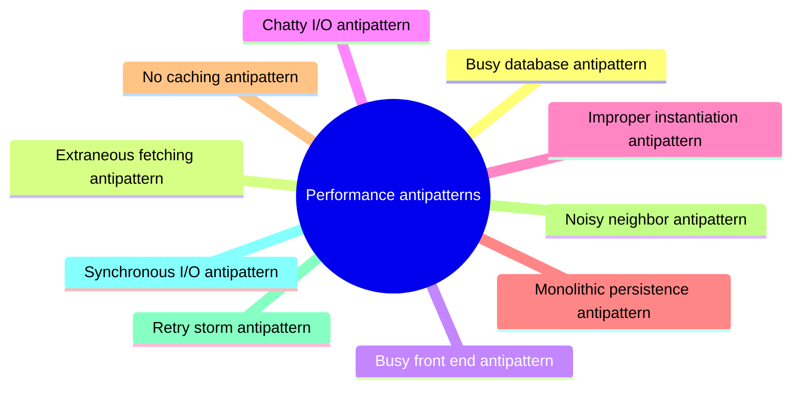

# Performance antipatterns

Common design and implementation mistakes that make cloud applications slow or unstable under load, with ways to detect each one.

This is a catalog section: it groups a large body of related notes inside the knowledge area. It is not a separate SWEBOK topic.

## Overview

Performance antipatterns in system design refer to common mistakes or suboptimal practices that can lead to poor performance in a system. These patterns can occur at different levels of the system and can be caused by a variety of factors such as poor design, lack of optimization, or lack of understanding of the workload.

Some of the examples of performance antipatterns include:

- **N+1 queries:** This occurs when a system makes multiple queries to a database to retrieve related data, instead of using a single query to retrieve all the necessary data.
- **Chatty interfaces:** This occurs when a system makes too many small and frequent requests to an external service or API, instead of making fewer, larger requests.
- **Unbounded data:** This occurs when a system retrieves or processes more data than is necessary for the task at hand, leading to increased resource usage and reduced performance.
- **Inefficient algorithms:** This occurs when a system uses an algorithm that is not well suited to the task at hand, leading to increased resource usage and reduced performance.

## Map

The map shows the notes and sections of this part of the library.

## Reading order

1. [Busy database antipattern](busy-database.md): A busy database in system design refers to a database that is handling a high volume of requests or transactions, this can occur when a system is experiencing high traffic or when a database is not...
2. [Extraneous fetching antipattern](extraneous-fetching.md): Extraneous fetching in system design refers to the practice of retrieving more data than is needed for a specific task or operation.
3. [Busy front end antipattern](busy-front-end.md): The busy front end antipattern occurs when resource intensive work runs on the same front end instances that serve user requests, for example on many background threads.
4. [Chatty I/O antipattern](chatty-io.md): The cumulative effect of a large number of I/O requests can have a significant impact on performance and responsiveness.
5. [Improper instantiation antipattern](improper-instantiation.md): Improper instantiation in system design refers to the practice of creating unnecessary instances of an object, class or service, which can lead to performance and scalability issues.
6. [Monolithic persistence antipattern](monolithic-persistence.md): Monolithic Persistence refers to the use of a single, monolithic database to store all of the data for an application or system.
7. [No caching antipattern](no-caching.md): No caching antipattern occurs when a cloud application that handles many concurrent requests, repeatedly fetches the same data.
8. [Noisy neighbor antipattern](noisy-neighbor.md): Noisy neighbor refers to a situation in which one or more components of a system are utilizing a disproportionate amount of shared resources, leading to resource contention and reduced performance...
9. [Retry storm antipattern](retry-storm.md): Retry Storm refers to a situation in which a large number of retries are triggered in a short period of time, leading to a significant increase in traffic and resource usage.
10. [Synchronous I/O antipattern](synchronous-io.md): Blocking the calling thread while I/O completes can reduce performance and affect vertical scalability.
