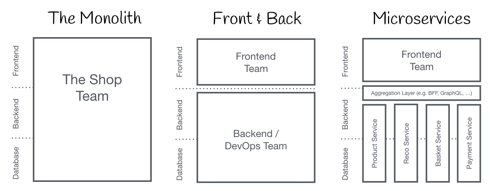
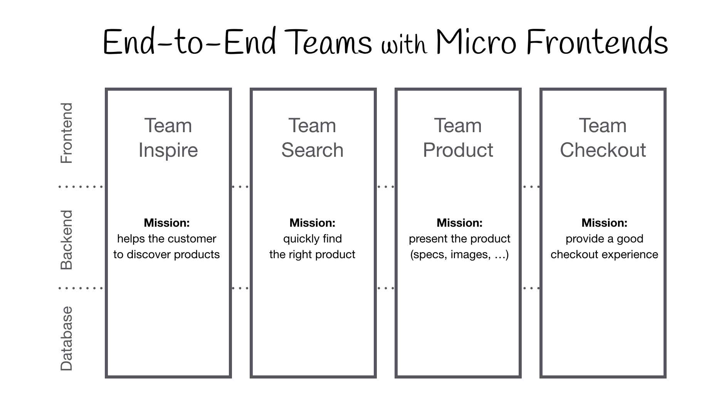

# Micro-frontends

## Summary

Microfrontends is an architectural style where independently deliverable frontend applications built by different teams using different technologies are composed into a greater whole. Simply, a Micro-Frontend is a portion of a webpage (not the entire page). There is a “Host” or a “Container” page in the Micro-Frontend Architecture page that can host one or more Micro-Frontends.

## Prerequisites

TODO: link the notes a reader should know first.

## Core concepts

### Definition

Microfrontends is an architectural style where independently deliverable frontend applications built by different teams using different technologies are composed into a greater whole. Simply, a Micro-Frontend is a portion of a webpage (not the entire page). There is a “Host” or a “Container” page in the Micro-Frontend Architecture page that can host one or more Micro-Frontends.

The term **Micro Frontends** emerged in ThoughtWorks Technology Radar in 2016, extending microservices concepts to the frontend. The trend is to build feature-rich single-page apps on microservice architecture, but the frontend often becomes a difficult-to-maintain monolith. Micro Frontends view a web app as a **composition of features** owned by **independent teams**, each with a specific business area or mission. Teams are **cross-functional**, developing features **end-to-end**. This concept is similar to Self-contained Systems and was previously known as Frontend Integration for Verticalised Systems, but Micro Frontends is a more user-friendly term.

### Core ideas

- **Be Technology Agnostic:** Each team should be able to choose and upgrade their stack without having to coordinate with other teams.
- **Isolate Team Code:** Don’t share a runtime, even if all teams use the same framework. Build independent apps that are self contained. Don’t rely on shared state or global variables.
- **Establish Team Prefixes:** Agree on naming conventions where isolation is not possible yet. Namespace CSS, Events, Local Storage and Cookies to avoid collisions and clarify ownership.
- **Favor Native Browser Features over Custom APIs:** Use Browser Events for communication instead of building a global PubSub system. If you really have to build a cross-team API, try keeping it as simple as possible.
- **Build a Resilient Site:** Your feature should be useful, even if JavaScript failed or hasn’t executed yet. Use Universal Rendering and Progressive Enhancement to improve perceived performance.

## Worked example

TODO: add a concrete, reproducible example with real values.

## Trade offs and when to use it

TODO: describe benefits, costs, alternatives and when this is the wrong choice.

## Common mistakes

TODO: list frequent misunderstandings and failure modes, with the fix for each.

## Practice

TODO: add three to five questions, with answers at the bottom.

## Further reading

- Geers, M.. [*Micro Frontends: extending the microservice idea to frontend development*](https://micro-frontends.org/). The site that describes the core ideas of micro-frontends and integration techniques in the browser.
- Jackson, C. (2019). [*Micro Frontends*](https://martinfowler.com/articles/micro-frontends.html). martinfowler.com. A detailed article on benefits, integration approaches and downsides of micro-frontends.

TODO: check the content of this note against the sources above and record what was verified and when.
