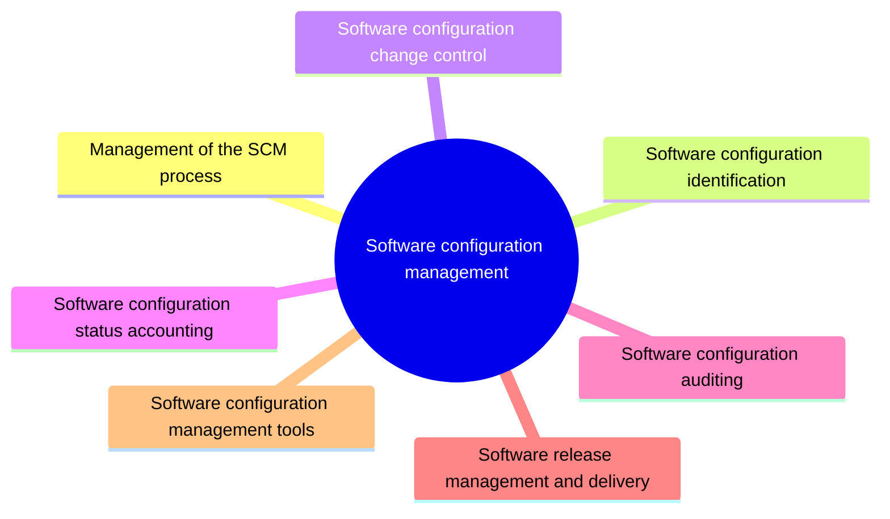

# Software configuration management

Software configuration management identifies the configuration of a system at points in time, controls changes to it and keeps its integrity and traceability across the life cycle. This knowledge area covers the SCM process, identification, change control, status accounting, auditing, release management and tools.

This knowledge area follows Chapter 8 of the [SWEBOK Guide V4.0](https://www.computer.org/education/bodies-of-knowledge/software-engineering) (IEEE Computer Society, 2024). Its sections are the topics of that chapter, in the same order.

## Map

The map shows the sections of this part of the library.

## Topics

- [Management of the SCM process](process-management/README.md) (planned): Planning and controlling configuration management itself: organizational context, constraints, the SCM plan and its surveillance.
- [Software configuration identification](configuration-identification/README.md) (planned): Identifying the items to control, their relations, versions and baselines.
- [Software configuration change control](change-control/README.md) (planned): Requesting, evaluating, approving and implementing changes to configuration items.
- [Software configuration status accounting](status-accounting/README.md) (planned): Recording and reporting the status of configuration items and changes.
- [Software configuration auditing](auditing/README.md) (planned): Checking that the delivered configuration matches its specification and its records.
- [Software release management and delivery](release-management-and-delivery/README.md) (1 note): Building, versioning and releasing software so that each release is identified and reproducible.
- [Software configuration management tools](tools/README.md) (planned): Version control systems, build servers and artifact repositories.
