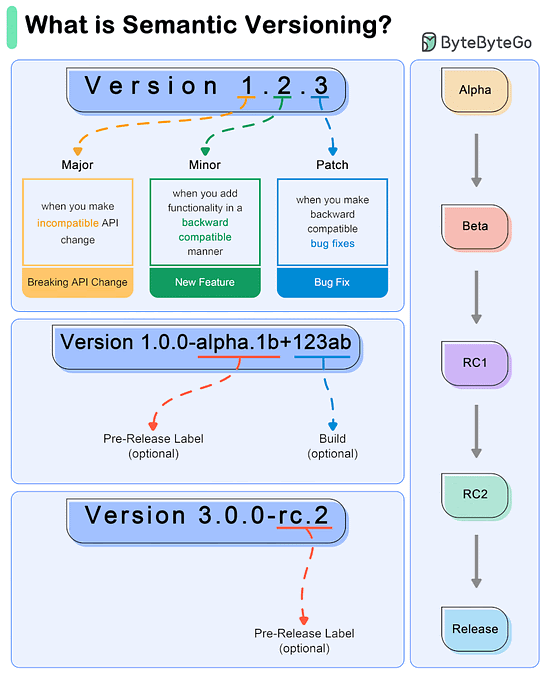

# Software versioning

## Summary

Versioning in software refers to the process of assigning unique version numbers to different stages of software development. This helps in tracking and managing changes to the software over time.

## Prerequisites

TODO: link the notes a reader should know first.

## Core concepts

### Definition

Versioning in software refers to the process of assigning unique version numbers to different stages of software development. This helps in tracking and managing changes to the software over time.

#### Usage

- **Track Changes:** It allows developers to keep track of what changes have been made, when they were made, and by whom.
- **Collaboration:** Multiple team members can work on the same project without overwriting each other's work.
- **Revert Changes:** If a new update causes issues, developers can roll back to a previous version.
- **Release Management:** It helps in managing releases by distinguishing between different stages like development, testing, and production.

##### Importance

- **Organization:** Keeps the codebase organized and manageable.
- **Accountability:** Maintains a history of changes, fostering accountability among team members.
- **Backup:** Acts as a backup mechanism for the software's source code.
- **Progress Tracking:** Allows teams to measure progress over the course of a project.
- **Compatibility:** Ensures compatibility with other systems by specifying which versions are compatible.

#### Semantic

Semantic Versioning (SemVer) is a versioning scheme for software that aims to convey meaning about the underlying changes in a release.

SemVer uses a three-part version number: MAJOR.MINOR.PATCH.

- MAJOR version: Incremented when there are incompatible API changes.
- MINOR version: Incremented when functionality is added in a backward-compatible manner.
- PATCH version: Incremented when backward-compatible bug fixes are made.

## Worked example

TODO: add a concrete, reproducible example with real values.

## Trade offs and when to use it

TODO: describe benefits, costs, alternatives and when this is the wrong choice.

## Common mistakes

TODO: list frequent misunderstandings and failure modes, with the fix for each.

## Practice

TODO: add three to five questions, with answers at the bottom.

## Further reading

- Preston-Werner, T.. [*Semantic Versioning 2.0.0*](https://semver.org/). The specification of MAJOR.MINOR.PATCH versions and their precedence rules.

TODO: check the content of this note against the sources above and record what was verified and when.
