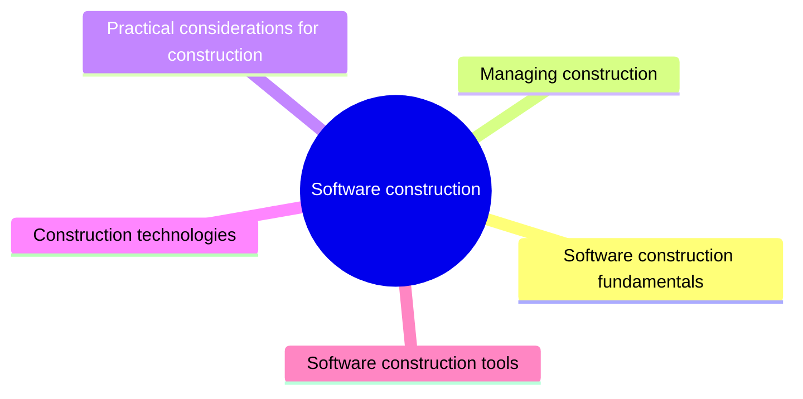

# Software construction

Software construction is the detailed creation of working software through coding, verification, unit testing, integration and debugging. This knowledge area covers construction fundamentals, its management, practical coding considerations, technologies and tools.

This knowledge area follows Chapter 4 of the [SWEBOK Guide V4.0](https://www.computer.org/education/bodies-of-knowledge/software-engineering) (IEEE Computer Society, 2024). Its sections are the topics of that chapter, in the same order.

## Map

The map shows the sections of this part of the library.

## Topics

- [Software construction fundamentals](fundamentals/README.md) (1 note): The goals that drive construction: minimizing complexity, anticipating and constructing for change, reuse, verification and standards.
- [Managing construction](managing-construction/README.md) (planned): How construction is planned and measured inside different life cycle models.
- [Practical considerations for construction](practical-considerations/README.md) (2 notes): Everyday construction practice: writing readable code, building cloud-ready applications, integration and debugging.
- [Construction technologies](construction-technologies/README.md) (1 note): Technologies used while building software: APIs, middleware, distributed runtimes, concurrency primitives and platform standards.
- [Software construction tools](tools/README.md) (planned): Tools that support construction: development environments, build systems, unit testing frameworks and profilers.

## Related elsewhere in the library

- [Design principles](../software-design/fundamentals/design-principles/README.md): Design principles that guide everyday coding decisions.
