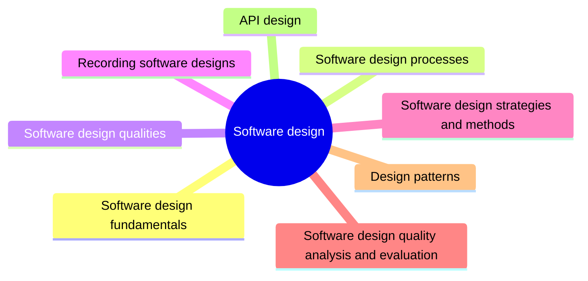

# Software design

Software design turns requirements and architecture into a description of components, interfaces and data detailed enough to be built. This knowledge area covers design principles, design strategies such as domain-driven design, and catalogs of design patterns and API styles.

This knowledge area follows Chapter 3 of the [SWEBOK Guide V4.0](https://www.computer.org/education/bodies-of-knowledge/software-engineering) (IEEE Computer Society, 2024). Its sections are the topics of that chapter, in the same order.

## Map

The map shows the sections of this part of the library.

## Topics

- [Software design fundamentals](fundamentals/README.md) (10 notes): The basic ideas of design: abstraction, coupling and cohesion, decomposition, encapsulation and the signs that a design is decaying.
- [Software design processes](processes/README.md) (planned): How design work is organized: high level and detailed design, and how design fits into iterative development.
- [Software design qualities](qualities/README.md) (planned): Qualities a design must address beyond functionality: concurrency, events, distribution, errors, interaction and persistence.
- [Recording software designs](recording-designs/README.md) (planned): How a design is captured so that others can understand and review it, from sketches to formal models.
- [Software design strategies and methods](strategies-and-methods/README.md) (1 note): General strategies and complete methods for producing a design, such as object-oriented design and domain-driven design.
- [Software design quality analysis and evaluation](quality-analysis-and-evaluation/README.md) (planned): How the quality of a design is reviewed and measured before and after it is implemented.
- [Design patterns](design-patterns/README.md) (33 notes): Named, reusable solutions to recurring design problems at the level of classes and objects, grouped into creational, structural, behavioral, enterprise and presentation patterns.
- [API design](api-design/README.md) (4 notes): Styles and protocols for interfaces between services: REST, GraphQL, RPC and gRPC, and the trade offs between them.
