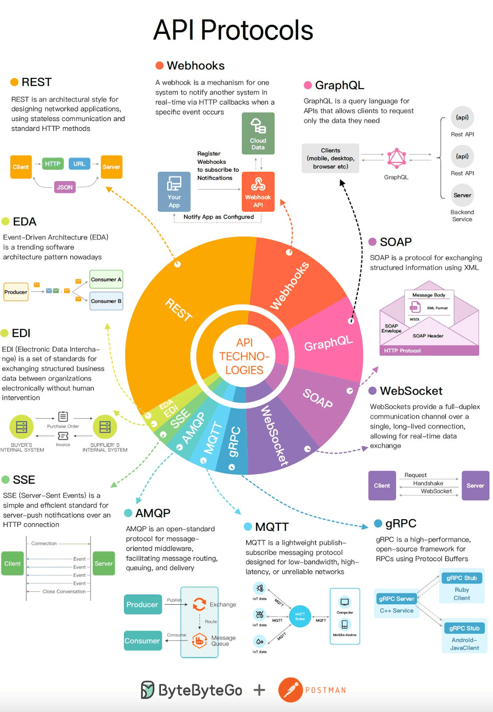
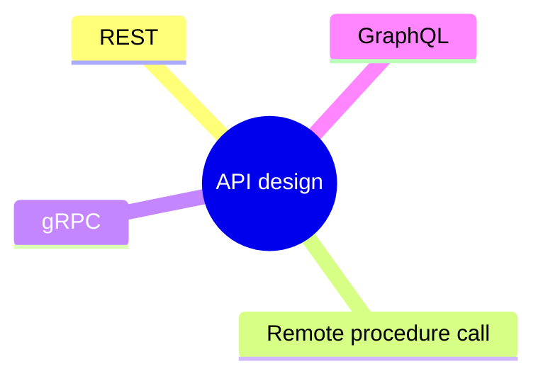

# API design

Styles and protocols for interfaces between services: REST, GraphQL, RPC and gRPC, and the trade offs between them.

This is a catalog section: it groups a large body of related notes inside the knowledge area. It is not a separate SWEBOK topic.

## Overview

### API protocols overview

## Map

The map shows the notes and sections of this part of the library.

## Reading order

1. [REST](rest.md): REST is an architectural style enforcing a client/server model where the client acts on a set of resources managed by the server.
2. [Remote procedure call (RPC)](rpc.md): In an RPC, a client causes a procedure to execute on a different address space, usually a remote server.
3. [gRPC](grpc.md): gRPC is a robust open-source RPC (Remote Procedure Call) framework used to build scalable and fast APIs.
4. [GraphQL](graphql.md): GraphQL is a query language and runtime for building APIs.

## Planned topics

- API versioning strategies
- Pagination, filtering and sorting
- Error formats (RFC 9457 problem details)
- OpenAPI and contract-first design
- Webhooks
- WebSockets and server-sent events
- Idempotency keys in APIs
