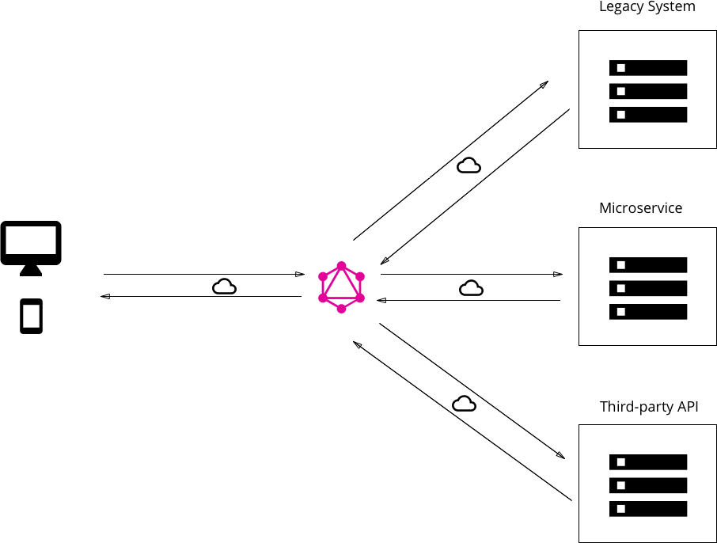
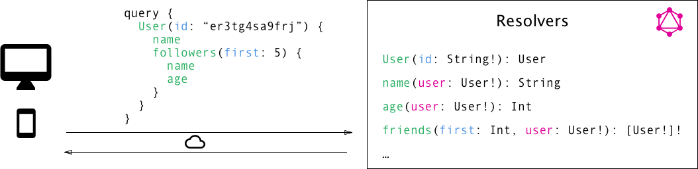

# GraphQL

## Summary

GraphQL is a query language and runtime for building APIs. It allows clients to define the structure of the data they need and the server will return exactly that. This is in contrast to traditional REST APIs, where the server exposes a fixed set of endpoints and the client must work with the data as it is returned.

## Prerequisites

TODO: link the notes a reader should know first.

## Core concepts

### Definition

GraphQL is a query language and runtime for building APIs. It allows clients to define the structure of the data they need and the server will return exactly that. This is in contrast to traditional REST APIs, where the server exposes a fixed set of endpoints and the client must work with the data as it is returned.

GraphQL is designed to make APIs fast, flexible, and developer-friendly. It can even be deployed within an integrated development environment (IDE) known as GraphiQL. As an alternative to REST, GraphQL lets developers construct requests that pull data from multiple data sources in a single API call.

Additionally, GraphQL gives API maintainers the flexibility to add or deprecate fields without impacting existing queries. Developers can build APIs with whatever methods they prefer, and the GraphQL specification will ensure they function in predictable ways to clients.

#### Advantages

- A GraphQL schema sets a single source of truth in a GraphQL application. It offers an organization a way to federate its entire API.
- GraphQL calls are handled in a single round trip. Clients get what they request with no overfetching.
- Strongly defined data types reduce miscommunication between the client and the server.
- GraphQL is introspective. A client can request a list of data types available. This is ideal for auto-generating documentation.
- GraphQL allows an application API to evolve without breaking existing queries.
- Many open source GraphQL extensions are available to offer features not available with REST APIs.
- GraphQL does not dictate a specific application architecture. It can be introduced on top of an existing REST API and can work with existing API management tools.

#### Disadvantages

- GraphQL presents a learning curve for developers familiar with REST APIs.
- GraphQL shifts much of the work of a data query to the server side, which adds complexity for server developers.
- Depending on how it is implemented, GraphQL might require different API management strategies than REST APIs, particularly when considering rate limits and pricing.
- Caching is more complex than with REST.
- API maintainers have the additional task of writing maintainable GraphQL schema.

### How it works

API developers use GraphQL to create a **schema** to describe all the possible data that clients can query through that service.

A GraphQL schema is made up of object types, which define which kind of object you can request and what fields it has.

As **queries** come in, GraphQL validates the queries against the schema. GraphQL then executes the validated queries.

The API developer attaches each field in a schema to a function called a **resolver**. During execution, the resolver is called to produce the value.

Apart from defining and validating syntax for API queries (outlined in the [graphql-spec](https://github.com/graphql/graphql-spec) repository), GraphQL leaves most other decisions to the API designer. GraphQL does not provide any direction for how to store data or what programming language to use. GraphQL offers no requirements for the network, authorization, or pagination.

From the point of view of the client, the most common GraphQL operations are likely to be **queries** and **mutations**. If we were to think about them in terms of the *create, read, update and delete* (CRUD) model, a query would be equivalent to *read*. All the others (*create, update,* and *delete*) are handled by mutations.

## Worked example

TODO: add a concrete, reproducible example with real values.

## Trade offs and when to use it

TODO: describe benefits, costs, alternatives and when this is the wrong choice.

## Common mistakes

TODO: list frequent misunderstandings and failure modes, with the fix for each.

## Practice

TODO: add three to five questions, with answers at the bottom.

## Further reading

- GraphQL Foundation. [*GraphQL Specification*](https://spec.graphql.org/). The language and execution specification of GraphQL maintained by the GraphQL Foundation.

TODO: check the content of this note against the sources above and record what was verified and when.
