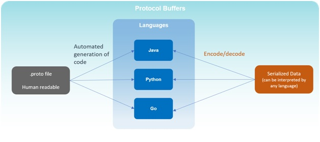
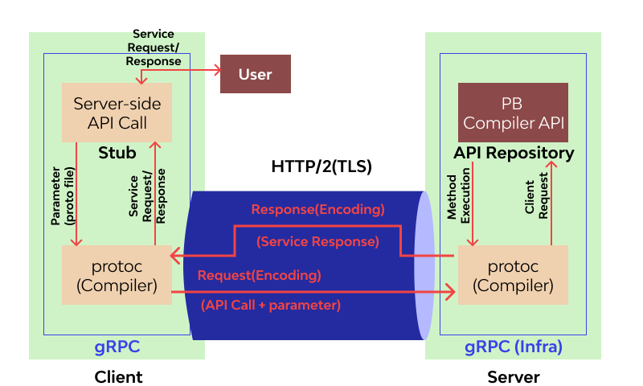

# gRPC

## Summary

gRPC is a robust open-source RPC (Remote Procedure Call) framework used to build scalable and fast APIs. It allows the client and server applications to communicate transparently and develop connected systems. Many leading tech firms have adopted gRPC, such as Google, Netflix, Square, IBM, Cisco, & Dropbox. This framework relies on HTTP/2, protocol buffers, and other modern technology stacks to ensure maximum API security, performance, and scalability.

## Prerequisites

- [Hypertext Transfer Protocol (HTTP)](../../computing-foundations/computer-networks-and-communications/http.md)

## Core concepts

### Definition

gRPC is a robust open-source RPC (Remote Procedure Call) framework used to build scalable and fast APIs. It allows the client and server applications to communicate transparently and develop connected systems. Many leading tech firms have adopted gRPC, such as Google, Netflix, Square, IBM, Cisco, & Dropbox. This framework relies on HTTP/2, protocol buffers, and other modern technology stacks to ensure maximum API security, performance, and scalability.

#### Concept

Protobuf is Google's serialization protocol used by gRPC for defining services and generating client libraries. Version proto3 offers the latest features with ease of use.

gRPC services are defined in proto files. The Protobuf compiler, protoc, generates code that uses the .proto file schema for message serialization/deserialization. Messages are then exchanged between clients and servers.

Protobuf outperforms JSON and XML in parsing efficiency, using less CPU and producing smaller, faster messages, beneficial for slower CPUs like mobile devices.

Streaming is another key concept of gRPC, where many processes can take place in a single request. The multiplexing capability (sending multiple responses or receiving multiple requests together over a single TCP connection) of HTTP/2 makes it possible. Here are the main types of streaming:

- Server-streaming RPCs, The client sends a single request to the server and receives back a stream of data sequences. The sequence is preserved, and server messages continuously stream until there are no messages left.
- Client-streaming RPCs, The client sends a stream of data sequences to the server, which then processes and returns a single response to the client. Once again, gRPC guarantees message sequencing within an independent RPC call.
- Bidirectional-streaming RPCs, It is two-way streaming where both client and server sends a sequence of messages to each other. Both streams operate independently; thus, they can transmit messages in any sequence. The sequence of messages in each stream is preserved.

#### Advantages

**Performance**

BgRPC is up to 10x faster than REST+JSON, using Protobuf and HTTP/2 for quick serialization and compact messages. HTTP/2 improves performance with server push, multiplexing, and advanced header compression, reducing latency and speeding up loading.

**Streaming**

gRPC supports client- or server-side streaming semantics, which are already incorporated in the service definition. This makes it much simpler to build streaming services or clients. A gRPC service supports different streaming combinations through HTTP/2:

- Unary (no streaming)
- Client-to-server streaming
- Server-to-client streaming
- Bi-directional streaming

**Code Generation**

gRPC uses protoc to generate client/server code from .proto files, creating server skeletons and client stubs, saving development time.

**Interoperability**

gRPC supports many languages like Java, JavaScript, Ruby, and others, offering cross-platform support with Protobuf and efficient code generation.

**Security**

The use of HTTP/2 over the TLS end-to-end encryption connection in gRPC ensures API security. gRPC encourages the use of SSL/TLS to authenticate and encrypts data exchanged between the client and server.

**Usability and Productivity**

As gRPC is an all-in-one RPC solution, it works seamlessly across various languages and platforms. Additionally, it features excellent tooling, with much of the required boilerplate code generated automatically. This saves considerable time and enables developers to focus more on business logic.

**Built-in Commodity Features**

gRPC provides built-in support for commodity features, such as metadata exchange, encryption, authentication, deadline/timeouts and cancellations, interceptors, load balancing, service discovery, and so much more.

#### Disadvantages

**Limited Browser Support**

As gRPC heavily uses HTTP/2, it is impossible to call a gRPC service from a web browser directly. No modern browser provides the control needed over web requests to support a gRPC client. Therefore, a proxy layer and gRPC-web are required to perform conversions between HTTP/1.1 and HTTP/2.

**Non-human Readable Format**

Protobuf compresses gRPC messages into a non-human readable format. This compiler needs the message’s interface description in the file to deserialize correctly. So, developers need additional tools like the gRPC command-line tool to analyze Protobuf payloads on the wire, write manual requests, and perform debugging.

**No Edge Caching**

While HTTP supports mediators for edge caching, gRPC calls use the POST method, which is a threat to API-security. The responses can’t be cached through intermediaries. Moreover, the gRPC specification doesn’t make any provisions and even indicates the wish for cache semantics between server and client.

**Steeper Learning Curve**

Many teams find gRPC challenging to learn, get familiar with Protobuf, and look for tools to deal with HTTP/2 friction. It is a common reason why users prefer to rely on REST for as long as possible.

### How it works

In the following gRPC architecture diagram, we have the gRPC client and server sides. In gRPC, every client service includes a stub (auto-generated files), similar to an interface containing the current remote procedures. The gRPC client makes the local procedure call to the stub with parameters to be sent to the server. The client stub then serializes the parameters with the marshaling process using Protobuf and forwards the request to the local client-time library in the local machine.

## Worked example

TODO: add a concrete, reproducible example with real values.

## Trade offs and when to use it

TODO: describe benefits, costs, alternatives and when this is the wrong choice.

## Common mistakes

TODO: list frequent misunderstandings and failure modes, with the fix for each.

## Practice

TODO: add three to five questions, with answers at the bottom.

## Further reading

- gRPC Authors. [*Introduction to gRPC*](https://grpc.io/docs/what-is-grpc/introduction/). Official overview of gRPC services, protocol buffers and the supported call types.

TODO: check the content of this note against the sources above and record what was verified and when.
