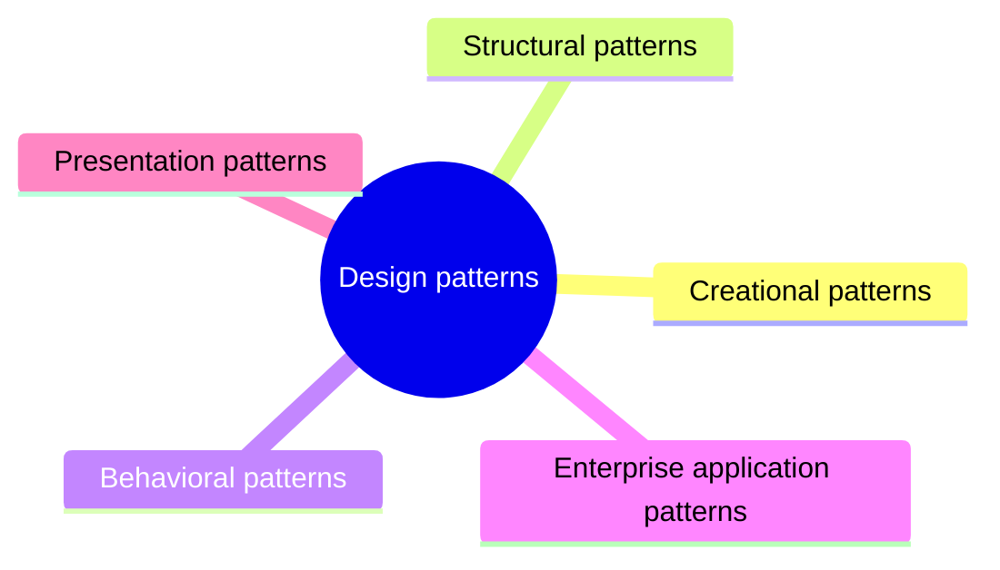

# Design patterns

Named, reusable solutions to recurring design problems at the level of classes and objects, grouped into creational, structural, behavioral, enterprise and presentation patterns.

This is a catalog section: it groups a large body of related notes inside the knowledge area. It is not a separate SWEBOK topic.

## Overview

Design patterns are general solutions to common problems that arise in software development. They provide a way to describe and communicate proven solutions to common design problems and they provide a common vocabulary for design. They are not specific to any particular programming language or technology, but rather describe the problem and the solution in a way that can be applied to many different contexts.

There are several different types of design patterns, including:

- Creational patterns
- Structural patterns
- Behavioral patterns
- Architectural patterns

## Map

The map shows the sections of this part of the library.

## Sections

- [Creational patterns](creational/README.md) (5 notes): Patterns that control how objects are created, so that client code does not depend on concrete classes.
- [Structural patterns](structural/README.md) (7 notes): Patterns that compose classes and objects into larger structures while keeping them flexible.
- [Behavioral patterns](behavioral/README.md) (10 notes): Patterns that assign responsibilities between objects and define how they communicate.
- [Enterprise application patterns](enterprise/README.md) (8 notes): Patterns for organizing domain logic, data access and data transfer in business applications.
- [Presentation patterns](presentation/README.md) (3 notes): Patterns that separate the user interface from the logic and data behind it.
