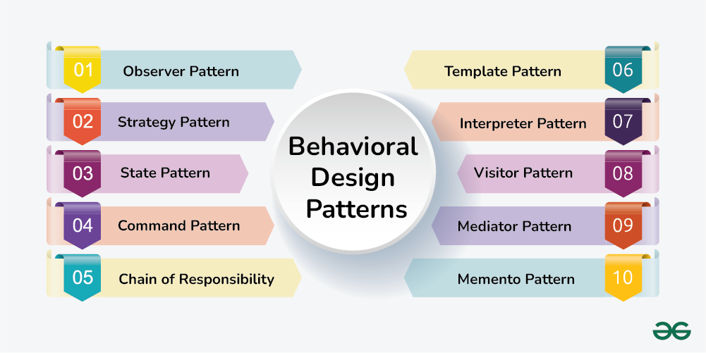
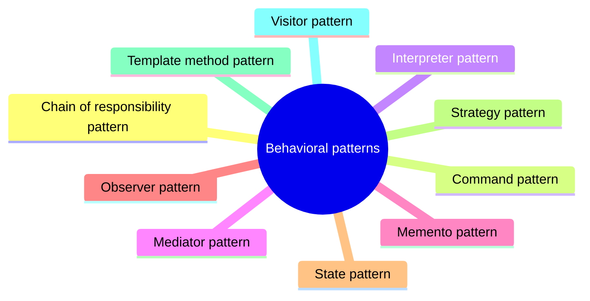

# Behavioral patterns

Patterns that assign responsibilities between objects and define how they communicate.

This is a catalog section: it groups a large body of related notes inside the knowledge area. It is not a separate SWEBOK topic.

## Overview

## Map

The map shows the notes and sections of this part of the library.

## Reading order

1. [Chain of responsibility pattern](chain-of-responsibility.md): The Chain of Responsibility pattern is a behavioral design pattern that allows multiple objects to process a request without coupling the sender to the receiver.
2. [Command pattern](command.md): The Command pattern is a behavioral design pattern that encapsulates a request as an object, allowing you to parameterize objects with operations, delay execution, or queue operations.
3. [Interpreter pattern](interpreter.md): The Interpreter pattern is a behavioral design pattern that defines a way to evaluate or interpret sentences in a specific language.
4. [Mediator pattern](mediator.md): The Mediator pattern is a behavioral design pattern that facilitates communication between objects by encapsulating how they interact.
5. [Memento pattern](memento.md): The Memento pattern is a behavioral design pattern that provides a way to capture and restore an object's state without exposing its internal details.
6. [Observer pattern](observer.md): The Observer pattern is a behavioral design pattern that establishes a one-to-many relationship between objects.
7. [State pattern](state.md): The State pattern is a behavioral design pattern that allows an object to alter its behavior when its internal state changes.
8. [Strategy pattern](strategy.md): The Strategy pattern is a behavioral design pattern that enables selecting an algorithm's behavior at runtime.
9. [Template method pattern](template-method.md): The Template Method pattern is a behavioral design pattern that defines the skeleton of an algorithm in a base class and allows subclasses to override specific steps without altering the overall...
10. [Visitor pattern](visitor.md): The Visitor pattern is a behavioral design pattern that allows you to separate algorithms from the objects on which they operate.
