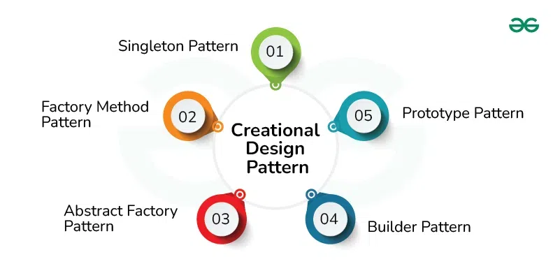
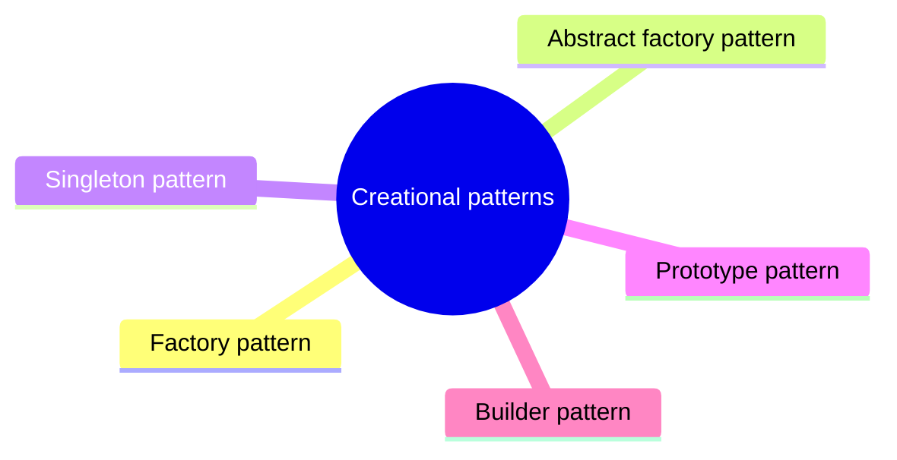

# Creational patterns

Patterns that control how objects are created, so that client code does not depend on concrete classes.

This is a catalog section: it groups a large body of related notes inside the knowledge area. It is not a separate SWEBOK topic.

## Overview

## Map

The map shows the notes and sections of this part of the library.

## Reading order

1. [Factory pattern](factory.md): The Factory pattern is a creational design pattern used to abstract the process of creating objects.
2. [Abstract factory pattern](abstract-factory.md): The Abstract Factory pattern is a creational design pattern that provides an interface for creating families of related or dependent objects without specifying their concrete classes.
3. [Singleton pattern](singleton.md): The Singleton pattern is a creational design pattern that ensures a class has only one instance and provides a global point of access to that instance.
4. [Prototype pattern](prototype.md): The Prototype pattern is a creational design pattern that enables the creation of new objects by copying existing ones, rather than instantiating them directly.
5. [Builder pattern](builder.md): The Builder pattern is a creational design pattern that provides a structured way to construct complex objects step by step.
