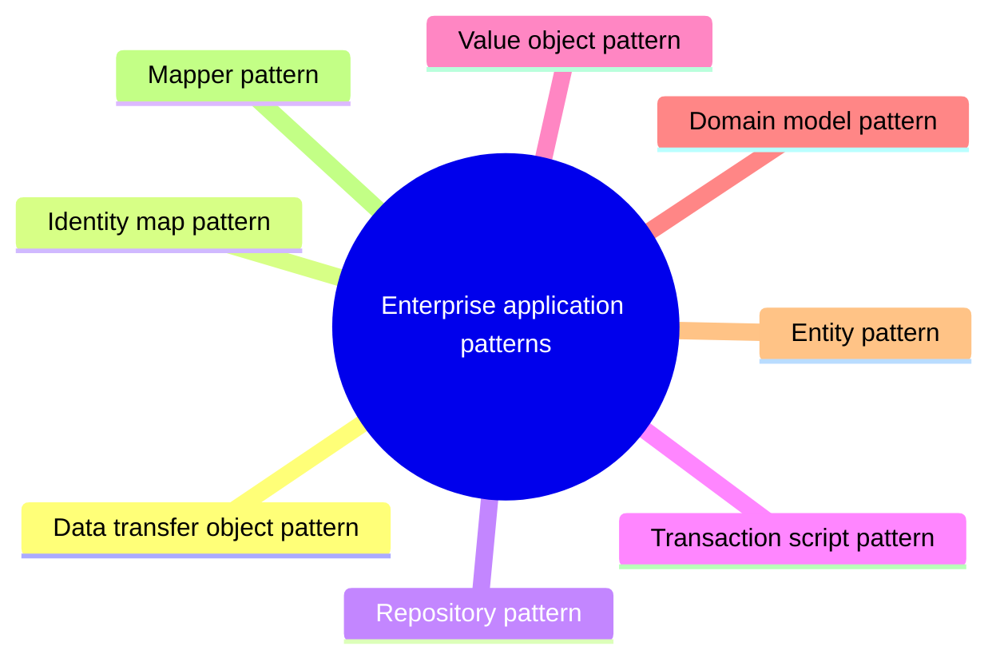

# Enterprise application patterns

Patterns for organizing domain logic, data access and data transfer in business applications.

This is a catalog section: it groups a large body of related notes inside the knowledge area. It is not a separate SWEBOK topic.

## Map

The map shows the notes and sections of this part of the library.

## Reading order

1. [Data transfer object (DTO) pattern](data-transfer-object.md): The Data Transfer Object (DTO) design pattern is a widely used enterprise application architecture pattern.
2. [Identity map pattern](identity-map.md): The Identity Map pattern is a crucial enterprise design pattern used to optimize object retrieval and maintain consistency in object identity within an application.
3. [Repository pattern](repository.md): The Repository pattern is a design pattern widely used in enterprise software development.
4. [Transaction script pattern](transaction-script.md): The Transaction Script pattern is a simple yet effective architectural pattern used for organizing business logic in enterprise applications.
5. [Value object pattern](value-object.md): The Value Object (VO) pattern is a key concept in enterprise software development, especially in Domain-Driven Design (DDD).
6. [Domain model pattern](domain-model.md): The Domain Model pattern is a fundamental architectural pattern in enterprise application development, particularly in Domain-Driven Design (DDD).
7. [Entity pattern](entity.md): The Entity pattern is a foundational concept in enterprise software design, especially in Domain-Driven Design (DDD) and object-oriented programming.
8. [Mapper pattern](mapper.md): The Mapper pattern is a design pattern used in enterprise applications to transform data between different data models or formats.

## Planned topics

- Unit of work pattern
- Active record pattern
- Table data gateway pattern
- Lazy load pattern
- Service layer pattern
