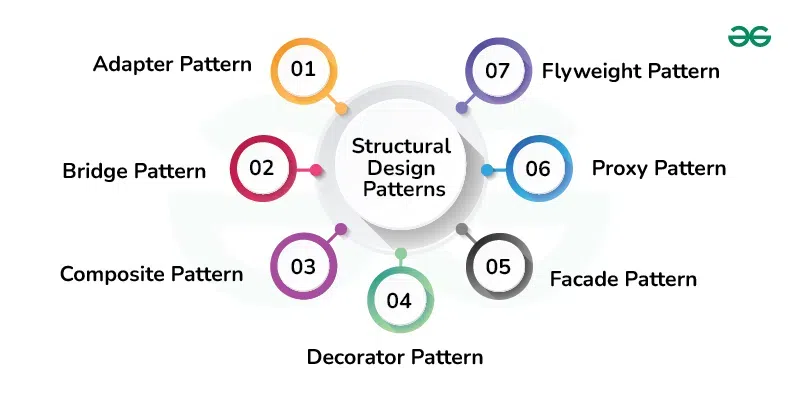
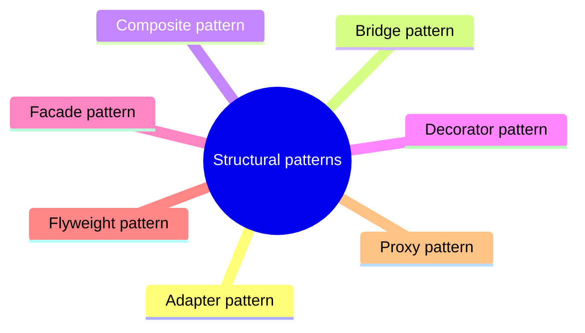

# Structural patterns

Patterns that compose classes and objects into larger structures while keeping them flexible.

This is a catalog section: it groups a large body of related notes inside the knowledge area. It is not a separate SWEBOK topic.

## Overview

## Map

The map shows the notes and sections of this part of the library.

## Reading order

1. [Adapter pattern](adapter.md): The Adapter pattern is a structural design pattern that allows incompatible interfaces to work together.
2. [Bridge pattern](bridge.md): The Bridge pattern is a structural design pattern that decouples an abstraction from its implementation, allowing them to evolve independently.
3. [Composite pattern](composite.md): The Composite pattern is a structural design pattern used to treat individual objects and compositions of objects uniformly.
4. [Decorator pattern](decorator.md): The Decorator pattern is a structural design pattern that allows you to dynamically add behavior or responsibilities to an object at runtime without modifying its structure.
5. [Facade pattern](facade.md): The Facade pattern is a structural design pattern that provides a simplified, unified interface to a set of complex subsystems.
6. [Flyweight pattern](flyweight.md): The Flyweight pattern is a structural design pattern that focuses on minimizing memory usage by sharing as much data as possible with similar objects.
7. [Proxy pattern](proxy.md): The Proxy pattern is a structural design pattern that provides a surrogate or placeholder for another object to control access to it.
