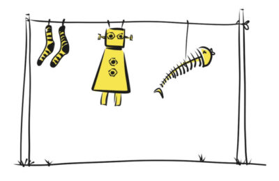
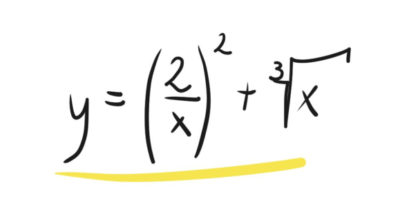
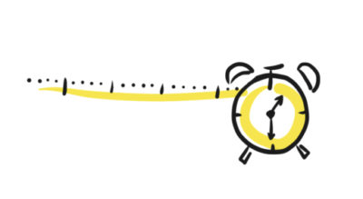
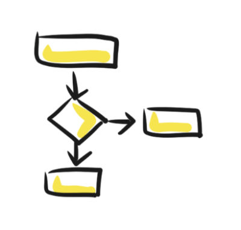
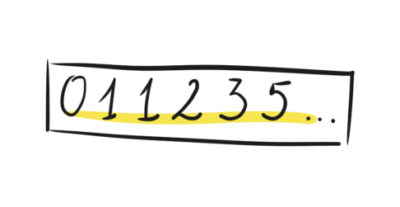
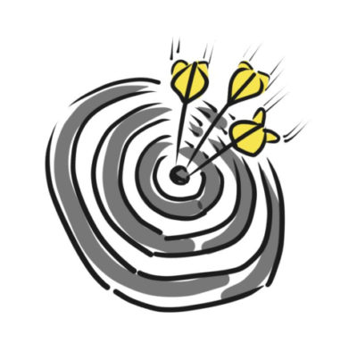
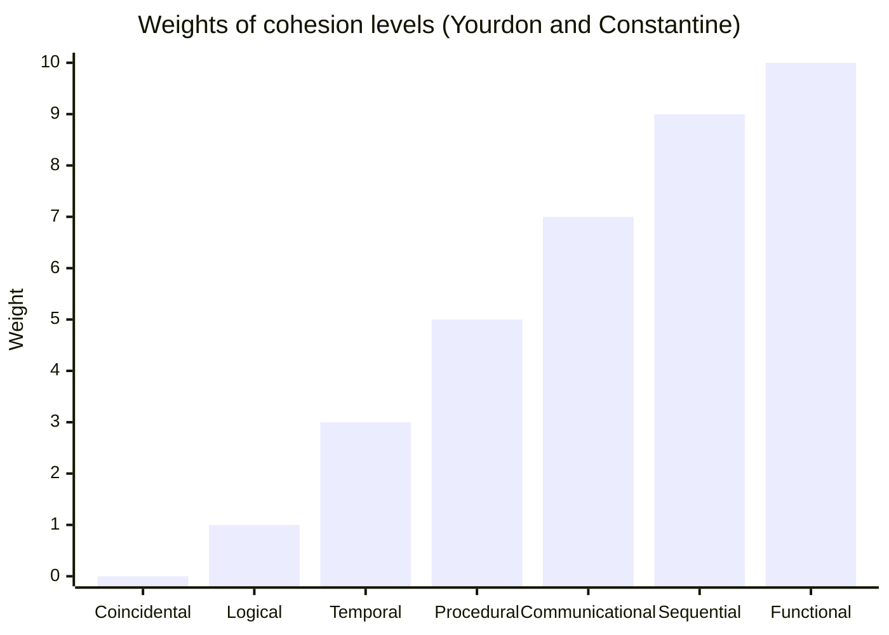

# Coupling and cohesion

## Summary

Coupling is the degree to which components depend on each other, and cohesion is the degree to which the elements inside one component belong together. Good designs aim for low coupling between components and high cohesion within them, so that a change stays local. The note describes the levels of coupling and of cohesion, with examples.

## Prerequisites

TODO: link the notes a reader should know first.

## Core concepts

TODO: add a diagram of the central mechanism (see GUIDELINE section 6.2).

### Introduction

Coupling and cohesion are two fundamental principles in software architecture that help define the quality and maintainability of a system. They are often used together to evaluate how well components are designed and how effectively the system is organized.

### Coupling

**Coupling** refers to the degree of interdependence between two components in a system. It measures how much one component relies on the internal details of another.

#### Types (from high to low)

1. **Content Coupling (Tightest)**:
    - One component directly modifies or relies on the internal workings of another.
    - **Example**: Component A accessing private variables of Component B.
2. **Common Coupling**:
    - Multiple components share global data or resources.
    - **Example**: Several modules accessing a global configuration variable.
3. **Control Coupling**:
    - One component controls the behavior of another by passing control flags.
    - **Example**: A function that passes a flag to dictate what another function should do.
4. **Data Coupling**:
    - Components interact by sharing only the necessary data.
    - **Example**: A method that accepts well-defined parameters.
5. **Message Coupling (Loosest)**:
    - Components communicate using abstract interfaces or messages.
    - **Example**: RESTful APIs where services communicate through HTTP requests.

#### High coupling

**Characteristics**:

- Components are tightly linked.
- Changes in one component directly affect others.
- Testing becomes more challenging as changes propagate.

**Problems**:

- Reduced modularity.
- Increased risk of bugs when making changes.
- Difficulty in reusing components.

#### Low coupling

**Characteristics**:

- Components interact minimally and only through well-defined interfaces.
- Changes in one component have little impact on others.
- Encourages modularity and maintainability.

**Benefits**:

- Easier to understand, test, and maintain.
- Promotes component reuse.
- Enhances scalability by enabling independent development and deployment.

### Cohesion

**Cohesion** refers to the degree to which the responsibilities within a component are related and focused on a single purpose. It measures the "togetherness" of a component's functionality.

#### Types (from low to high)

1. **Coincidental Cohesion (Lowest)**:
    - Unrelated functionalities grouped together.
    - **Example**: A utility module containing logging, authentication, and database operations.
2. **Logical Cohesion**:
    - Functions performing similar tasks are grouped, but they execute based on control flow.
    - **Example**: A function that performs all file-related operations but relies on control flags to determine specific behavior.
3. **Temporal Cohesion**:
    - Functions grouped by when they are executed, not by their purpose.
    - **Example**: Initialization methods that perform unrelated tasks during startup.
4. **Procedural Cohesion**:
    - Functions are grouped because they execute in a specific sequence.
    - **Example**: A workflow module combining steps for order processing.
5. **Communicational Cohesion**:
    - Functions operate on the same data or contribute to the same output.
    - **Example**: A component that processes and formats user input.
6. **Functional Cohesion (Highest)**:
    - Every responsibility contributes directly to a single, well-defined purpose.
    - **Example**: A `PaymentProcessor` class that validates, processes, and logs payments.

The list above omits one level that the classic classification includes: *sequential cohesion*, which sits between communicational and functional cohesion. The next section describes all seven levels.

#### Levels of cohesion in detail

Cohesion describes how strongly the elements of a module are related. From the start the concept was hard even to name. It was called "functional relatedness", a term later judged clumsy, and other names such as "binding" and "functionality" were proposed. Glenford Myers, in *Reliable Software Through Composite Design*, called it "strength", which captures the idea well: it is the strength with which the elements of a class are bound together. The figures show the elements of a module and what binds them at each level.

##### Coincidental cohesion

The first criterion is really the absence of one: the elements of the class are chosen completely at random. Such classes appear by accident, not through design.

They are rare, and when they occur they are usually artifacts of forced modularization. A team splits a system for the sake of splitting, or notices that a sequence of calls repeats and wraps it in a class, even though the extracted code means something different in each context where it is used. Over time every one of those contexts needs its own changes to the class.

##### Logical cohesion

The elements are bound by solving the same class of problems. Something logically connects them, but each performs a different function.

A good example is a set of mathematical operations that are completely independent of each other. Each one does something different, yet they are grouped in one class of "mathematical operations".

##### Temporal cohesion

If the elements are additionally bound by the time at which they are executed, the result is temporal cohesion.

The best examples are initialization, shutdown and cleanup modules. Initialization functions are logically related because they share a purpose (they initialize something), and they are also related in time because they must run in the same time window, here during initialization. Some modules simply have to have this kind of cohesion and are hard to write any other way.

##### Procedural cohesion

Procedural cohesion appears when, instead of modeling the problem domain, the design focuses only on the algorithm, the flow of control. The result models a sequence of steps rather than the problem being solved.

Because the elements of a procedurally cohesive module are bound by both order and time, the cohesion is stronger than temporal cohesion, where order did not matter. Procedural modules typically contain many loops, conditions and steps. They are the classes that make a reader reach for paper and pencil to draw a flowchart.

##### Communicational cohesion

Communicational cohesion is the first level that focuses on the problem being modeled. The elements are grouped because they are related through data: they operate on the same input or produce the same output. This makes the class easier to use in different contexts.

Such classes usually come from thinking about which operations can be performed on a specific set of data, or which operations are needed to produce a specific result.

##### Sequential cohesion

When the main criterion for grouping is the sequence of data processing, the cohesion is sequential: the output of one processing element is the input of the next, so one element's activity must be preceded by another's.

There is a catch. A processing chain can be grouped into classes in different ways, so a sequentially cohesive class may perform more than one function, or only part of one. That is why sequential cohesion ranks below functional cohesion.

##### Functional cohesion

A class is functionally cohesive when its elements are chosen to perform one specific task as well as possible. Every processing element is an integral part of the class and essential to its function. The class does no more and no less than one function.

Single mathematical operations are often given as an example: one class per operation. Compare this with logical cohesion, where one class bundled many different operations.

It is easy to tell whether a small class is functionally cohesive, but at higher levels of abstraction it is often hard. The practical method is elimination: check that the class shows none of the "defects" of the lower levels.

##### Weights of the levels

Larry Constantine and Edward Yourdon proposed, reluctantly, a weight for each level. They did not want the weights to be used for detailed analysis or to constrain future research on cohesion, but they wanted to show that the levels are not evenly spaced:

| Level | Weight |
| --- | --- |
| Coincidental | 0 |
| Logical | 1 |
| Temporal | 3 |
| Procedural | 5 |
| Communicational | 7 |
| Sequential | 9 |
| Functional | 10 |

The chart shows the nonlinear spacing: the three lowest levels sit far below the others.

#### High cohesion

**Characteristics**:

- All functionalities within a component are tightly related to its purpose.
- Clear, well-defined responsibilities.
- Easier to understand, test, and maintain.

**Benefits**:

- Improves readability and modularity.
- Simplifies debugging and testing.
- Promotes reuse by clearly defining the component’s functionality.

#### Low cohesion

- **Characteristics**:
    - Responsibilities within a component are unrelated or loosely related.
    - Components become overly complex and difficult to understand.
- **Problems**:
    - Reduced maintainability.
    - Increased likelihood of bugs.
    - Harder to test as unrelated responsibilities are bundled together.

### Coupling and cohesion comparison

| **Aspect** | **High Coupling** | **Low Coupling** | **High Cohesion** | **Low Cohesion** |
| --- | --- | --- | --- | --- |
| **Dependency** | Strong interdependence between components | Minimal interdependence | Tight focus on a single purpose | Scattered responsibilities |
| **Change Impact** | Changes propagate across components | Changes are isolated to specific components | Localized changes | Changes affect multiple unrelated functions |
| **Testability** | Difficult to test components independently | Easy to test components independently | Easier to test and debug | Hard to test due to unrelated responsibilities |
| **Reusability** | Difficult to reuse components | High potential for reuse | Clear, reusable components | Rarely reusable due to unclear responsibilities |
| **Maintenance** | High risk of introducing bugs | Easier to maintain | Simplifies maintenance | Maintenance is complex |

### Best practices

1. **Aim for Low Coupling and High Cohesion**: Design components to have minimal dependencies and well-defined responsibilities.
2. **Use Interface-Based Design**: Define interactions through interfaces to reduce coupling.
3. **Encapsulate Responsibilities**: Group related functionalities and data within a single component.
4. **Refactor Regularly**: Identify and address high coupling or low cohesion in code.
5. **Use Dependency Injection:** Decouple component dependencies and make them configurable.
6. **Adopt Design Patterns**: Patterns like **Factory**, **Mediator**, and **Observer** help achieve low coupling.
7. **Modular Architecture**: Use architectural styles like microservices or layered architecture to enforce separation of concerns.

## Worked example

### Examples

#### Low coupling, high cohesion

- **Scenario**: A microservices architecture.
    - Services like `UserService`, `OrderService`, and `PaymentService` have:
        - **Low Coupling**: Interact only via APIs.
        - **High Cohesion**: Each service focuses on its domain-specific responsibilities.

##### High coupling, low cohesion

- **Scenario**: A monolithic application with tightly intertwined modules.
    - **High Coupling**: Changes in one module require updates in others.
    - **Low Cohesion**: Modules handle multiple unrelated tasks (e.g., a single module managing UI rendering, data access, and business logic).

## Trade offs and when to use it

TODO: describe benefits, costs, alternatives and when this is the wrong choice.

## Common mistakes

TODO: list frequent misunderstandings and failure modes, with the fix for each.

## Practice

TODO: add three to five questions, with answers at the bottom.

## Further reading

- Stevens, W. P., Myers, G. J., Constantine, L. L. (1974). [*Structured design*](https://doi.org/10.1147/sj.132.0115). IBM Systems Journal. The paper that introduced coupling and cohesion as measures of modular design.
- Yourdon, E., Constantine, L. L. (1979). *Structured Design: Fundamentals of a Discipline of Computer Program and Systems Design*. Prentice Hall. The book that defines the levels of cohesion and coupling and their relative weights.

TODO: check the content of this note against the sources above and record what was verified and when.
