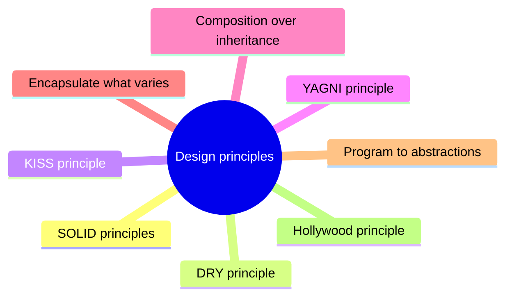

# Design principles

Rules of thumb that guide design decisions toward code that is easy to understand, change and extend.

This section corresponds to topic 3.1 of the [SWEBOK Guide V4.0](https://www.computer.org/education/bodies-of-knowledge/software-engineering).

## Overview

There are many software design principles that aim to guide the development of software in a way that makes it easy to understand, maintain, and extend. Some of the most common design principles include:

- SOLID principles (Single Responsibility Principle, Open/Closed Principle, Liskov Substitution Principle, Interface Segregation Principle, and Dependency Inversion Principle)
- DRY (Don’t Repeat Yourself)
- YAGNI (You Ain’t Gonna Need It)
- KISS (Keep It Simple, Stupid)
- LoD (Law of Demeter)
- Composition over Inheritance
- Encapsulate What Varies
- Hollywood Principle
- Program Against Abstractions

## Map

The map shows the notes and sections of this part of the library.

## Reading order

1. [SOLID principles](solid.md): SOLID is a set of five object-oriented design principles: single responsibility, open-closed, Liskov substitution, interface segregation and dependency inversion.
2. [DRY principle](dry.md): DRY (Don’t Repeat Yourself) is a software development principle that suggests that code should not have duplicate functionality.
3. [KISS principle](kiss.md): KISS (keep it simple, stupid) says that a system works best when it has as few parts, and especially as few interdependent parts, as the problem allows.
4. [YAGNI principle](yagni.md): YAGNI (You Ain’t Gonna Need It) is a software development principle that suggests that developers should not add functionality to a codebase unless it is immediately necessary.
5. [Composition over inheritance](composition-over-inheritance.md): The "Composition over Inheritance" principle encourages creating modular, flexible, and maintainable systems by combining smaller, reusable components rather than building complex class hierarchies.
6. [Encapsulate what varies](encapsulate-what-varies.md): The "Encapsulate What Varies" principle is essential for creating flexible, maintainable, and scalable systems.
7. [Program to abstractions](program-to-abstractions.md): Programming against abstractions is a foundational principle for building flexible, maintainable, and scalable software systems.
8. [Hollywood principle](hollywood-principle.md): The Hollywood Principle enforces a separation of responsibilities, ensuring high-level components control the flow of an application while low-level components remain passive and responsive.

## Planned topics

- Principle of least astonishment
- Tell, do not ask
- Command-query separation
