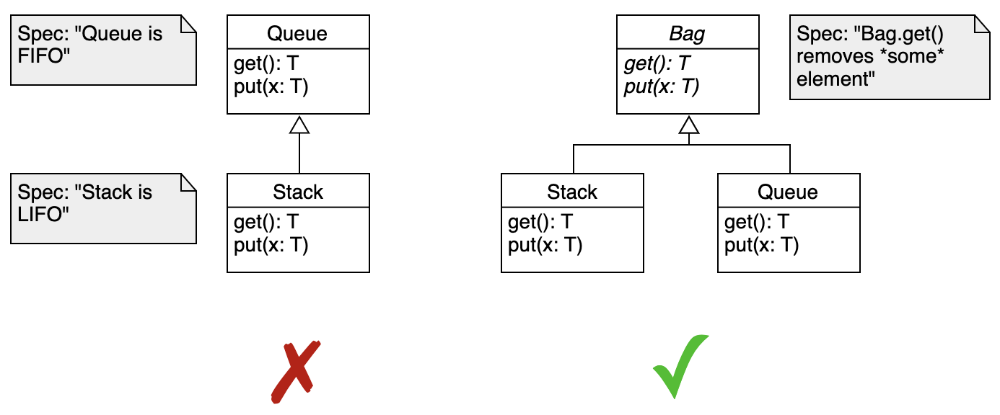
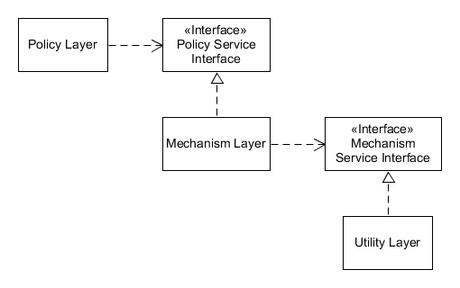

# SOLID principles

## Summary

SOLID is a set of five object-oriented design principles: single responsibility, open-closed, Liskov substitution, interface segregation and dependency inversion. Together they aim to make code easier to change by keeping classes focused, extensible without modification, safely substitutable and dependent on abstractions rather than details.

## Prerequisites

- [Coupling and cohesion](../coupling-and-cohesion.md)

## Core concepts

TODO: add a diagram of the central mechanism (see GUIDELINE section 6.2).

### Definition

**SOLID** is an acronym representing five design principles that promote maintainable, scalable, and robust object-oriented programming (OOP). Coined by Robert C. Martin ("Uncle Bob"), these principles aim to make software designs more understandable and reduce the cost of changes.

- **S**: **Single Responsibility Principle (SRP)**
- **O**: **Open/Closed Principle (OCP)**
- **L**: **Liskov Substitution Principle (LSP)**
- **I**: **Interface Segregation Principle (ISP)**
- **D**: **Dependency Inversion Principle (DIP)**

### The five principles

#### Single responsibility principle (SRP)

"A class should have one and only one reason to change."

**Explanation:**

- A class should only focus on one responsibility or functionality.
- If a class has multiple responsibilities, changes in one responsibility can impact others, leading to fragile designs.
- A **responsibility** is defined as a reason to change.
- Encourages breaking down complex classes into smaller, more focused ones.

**Example:**

Violation:

```text
class Invoice {
    void GenerateInvoice() { /* logic */ }
    void SaveToDatabase() { /* logic */ }
    void PrintInvoice() { /* logic */ }
}
```

- This class has multiple responsibilities: generating, saving, and printing the invoice.

**Adherence:**

```text
class Invoice {
    void GenerateInvoice() { /* logic */ }
}

class InvoiceDatabase {
    void SaveToDatabase() { /* logic */ }
}

class InvoicePrinter {
    void PrintInvoice() { /* logic */ }
}
```

- Each class focuses on one responsibility.

**Benefits:**

- Improved maintainability.
- Easier to test and debug.
- Reduces coupling.

#### Open/Closed principle (OCP)

"Software entities (classes, modules, functions) should be open for extension but closed for modification."

**Explanation:**

- New functionality should be added by extending the code, not modifying existing code.
- Achieved through **abstraction** and **polymorphism**.
- Promote the use of interfaces or abstract classes.
- Reduces the risk of introducing bugs in existing functionality.

**Example:**

**Violation:**

```csharp
class PaymentProcessor {
    void ProcessPayment(string type) {
        if (type == "credit") {
            // Credit card payment logic
        } else if (type == "paypal") {
            // PayPal payment logic
        }
    }
}
```

- Adding a new payment type requires modifying the existing class.

**Adherence:**

```csharp
interface IPayment {
    void ProcessPayment();
}

class CreditCardPayment : IPayment {
    public void ProcessPayment() { /* logic */ }
}

class PayPalPayment : IPayment {
    public void ProcessPayment() { /* logic */ }
}

class PaymentProcessor {
    void ProcessPayment(IPayment payment) {
        payment.ProcessPayment();
    }
}
```

- New payment types can be added without modifying `PaymentProcessor`.

**Benefits:**

- Enhances code scalability.
- Protects existing code from unintended changes.
- Simplifies adding new functionality.

#### Liskov substitution principle (LSP)

"Objects of a superclass should be replaceable with objects of a subclass without altering the correctness of the program."

**Explanation:**

- Subclasses should adhere to the behavior expected by their parent classes.
- A subclass should not weaken the postconditions or strengthen the preconditions of the superclass methods.
- Ensure **IS-A** relationships are properly maintained.
- Focuses on substitutability.

**Example:**

**Violation:**

```java
class Bird {
    void Fly() { /* logic */ }
}

class Penguin : Bird {
    void Fly() { throw new Exception("Penguins can't fly"); }
}
```

- Violates LSP because the subclass changes the expected behavior of the superclass.

**Adherence:**

```csharp
interface IFlyable {
    void Fly();
}

class Bird : IFlyable {
    public void Fly() { /* logic */ }
}

class Penguin {
    // Penguins do not implement IFlyable, adhering to LSP
}
```

**Benefits:**

- Avoids runtime exceptions caused by unexpected behavior.
- Enhances polymorphism and reusability.

#### Interface segregation principle (ISP)

"A client should not be forced to depend on interfaces it does not use."

**Explanation:**

- Large interfaces should be divided into smaller, more specific ones.
- A class implementing an interface should not be forced to implement methods it doesn’t need.
- Avoids "fat interfaces."
- Promotes multiple, focused interfaces.

**Example:**

**Violation:**

```csharp
interface IWorker {
    void Work();
    void Eat();
}

class Robot : IWorker {
    public void Work() { /* logic */ }
    public void Eat() { throw new Exception("Robots don't eat"); }
}
```

**Adherence:**

```csharp
interface IWorker {
    void Work();
}

interface IHuman {
    void Eat();
}

class Robot : IWorker {
    public void Work() { /* logic */ }
}

class HumanWorker : IWorker, IHuman {
    public void Work() { /* logic */ }
    public void Eat() { /* logic */ }
}
```

**Benefits:**

- Reduces unnecessary dependencies.
- Makes the system easier to understand and modify.

#### Dependency inversion principle (DIP)

"High-level modules should not depend on low-level modules. Both should depend on abstractions."

**Explanation:**

- Depend on abstractions (interfaces) rather than concrete implementations.
- Encourages loosely coupled systems.
- High-level logic should not directly depend on low-level details.
- Changes in low-level modules do not affect high-level modules.

**Example:**

Violation:

```csharp
class FileLogger {
    void Log(string message) { /* logic */ }
}

class App {
    FileLogger logger = new FileLogger();
    void Run() {
        logger.Log("Running");
    }
}
```

- `App` is tightly coupled to `FileLogger`.

**Adherence:**

```csharp
interface ILogger {
    void Log(string message);
}

class FileLogger : ILogger {
    public void Log(string message) { /* logic */ }
}

class App {
    ILogger logger;
    public App(ILogger logger) {
        this.logger = logger;
    }
    void Run() {
        logger.Log("Running");
    }
}
```

- `App` depends on the abstraction `ILogger`, making it flexible to changes.

**Benefits:**

- Encourages modularity.
- Simplifies testing (e.g., by using mock implementations).
- Promotes reusable and flexible code.

### The principles in more depth

#### Responsibility as a reason to change

Martin defines a responsibility as a *reason to change* and concludes that a class or module should have one, and only one, reason to be changed. Consider a module that compiles and prints a report. It can change for two reasons: the content of the report can change, and its format can change. These change for different causes, so they are two responsibilities and belong in separate classes or modules. Coupling two things that change for different reasons at different times is bad design. Keeping a class focused on a single concern also makes it more robust: if the report compilation changes, printing code in the same class is more likely to break.

#### Open and closed modules

The original formulation of the open-closed principle distinguishes two states of a module:

- A module is *open* if it is still available for extension, for example by adding fields to its data structures or new elements to the set of functions it performs.
- A module is *closed* if it is available for use by other modules. This assumes it has a well-defined, stable description (its interface in the sense of information hiding).

#### Behavioral subtyping

The formal statement of the Liskov substitution principle is:

> *Let φ(x) be a property provable about objects x of type T. Then φ(y) should be true for objects y of type S where S is a subtype of T.*

In practice: if code substitutes a superclass reference with an object of any of its subclasses, the program must not break. An overriding method must accept the same input values as the superclass method. It may apply less restrictive validation, but not stricter. Similar rules apply to return values: the subclass may only return a subset of what the superclass may return, for example a more specific subclass of the declared type.

A subclass method breaks the contract of the superclass method when it:

1. returns an object that is incompatible with what the superclass method returns,
2. throws a new exception that the superclass method does not throw,
3. changes the semantics or introduces side effects that are not part of the superclass contract.

LSP violations are a design smell. Often a concept was generalized too early and a superclass was created where none was needed. If client code cannot freely substitute a subclass, it is forced into `instanceof` checks and special handling, and every new or changed subclass means combing through the codebase. That defeats the purpose of the supertype abstraction, which was to make the program easy to extend.



#### Role interfaces

ISP splits very large interfaces into smaller, more specific ones, so that clients only know about the methods they use. Such small interfaces are called *role interfaces*. ISP keeps a system decoupled and easier to refactor, change and redeploy. Beyond object-oriented design it applies to distributed systems and microservices: it is one of the [IDEALS principles](../../../software-architecture/architectural-styles/ideals-principles.md) for microservice design.

#### The dependency inversion pattern

Dependency inversion places an abstraction between high-level and low-level layers. "Inversion" does not mean that lower layers depend on higher layers directly. Both depend on abstractions that expose the behavior the higher layers need.



Many projects treat the principle and the pattern as one concept and apply interfaces between all classes. There are two reasons: it is easier to see a principle as a coding pattern ("I wrote an interface, so I did the abstraction"), and many mocking tools rely on inheritance, so generic interfaces everywhere became the rule. This has drawbacks:

1. Putting an interface on a class does not by itself reduce coupling. Only thinking about the abstraction of the interaction does.
2. Interfaces everywhere make the code harder to understand. The reader keeps asking what the other implementations are, and the answer is usually: only mocks.
3. Generalized interfaces need more plumbing, in particular factories, usually provided by a dependency injection framework.
4. They restrict how the programming language can be used.

Applied strictly, the pattern also implies that all member variables are interfaces or abstract types, concrete classes connect only through abstractions, no class derives from a concrete class, no method overrides an implemented method, and every instantiation goes through a creational pattern (such as a factory) or a dependency injection framework.

*Example.* A genealogy system can represent relationships as a graph of direct relations (father and son, wife and husband, and so on). This is efficient and extensible: adding an ex-husband or a legal guardian is easy. Higher-level modules, however, may want a simpler view: a person has children, parents, siblings, grandparents and cousins. Exposing these common relations as direct properties and hiding the graph makes the coupling between the higher-level module and the genealogy module much lighter. The internal representation can then change completely without affecting the users, and exact definitions of siblings or uncles can live in the genealogy module, which also follows the single responsibility principle. The abstraction of the interaction simplified the interface of the lower-level module and may simplify its implementation as well.

## Worked example

TODO: add a concrete, reproducible example with real values.

## Trade offs and when to use it

TODO: describe benefits, costs, alternatives and when this is the wrong choice.

## Common mistakes

TODO: list frequent misunderstandings and failure modes, with the fix for each.

## Practice

TODO: add three to five questions, with answers at the bottom.

## Further reading

- Martin, R. C. (2002). *Agile Software Development, Principles, Patterns, and Practices*. Prentice Hall. The book that presents the SOLID principles in detail and discusses the symptoms of rotting design.
- Liskov, B. H., Wing, J. M. (1994). [*A Behavioral Notion of Subtyping*](https://doi.org/10.1145/197320.197383). ACM Transactions on Programming Languages and Systems. The formal definition of behavioral subtyping behind the Liskov substitution principle.

TODO: check the content of this note against the sources above and record what was verified and when.
