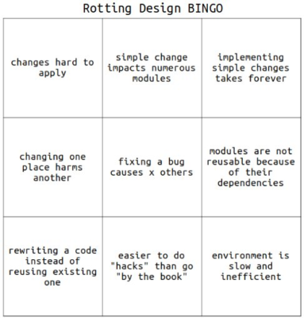
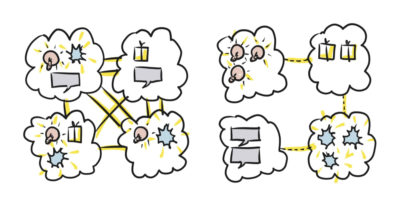

# Design rot

## Summary

Design rot is the gradual decay of a software design until simple changes become slow, risky and expensive. It shows up as four symptoms: rigidity, fragility, immobility and viscosity. The usual root cause is not changing requirements but poorly managed dependencies, so the cure is low coupling between modules and high cohesion inside them.

## Prerequisites

- [Coupling and cohesion](coupling-and-cohesion.md), the two measures that explain why designs rot.

## Core concepts

The figure below shows the four symptoms of a rotting design.

### Rigidity

Rigidity means that a seemingly simple, harmless change in the code triggers an avalanche of unforeseen changes, each of which pulls in the next one. The change spreads through the code into ever larger areas and reaches dependent classes. Changes that look trivial therefore become very hard to make, because they require corrections in many other places.

### Fragility

Fragility shows when a change in one place causes bugs in places that are logically unrelated to the change.

### Immobility

Imagine that while writing a new feature you know there is a piece of code somewhere that would fit perfectly, both in what it does and in the context where it is used. You find it, analyze it from every side, and then leave it alone and write the same thing again in a new place. The reason is that the cost of reusing it (extracting it and satisfying its dependencies) is so high that reuse does not pay off. The result is classes that simply cannot be reused.

### Viscosity

There are basically two ways to make a change: in line with the current design, or against it. When it is easier to work against the design, the design is viscous. A typical case: the team knows how something "should" be written, but after estimating the effort it decides to make a small exception for now in order to ship quickly. In short, adding a hack is more convenient and faster than following the design.

### Root cause: dependency management

If changing requirements are not necessarily the cause, what is? Most often it is poor management of dependencies in the code. Two old concepts help here: coupling and cohesion.

*Coupling* is the degree of dependence between classes or modules, the strength of their relationship. People usually talk about loose and tight coupling, but there are intermediate levels between the two extremes.

*Cohesion* describes how well the elements of a single class belong together. They should all work together toward one specific shared purpose and fit together naturally, without any "glue" to connect them. Cohesion is usually described as low or high, and here too there are levels in between.

Overall, a good design (one that is easy to maintain and resilient to change) has classes that are independent, loosely coupled to each other and that perform precisely defined tasks. In other words, such a design has loose coupling between classes and high cohesion within them.

## Worked example

TODO: add a concrete, reproducible example that shows one symptom (for example fragility) appearing after a change, and the refactoring that removes it.

## Trade offs and when to use it

TODO: describe when it is reasonable to accept some viscosity (for example a deliberate, tracked shortcut) and what it costs later.

## Common mistakes

TODO: list frequent misunderstandings, such as blaming design rot only on changing requirements.

## Practice

TODO: add three to five questions, with answers at the bottom.

## Further reading

- Martin, R. C. (2002). *Agile Software Development, Principles, Patterns, and Practices*. Prentice Hall. The book that presents the SOLID principles in detail and discusses the symptoms of rotting design.

TODO: check the content of this note against the sources above and record what was verified and when.
