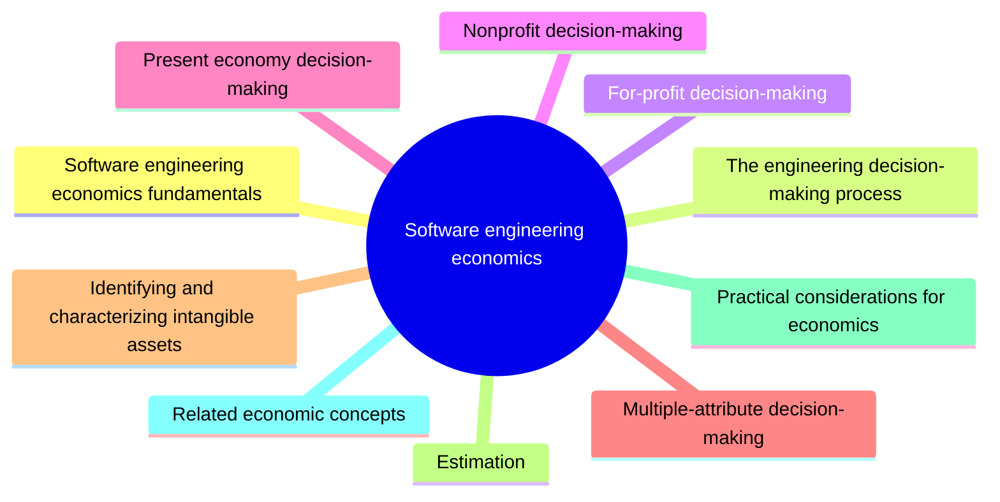

# Software engineering economics

Software engineering economics is about making technical decisions in the context of the business: value, cost, risk and return. This knowledge area covers economic fundamentals, decision making for profit and nonprofit organizations, estimation and related concepts.

This knowledge area follows Chapter 15 of the [SWEBOK Guide V4.0](https://www.computer.org/education/bodies-of-knowledge/software-engineering) (IEEE Computer Society, 2024). Its sections are the topics of that chapter, in the same order.

## Map

The map shows the sections of this part of the library.

## Topics

- [Software engineering economics fundamentals](fundamentals/README.md) (planned): Finance, accounting, cash flow, time value of money, inflation and depreciation as they apply to software.
- [The engineering decision-making process](engineering-decision-making/README.md) (planned): A structured process for understanding the problem, identifying alternatives and choosing between them.
- [For-profit decision-making](for-profit-decision-making/README.md) (planned): Minimum acceptable rate of return, return on investment and economic life in commercial settings.
- [Nonprofit decision-making](nonprofit-decision-making/README.md) (planned): Benefit-cost analysis and cost-effectiveness analysis for public and nonprofit organizations.
- [Present economy decision-making](present-economy-decision-making/README.md) (planned): Decisions where the time value of money does not matter, such as break-even analysis and optimization.
- [Multiple-attribute decision-making](multiple-attribute-decision-making/README.md) (planned): Choosing between alternatives that are judged on several attributes at once.
- [Identifying and characterizing intangible assets](intangible-assets/README.md) (planned): Recognizing and valuing intangible assets such as software, knowledge and reputation.
- [Estimation](estimation/README.md) (planned): Estimation techniques for effort, cost and schedule, and how to deal with their uncertainty.
- [Practical considerations for economics](practical-considerations/README.md) (planned): The business case, multiple currency analysis and systems thinking in economic decisions.
- [Related economic concepts](related-concepts/README.md) (planned): Concepts that complement software economics, such as cost of delay and technical debt as an economic model.

TODO: no notes yet. Start with the planned topics of the sections listed above.
