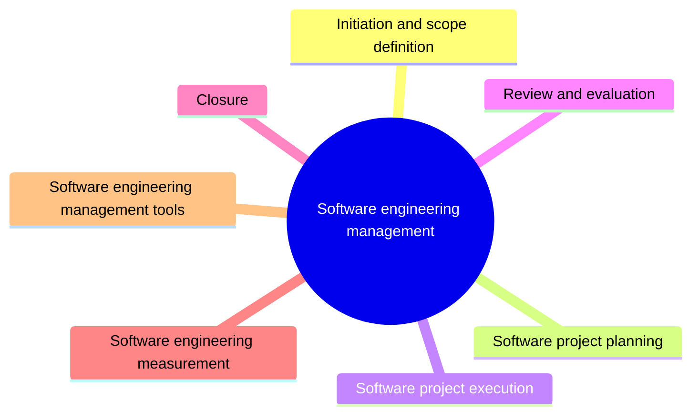

# Software engineering management

Software engineering management applies management activities (planning, coordinating, measuring, monitoring, controlling and reporting) to software projects. This knowledge area follows a project from initiation to closure and covers measurement.

This knowledge area follows Chapter 9 of the [SWEBOK Guide V4.0](https://www.computer.org/education/bodies-of-knowledge/software-engineering) (IEEE Computer Society, 2024). Its sections are the topics of that chapter, in the same order.

## Map

The map shows the sections of this part of the library.

## Topics

- [Initiation and scope definition](initiation-and-scope-definition/README.md) (planned): Deciding to start a project: determining and negotiating requirements, feasibility and the process for revising scope.
- [Software project planning](project-planning/README.md) (planned): Planning the work: process planning, deliverables, effort, schedule and cost estimation, resource allocation and risk management.
- [Software project execution](project-execution/README.md) (planned): Carrying out the plan: implementation of plans, supplier contracts, monitoring and controlling the process and reporting.
- [Review and evaluation](review-and-evaluation/README.md) (planned): Checking whether requirements are satisfied and evaluating performance of the project and the team.
- [Closure](closure/README.md) (planned): Ending a project or phase: determining closure and the closure activities.
- [Software engineering measurement](measurement/README.md) (planned): Establishing and sustaining a measurement program for software engineering.
- [Software engineering management tools](tools/README.md) (planned): Tools for planning, tracking and reporting software work.

TODO: no notes yet. Start with the planned topics of the sections listed above.
