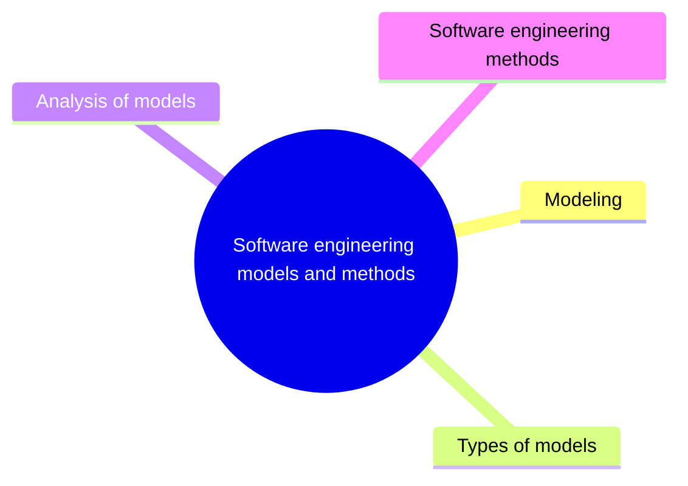

# Software engineering models and methods

Models and methods give structure to software engineering work so that it is systematic, repeatable and focused on results. This knowledge area covers modeling, types of models, analysis of models and software engineering methods such as agile methods.

This knowledge area follows Chapter 11 of the [SWEBOK Guide V4.0](https://www.computer.org/education/bodies-of-knowledge/software-engineering) (IEEE Computer Society, 2024). Its sections are the topics of that chapter, in the same order.

## Map

The map shows the sections of this part of the library.

## Topics

- [Modeling](modeling/README.md) (1 note): Principles of modeling, the properties of good models and the languages used to express them.
- [Types of models](types-of-models/README.md) (planned): Information, behavioral and structural models.
- [Analysis of models](analysis-of-models/README.md) (planned): Analyzing models for completeness, consistency, correctness, traceability and interaction.
- [Software engineering methods](methods/README.md) (2 notes): Heuristic, formal, prototyping and agile methods for developing software.
