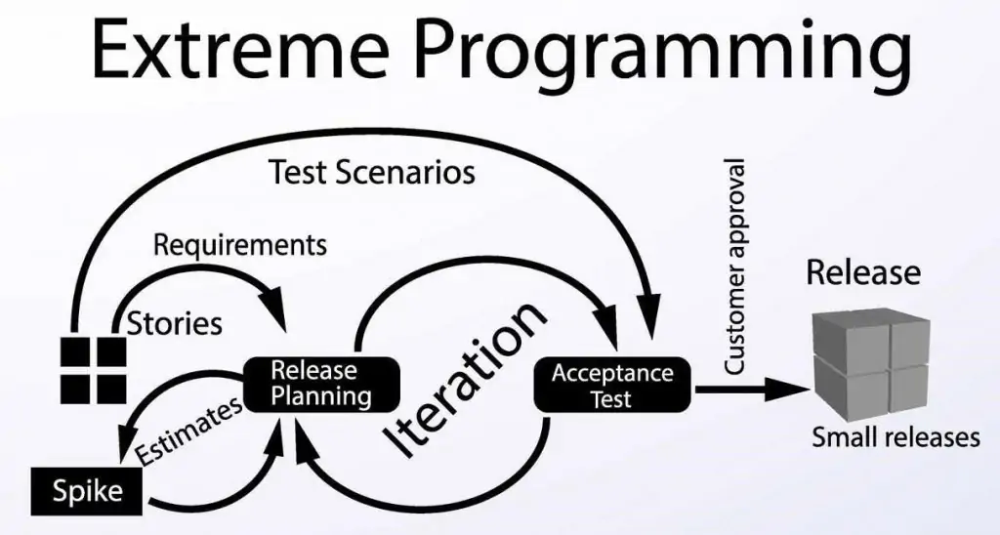
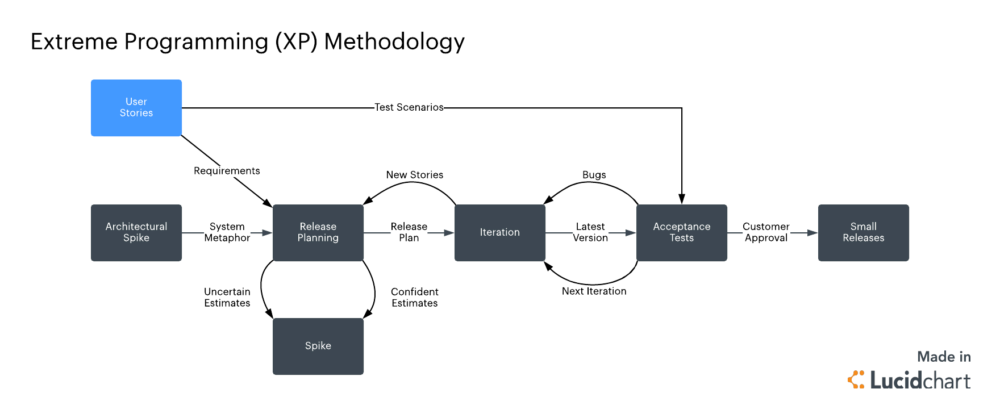
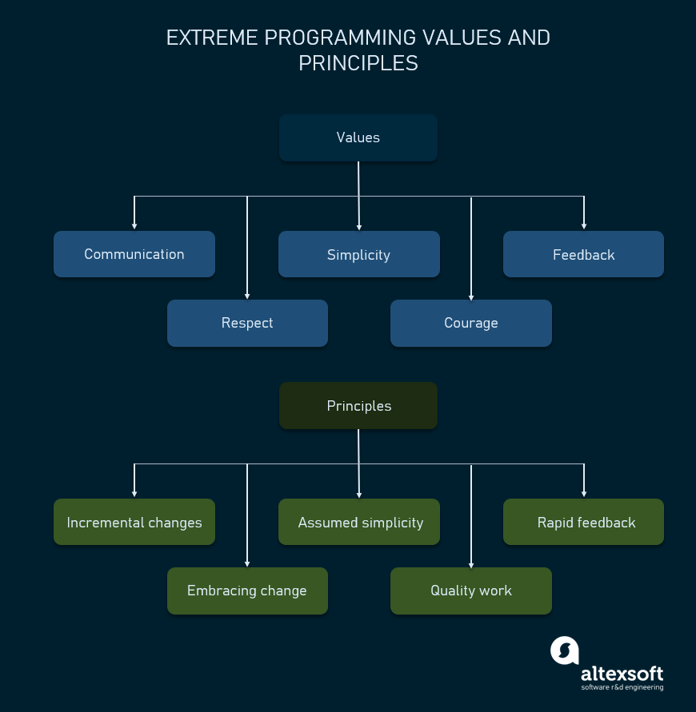
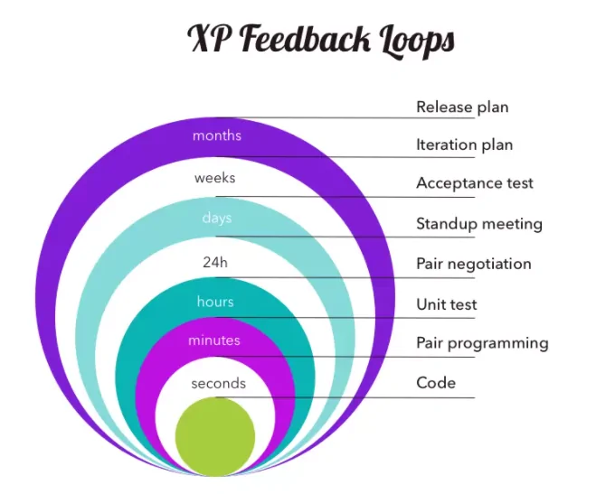
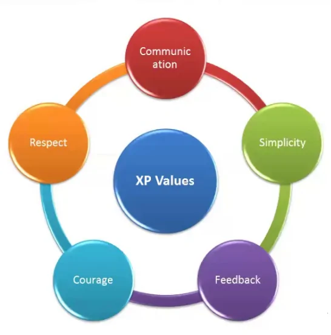

# Extreme programming (XP)

## Summary

Extreme programming is a software development methodology that’s part of what’s collectively known as agile methodologies. XP is built upon values, principles, and practices, and its goal is to allow small to mid-sized teams to produce high-quality software and adapt to evolving and changing requirements.

## Prerequisites

TODO: link the notes a reader should know first.

## Core concepts

### Introduction

Extreme programming is a software development methodology that’s part of what’s collectively known as agile methodologies. XP is built upon values, principles, and practices, and its goal is to allow small to mid-sized teams to produce high-quality software and adapt to evolving and changing requirements.

What sets XP apart from the other agile methodologies is that XP emphasizes the technical aspects of software development. Extreme programming is precise about *how* engineers work since following engineering practices allows teams to deliver high-quality code at a sustainable pace.

Extreme programming is, in a nutshell, about good practices taken to an extreme. Since pair-programming is good, let’s do it all of the time. Since testing early is good, let’s test before the production code is even written.

### How extreme programming works

XP, unlike other methodologies, is very opinionated when it comes to engineering practices.

Besides practices, XP is built upon values and principles.

**Values** provide purpose to teams. They act as a “north star” to guide your decisions in a high-level way. However, values are abstract and too fuzzy for specific guidance. For instance: saying that you value communication can result in many different outcomes.

**Practices** are, in some ways, the opposite of values. They’re concrete and down to earth, defining the specifics of what to do. Practices help teams hold themselves accountable to the values. For instance, the practice of Informative Workspaces favors transparent and simple communication.

Principles are domain-specific guidelines that bridge the gap between practices and values.

### XP values

The XP values: communication, simplicity, feedback, courage, and respect. Let’s look at each one of them in more detail.

**Communication:** Lack of communication prevents knowledge from flowing inside a team. Often, when there’s a problem, someone already knows how to solve it. But lack of communication prevents them from learning about the problem or contributing to its solution. So, the problem ends up being solved twice, generating waste.

**Simplicity:** Simplicity says you always strive to do the simplest thing that works. It’s often misunderstood and taken as *the simplest thing*, period, ignoring the “that works” part.

It’s also crucial to remember that simplicity is highly contextual. What’s simple for one team, is complex for another depending entirely on each team’s skills, experience, and knowledge.

**Feedback:** Feedback in more traditional, waterfall-like software development methodologies often is “too little, too late”.

XP, however, embraces change and XP teams strive to receive early, constant feedback. If there is a need to course-correct, XPers want to know that as soon as possible.

**Courage:** Kent Beck defines courage as “effective action in the face of fear.” As a software engineer, you have plenty to be afraid of and therefore plenty of opportunities to show courage.

**Respect:** A fundamental premise of XP is that everyone cares about their work. No amount of technical excellence can save a project if there’s no care and respect.

### XP principles

Principles provide more specific guidance than values. They’re guidelines that illuminate the values and make them more explicit and less ambiguous.

#### Humanity

Humans create software for humans, a fact that’s often overlooked. But taking human basic needs, strengths, and weaknesses into account creates products humans *want* to use. And a work environment that gives you the opportunity for accomplishment and growth, the feeling of belonging, and basic safety, is a place where you more easily take others’ needs into account.

##### Economics

In XP, teams heed the economic realities of software development all the time, they constantly assess the economic risks and needs of the project.

For instance, they’d implement user stories according to their business value rather than technical concerns.

##### Mutual benefit

Following XP, you avoid solutions that benefit one party to the detriment of another. For instance, extensive specifications might help someone else understand it, but it takes you away from implementing it, and it delays it for your users.

##### Self-similarity

If a given solution works at a level, it might also work at a higher or lower level. For instance, obtaining early and constant feedback is at play at various levels in XP.

- at the developer level, programmers receive feedback from their work using the test-first approach;
- at the team level, the continuous integration pipeline integrates, builds, and tests the code several times a day;
- at the organization level, the weekly and quarterly cycles allow teams to get feedback and improve their work as needed.

##### Improvement

According to the principle of improvement, teams don’t strive for perfection in an initial implementation but for a good enough one, and to then learn and improve it continuously with feedback from real users.

##### Diversity

You and your coworkers benefit from a diversity of perspectives, skills, and attitudes. Such diversity often leads to conflict, but that’s okay.

##### Reflection

Great teams reflect on their work and analyze how to be better. XP offers plenty of opportunities for that. Not just in its weekly and quarterly cycles, but in every practice it promotes.

##### Flow

Traditional software development methodologies have discrete phases, which last for a long time and have few feedback and course correction opportunities. Instead, software development in XP occurs in activities that happen all of the time, in a consistent “flow” of value.

##### Opportunity

Problems are inevitable in software development. However, every problem is an opportunity for improvement. Learn to look at them that way and you’re far more likely to come up with creative, goal-oriented solutions that also serve to prevent them from happening again.

##### Redundancy

The redundancy principle says that if a given problem is critical, you must employ many tactics to counter it.

##### Failure

Failure isn’t waste when it results in knowledge. Acting and quickly learning what doesn’t work is way more productive than inaction caused by indecision in choosing between many options.

##### Quality

Often people think there’s a dilemma between quality and speed.

##### Baby steps

Big changes are risky. XP mitigates that risk by doing changes in tiny steps, at all levels.

##### Accepted responsibility

In XP, responsibility should be accepted, never assigned.

### Key roles and responsibilities

That said, there are some common roles that people associate with XP:

- Customer: ideally, there should be a real customer on-site to answer questions, prioritize user stories or collaborate with acceptance testing. When this isn’t possible, this role could be fulfilled by a customer representative.
- Programmers: in an XP team, programmers estimate the effort needed to complete tasks and stories, write automated tests, and implement the stories.
- Coach: Having a coach isn’t required, and many teams have achieved success without one. However, having someone experienced in XP to coach a team can ensure the team members follow the practices, turn them into habits and don’t revert to the old ways.
- Tracker: A tracker tracks the team’s progress metrics and talks with every team member to identify roadblocks and figure out solutions. The tracker calculates the metrics that indicate how well the team is doing, such as velocity and burndown charts, or the team uses a digital scrum or kanban board that calculates them automatically.

### Methods and techniques

#### Pair programming

In XP, you write code in pairs sitting at one machine. You and your pair talk to each other while analyzing, implementing, and testing the feature you’re working on. Pair programming is particularly effective in producing code with fewer defects while also being engaging, fun, and tiring.

##### Ten minute build

The continuous integration server is expected to build the whole project, including running all the automated tests, in ten minutes at the most. This limit serves to keep tests lean and mean, i.e. focused.

##### Test-First programming

In XP, you implement your features using the test-first approach, also called test-driven development (TDD.) TDD consists of developing using a straightforward cycle:

- you write a failing test;
- then, you write production code to make the test pass;
- if needed, you refactor the production code to make it cleaner and easier to understand.

##### Incremental design

The practice of incremental design means that you must invest in the design of the application every day, searching for opportunities to remove duplication and make small improvements reaching the best possible design for what the system needs today.

##### Continuous integration

In XP, you integrate your work to the shared main repository many times a day, triggering an automatic build of the whole system. Integrating as early and often as possible dramatically reduces the cost of the integration as it makes it less likely for merge and logical conflicts to occur. It also exposes environmental and dependency problems.

##### Shared code (collective ownership)

XP promotes shared code, or collective ownership: every developer is responsible for all of the code. It encourages an exchange of information, reduces the team’s [bus factor,](https://en.wikipedia.org/wiki/Bus_factor) and increases the overall quality of each module if we consider the principle of diversity.

##### Single CodeBase

Single codebase is also known as “trunk-based development.” It means that there is only one single source of truth. So, rather than developing in isolation for long periods of time, you merge your contributions to the single stream early and frequently. Feature flags help to keep feature use restricted while they’re not complete.

##### Daily deployment

Deploying to production at least once a day is a logical consequence of continuous integration:. Actually, nowadays, many teams go even further and practice continuous deployment. That is, every time someone merges to the mainline, the application is deployed to production.

##### Code and tests

This practice means that source code, including tests, is the only permanent artifact of a software project. Putting effort into generating other types of artifacts, including documentation, is often waste because it doesn’t generate actual value for the customer.

##### Root-Cause analysis

Whenever a defect slips into production, don’t just fix the defect. Ensure you understand what caused it in the first place, why you and your teammates couldn’t prevent the slip. Then, take steps to ensure that it won’t happen again.

### Project management

#### Stories

You write user requirements in a format known as user stories. A user story has a short, descriptive name and also a brief description of what is to be implemented.

##### Slack

When planning for a cycle, add minor tasks the team can drop in case they need. More stories can always be added if the team over-delivers.

##### Cycles (quarterly and weekly)

Development in XP happens in two main cycles: the weekly cycle and the quarterly cycle. More on that in the next section.

##### Key meetings, cycles, delivery cadences

Development in XP works in two primary cycles: the weekly cycle and the quarterly cycle. Initially, Kent Beck recommended a two-week cycle, but he changed this in the second edition of his book.

##### Weekly cycle

The weekly cycle is the “pulse” of an XP project. The cycle starts with a meeting where the customer chooses which stories they want to implement during the week. Also, the team reviews their work, including last week’s progress, and thinks of how to improve their process.

##### Quarterly cycle

Each quarter, the team reflects and identifies opportunities for improvement in their process. The customer picks one or more themes for that quarter, along with stories in these themes.

## Worked example

TODO: add a concrete, reproducible example with real values.

## Trade offs and when to use it

TODO: describe benefits, costs, alternatives and when this is the wrong choice.

## Common mistakes

TODO: list frequent misunderstandings and failure modes, with the fix for each.

## Practice

TODO: add three to five questions, with answers at the bottom.

## Further reading

- Beck, K., Andres, C. (2004). *Extreme Programming Explained: Embrace Change, 2nd Edition*. Addison-Wesley. The primary description of XP values, principles and practices.

TODO: check the content of this note against the sources above and record what was verified and when.
